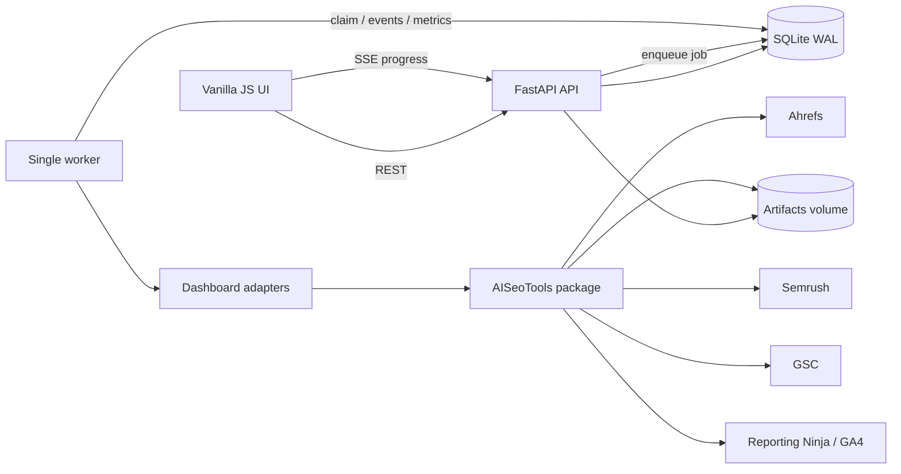

# The Yovth Clients Report — аналіз і план реалізації

**Дата аналізу:** 2026-07-22  
**Статус:** готовий технічний blueprint; код застосунку ще не створювався  
**Робоча назва продукту:** The Yovth Metrics Dashboard

## 1. Результат, який будуємо

Внутрішній web dashboard агенції, де на одному екрані видно всіх клієнтів і ключові SEO/marketing-метрики з Ahrefs, Semrush, Google Search Console та Reporting Ninja/GA4. Для кожної метрики показуються два порівнювані значення, абсолютна й відсоткова зміна, точні дати періодів, свіжість та якість даних.

Оператор має змогу:

- перемкнути глобальний період `Тиждень / Місяць`;
- знайти та відфільтрувати клієнтів;
- одразу побачити позитивні/негативні зміни й проблеми зі свіжістю;
- відкрити деталі клієнта та історію метрик;
- запустити збір для одного, кількох або всіх провайдерів;
- бачити живий прогрес, кроки, попередження і помилки;
- закрити progress modal без зупинки задачі й повернутися до неї пізніше;
- повторити лише невдалі кроки без повторного списання API units там, де це можливо.

Усі нормалізовані значення, статуси запусків і прогрес зберігаються в SQLite. Сирі JSON/CSV/PDF/скриншоти зберігаються як діагностичні артефакти на окремому volume, а в БД — їх метадані та checksum.

## 2. Що вже є і що виявлено

### 2.1 Цільовий репозиторій

`/home/elon/dev/git/TheYovthClientsReport` зараз не містить застосунку — тільки `.git`. Отже, тут можна створити чисту архітектуру без міграції старого frontend/backend коду.

### 2.2 AISeoTools

Досліджено `/home/elon/dev/seo/AISeoTools` на поточній гілці та наявні артефакти реальних прогонів. Репозиторій уже є Python-пакетом `seo-audit` з Python `>=3.11`, Pydantic, httpx, Playwright/Patchright, Typer та тестами. Його не треба переносити на Poetry: Poetry потрібен новому застосунку, а `AISeoTools` можна встановлювати як звичайну PEP 517 залежність.

| Джерело | Що вже реалізовано | Придатне для dashboard | Обмеження |
|---|---|---|---|
| Reporting Ninja API | `ReportingNinjaClient`, discovery GA4/GSC fields, довільні date ranges, GA4/GSC fetchers, retry для 429/5xx | Так, це найнадійніший MVP-шлях для GA4 та агрегатів GSC | Поточний `build_report()` жорстко збирає 6 старих періодів; потрібен новий wrapper для двох довільних періодів |
| Reporting Ninja PDF | login session, шість PDF, `pdftotext` parser | Як fallback/звірка | Повільно, headed browser, залежність від DOM і локального `pdftotext`; не використовувати як основний dashboard transport |
| GSC | browser export, CSV ingest, raw/findings JSON, totals clicks/impressions/CTR/position, детальні index/CWV дані | Так | UI export має ліміти й data lag; чинний Reporting Ninja fetcher повертає лише clicks/impressions |
| Ahrefs Site Audit | project lookup, health score, issue counts, affected URLs, live verification, API/CSV fallback | Так, для технічного health snapshot | Частина API планів не має Site Audit; API units; browser fallback може не мати project metadata/health score |
| Ahrefs Rank Movement | current/previous keyword і page movement, traffic, competitors, SERP | Для деталізації та майбутніх KPI | Це важкий аудит, не варто запускати повністю заради чотирьох KPI на кожне відкриття dashboard |
| Semrush API | overview, organic keywords, competitors, backlinks, historical snapshots | Так | Metered API units; баланс може бути обмежений |
| Semrush browser + ingest | exports, manifest allow-list, unified snapshot shape, authority score | Так, рекомендований наявним кодом шлях | Потрібен paid account і постійний browser profile; деякі totals можуть бути лише частковими/derived |

Корисні чинні точки повторного використання:

- `seo_audit.clientreport.ga4_fetcher.fetch_ga4_period()`;
- `seo_audit.clientreport.gsc_fetcher.fetch_gsc_period()`;
- `seo_audit.clientreport.builder.build_report()` уже має простий string `on_progress`, але його періодний контракт змінювати не треба;
- `seo_audit.ahrefs_site_audit.collect.collect()` повертає структурований `AhrefsMachineFindings`;
- `seo_audit.ahrefs_site_audit.verify.pipeline.verify_issues()` уже вміє повідомляти прогрес;
- `seo_audit.semrush.client.SemrushClient` повертає нормалізовані dict-структури;
- `seo_audit.semrush.ingest_manual.ingest_semrush()` читає browser manifest і відрізняє incomplete run;
- `seo_audit.clientreport.pdf_exporter.fetch_pdfs()` поки повідомляє прогрес лише через logging.

### 2.3 Важливі проблеми чинних контрактів

1. **Розбіжність семантики періодів.** Документація Reporting Ninja місцями описує current MTD/QTD, але `get_report_periods()` фактично прив'язує звіт до останнього повного місяця й trailing three-month blocks. Новому UI потрібен окремий, протестований period engine.
2. **Snapshot і range-метрики не можна порівнювати однаково.** GSC/GA4 рахуються за date range; Ahrefs Health Score та Semrush Authority Score — стан на момент збору. Для snapshot KPI попереднє значення треба брати з історії БД, а не штучно “сумувати за місяць”.
3. **`None` не дорівнює нулю.** Чинні парсери чесно повертають `None` при відсутності даних. UI повинен показувати `— / немає даних`, а не `0`.
4. **Частковий результат не є успішним повним результатом.** Кілька чинних collection функцій накопичують `warnings` і повертають partial/empty структуру без exception. Adapter має окремі validation gates.
5. **Browser profiles не можна використовувати паралельно.** Ahrefs, Semrush, GSC та Ninja мають persistent sessions; конкурентний запуск одного профілю ризикує зіпсувати сесію або змішати downloads.
6. **CLI stdout — не API.** Web worker не повинен парсити Rich/log output. Потрібен структурований Python adapter contract; старі CLI-команди залишаються thin clients чинного контракту.
7. **Є незакомічені зміни в AISeoTools.** Інтеграцію треба пінити лише на конкретний commit/tag після додавання adapter API та проходження повної regression suite.

### 2.4 Бренд The Yovth

З [актуального сайту The Yovth](https://theyovth.com/) та наданого референсу:

- основний фон: `#0E0E0E`;
- поверхня/картка: `#1E1E1E`;
- accent orange: `#FF4A17`;
- основний текст: `#FFFFFF`;
- secondary text: `#D7D7D7` / `#B9B9B9`;
- display font: **League Spartan**, вага 900, uppercase;
- body/UI font: **Archivo**, 400/700;
- візуальна мова: чорне поле, білі масивні заголовки, orange `V`, тонкі лінії та геометричні orange-патерни;
- офіційний logo asset на сайті: `logo-3.svg`.

`#747373` не слід використовувати для дрібного основного тексту на чорному фоні через слабший контраст; він підходить для border/disabled/decorative станів. Orange glow залишити тільки для primary action та активного progress, інакше dashboard стане візуально шумним.

## 3. Рішення щодо продукту

### 3.1 Періоди

Рекомендований default для регулярної перевірки — **закриті, однакові за довжиною періоди**:

- `Тиждень`: останній повний понеділок–неділя проти попереднього понеділка–неділі;
- `Місяць`: останній повний календарний місяць проти місяця перед ним;
- timezone клієнта, default `America/New_York` для наявних американських клієнтів, з явним полем у Client;
- UI завжди показує точні діапазони, наприклад `13–19 липня vs 6–12 липня`;
- для GSC додатково показується `data through`, бо дані можуть запізнюватися.

Архітектура відразу підтримує другий режим `to_date`:

- поточний week-to-date/month-to-date;
- попередній період обрізається до тієї самої кількості повних днів;
- цей режим додається лише після окремого UX-рішення, щоб не змішати часткові та закриті дані.

### 3.2 MVP-метрики

Не варто на першому екрані показувати всі поля з усіх звітів. Картка має давати 3–4 KPI на сервіс; повна історія та додаткові поля відкриваються в drawer/detail view.

| Сервіс | KPI у картці | Тип порівняння | Джерело MVP |
|---|---|---|---|
| Ahrefs | Health Score, Errors, Warnings, URLs crawled | snapshot: останній збір у кожному періоді | Site Audit API; CSV/browser fallback з quality badge |
| Semrush | Authority Score, Organic Traffic, Organic Keywords, Referring Domains | snapshot | browser export + `ingest_semrush`; API fallback |
| GSC | Clicks, Impressions, CTR, Avg Position | range | Reporting Ninja API для clicks/impressions; direct GSC adapter для CTR/position |
| Reporting Ninja / GA4 | Users, Organic Users, Total Conversions, Organic Conversions | range | Reporting Ninja API |

Правила метрик зберігаються в code-level catalog:

- `key`, label, provider, unit/format;
- `comparison_kind = range | snapshot`;
- `better_direction = up | down | neutral`;
- decimal precision;
- чи дозволений derived value;
- freshness SLA;
- minimum quality для показу.

Це важливо: зменшення Ahrefs Errors є позитивним, а зменшення Clicks — негативним. Колір визначається семантикою метрики, а не знаком числа.

### 3.3 Не входить у перший MVP

- генерація AI-висновків і повних XLSX-аудитів з dashboard;
- довільний конструктор формул;
- multi-tenant/client-facing portal;
- одночасні browser workers на кількох машинах;
- PostgreSQL/Kubernetes;
- автоматична зміна browser pins або обхід ручної автентифікації.

## 4. UX/UI

### 4.1 Інформаційна архітектура

Головний екран:

```text
┌─────────────────────────────────────────────────────────────────────┐
│ THE YOVTH   CLIENT PULSE      [Тиждень | Місяць]   [Оновити всі ↗] │
│ Період: 13–19 Jul vs 6–12 Jul     Last sync / active jobs          │
├─────────────────────────────────────────────────────────────────────┤
│ [Пошук] [Усі / проблемні / застарілі] [Провайдер] [Sort]           │
├───────────────────────────────┬─────────────────────────────────────┤
│ [logo] CLIENT NAME      ● ok  │ [logo] CLIENT NAME      ! stale    │
│ domain.com                    │ domain.com                          │
│ AHREFS    current │ previous  │ AHREFS    current │ previous       │
│ SEMRUSH   current │ previous  │ SEMRUSH   current │ previous       │
│ GSC       current │ previous  │ GSC       current │ previous       │
│ RN / GA4  current │ previous  │ RN / GA4  current │ previous       │
│ [Details]       [Sync ↗]      │ [Details]       [Retry ↗]          │
└───────────────────────────────┴─────────────────────────────────────┘
```

### 4.2 Картка клієнта

- На desktop — близька до квадратної (`aspect-ratio: 1 / 1`) з мінімальною шириною, але без обрізання даних; на tablet/mobile — `height:auto`.
- Header: client logo, назва, domain, overall status, “оновлено N год тому”.
- Кожен provider row має офіційну/впізнавану іконку, status dot та дві підколонки `Поточний / Попередній`.
- Біля current value: delta chip (`+12.4%`, `−8`), semantic color та accessible icon; колір не є єдиним носієм змісту.
- `—` означає unavailable, ніколи не zero.
- `partial`, `stale`, `truncated`, `auth required`, `failed` мають окремі badges/tooltips.
- Click по provider відкриває деталі: history chart, source, exact dates, raw artifact link, warnings.
- “Sync” доступний з клавіатури й не запускається випадково при кліку по всій картці.

### 4.3 Sync modal і живий прогрес

Перед запуском:

- точний client і періоди;
- checkbox провайдерів;
- джерело `API / browser / auto`;
- estimated Ahrefs/Semrush units, якщо можливо;
- режим `зібрати відсутнє` або `force refresh`;
- preflight: credentials/session/profile/account mapping.

Після запуску modal показує список провайдерів і stages:

`Queued → Preflight → Authenticate → Fetch current → Fetch previous/history → Normalize → Validate → Persist → Complete`.

Поводження:

- determinate progress там, де відома кількість кроків; spinner на невизначеному browser wait;
- live log за замовчуванням collapsed;
- progress modal можна закрити — задача триває, а header показує active job;
- після reconnect UI відновлює events із БД;
- partial job дозволяє `Retry failed only`;
- `Cancel` є cooperative: активний HTTP/download не вбивається посеред запису, а зупинка відбувається на безпечній межі stage;
- після успіху картки оновлюються без повного reload.

### 4.4 Loading, empty та error states

- skeleton повторює реальні розміри card/provider rows, щоб layout не стрибав;
- окремий empty state для “ще не було зборів” з CTA;
- останні успішні дані не зникають через нову помилку: UI показує старе значення + badge `останній refresh failed`;
- network/offline banner і retry;
- toast лише для короткого підтвердження, деталі помилок — у modal/drawer;
- `prefers-reduced-motion` вимикає декоративні анімації.

### 4.5 Frontend stack

- semantic HTML + CSS + ES modules, без framework;
- Bootstrap 5.3.x як accessibility/layout utility foundation, але з повністю custom The Yovth theme;
- Tabler Icons як локальний SVG sprite;
- Chart.js лише для detail history;
- League Spartan та Archivo self-hosted;
- усі залежності pinned і vendored у production, без runtime CDN;
- frontend модулі: `api.js`, `store.js`, `dashboard.js`, `client-card.js`, `sync-modal.js`, `sse.js`, `formatters.js`.
- усі frontend-агенти обов'язково виконують project-specific anti-slop і production UX правила з `frontend/AGENTS.md`.

## 5. Архітектура



### 5.1 Чому окремий worker

FastAPI `BackgroundTasks` не є durable queue: задача губиться при restart процесу, її складніше відновити й ізолювати від API. Тут парсинг довгий, browser-driven та іноді триває хвилини. Тому:

- API тільки валідує request і створює job у БД;
- один worker атомарно claim-ить queued jobs;
- heartbeat/lease дозволяє після restart перевести “завислу” job назад у queue або failed;
- один worker відповідає обмеженню SQLite “один writer у момент часу” та захищає browser profiles;
- у майбутньому PostgreSQL + Redis queue можна додати за adapter boundary без зміни UI API.

SQLite працює в `WAL`, з `foreign_keys=ON`, `busy_timeout`, короткими транзакціями та одним write-heavy worker. Це відповідний компроміс для внутрішнього single-host застосунку; SQLite WAL дозволяє readers працювати одночасно з writer, але writer все одно один.

### 5.2 Структура репозиторію

```text
TheYovthClientsReport/
├── app/
│   ├── main.py
│   ├── api/
│   │   ├── dashboard.py
│   │   ├── clients.py
│   │   ├── jobs.py
│   │   └── health.py
│   ├── core/
│   │   ├── config.py
│   │   ├── logging.py
│   │   └── security.py
│   ├── db/
│   │   ├── base.py
│   │   ├── models.py
│   │   ├── session.py
│   │   └── repositories/
│   ├── integrations/
│   │   ├── contract.py
│   │   ├── registry.py
│   │   ├── ahrefs.py
│   │   ├── semrush.py
│   │   ├── gsc.py
│   │   └── reporting_ninja.py
│   ├── metrics/
│   │   ├── catalog.py
│   │   ├── periods.py
│   │   ├── normalize.py
│   │   └── quality.py
│   ├── jobs/
│   │   ├── worker.py
│   │   ├── runner.py
│   │   ├── events.py
│   │   └── recovery.py
│   ├── importers/
│   │   └── ai_seo_tools.py
│   └── schemas/
├── frontend/
│   ├── AGENTS.md
│   ├── index.html
│   ├── assets/
│   ├── css/
│   ├── js/
│   └── vendor/
├── migrations/
├── scripts/
├── tests/
│   ├── unit/
│   ├── integration/
│   ├── contract/
│   └── e2e/
├── docker/
├── Dockerfile
├── compose.yaml
├── pyproject.toml
├── poetry.lock
├── .env.example
├── README.md
└── PLAN.md
```

FastAPI віддає API та статичний frontend з одного origin. Окремий nginx/frontend container для MVP не потрібен.

## 6. Модель даних

Використати SQLAlchemy 2.x ORM + Alembic. API може працювати через `sqlite+aiosqlite`; worker має дотримуватися тих самих repository contracts.

### `clients`

- `id` UUID/text primary key;
- `name`, `slug`, `domain`;
- `logo_path` nullable;
- `market`, `timezone`, `enabled`;
- `created_at`, `updated_at`;
- unique normalized domain/slug.

### `client_integrations`

- `id`, `client_id`, `provider`;
- `enabled`, `source_mode` (`auto/api/browser/pdf`);
- non-secret external identifiers: property/account/project id, database/country, report name;
- `config_json` лише для валідованих non-secret settings;
- `last_success_at`, `last_attempt_at`;
- `created_at`, `updated_at`;
- unique `(client_id, provider)`.

API keys, passwords і session secrets не зберігати в цій таблиці. Лише environment/Docker secrets або шлях до mounted session/profile.

### `sync_jobs`

- `id`, optional `batch_id`, `client_id`;
- `period_kind`, `comparison_mode`, `anchor_date`;
- `requested_providers_json`;
- `status`: `queued/running/succeeded/partial/failed/cancel_requested/cancelled`;
- `progress_percent`, `current_stage`;
- `attempt`, `idempotency_key`;
- `lease_owner`, `lease_expires_at`, `heartbeat_at`;
- `created_at`, `started_at`, `finished_at`;
- safe public `error_code`, `error_message` без secret payload.

### `sync_job_steps`

- `id`, `job_id`, `provider`, `stage`;
- status, progress, timestamps, attempt;
- warning/error summary;
- units spent/estimated nullable;
- unique `(job_id, provider, stage, attempt)`.

### `job_events`

- auto-increment `seq` — одночасно SSE event id;
- `job_id`, `timestamp`, `level`, `provider`, `stage`, `percent`;
- redacted human message;
- structured `details_json`;
- index `(job_id, seq)`.

Events зберігаються для reconnect/audit; retention, наприклад 30–90 днів, задається setting.

### `provider_snapshots`

- `id`, `job_id`, `client_id`, `provider`;
- `source_mode`, `source_version`/AISeoTools commit;
- `observed_at`, optional `data_through`;
- `quality`: `complete/partial/truncated/stale/unavailable`;
- `warnings_json`, `provenance_json`;
- `raw_artifact_id` nullable;
- immutable після commit.

### `metric_values`

- `id`, `snapshot_id`, `client_id`, `provider`, `metric_key`;
- `period_role`: `current/previous/snapshot`;
- `period_start`, `period_end` nullable для snapshot;
- `value_numeric` Decimal nullable, `value_text` nullable;
- `unit`, `quality`, `is_derived`;
- unique `(snapshot_id, metric_key, period_role)`;
- indexes для client/provider/metric/date.

### `artifacts`

- `id`, `job_id`, `provider`, `kind`, relative `path`;
- `sha256`, byte size, MIME, created_at;
- жодних абсолютних довільних шляхів з browser request;
- download лише через авторизований endpoint із path traversal guard.

### `imported_sources`

- source path/relative id, sha256, imported_at, importer version;
- гарантує ідемпотентний backfill з `AISeoTools/out`.

## 7. Єдиний integration contract

Новий застосунок не залежить від внутрішніх dict keys у view/API layer. Кожен adapter реалізує один контракт:

```python
class ProviderAdapter(Protocol):
    provider: Provider

    def preflight(self, context: CollectionContext) -> PreflightResult: ...

    def collect(
        self,
        context: CollectionContext,
        emit: Callable[[ProgressEvent], None],
        is_cancel_requested: Callable[[], bool],
    ) -> CollectionResult: ...
```

`CollectionResult` містить:

- normalized metric values;
- exact period ranges/observed time;
- complete/partial/truncated quality;
- warnings і safe error codes;
- provenance та raw artifacts;
- usage/units metadata.

Progress event має стабільні поля `provider`, `stage`, `completed`, `total`, `percent`, `message`, `details`. Повідомлення не є джерелом логіки — UI працює зі структурованими полями.

## 8. Безпечне розширення AISeoTools

### 8.1 Принцип сумісності

- не перейменовувати існуючі функції та CLI-команди;
- не змінювати наявні return shapes;
- не змінювати значення старого `on_progress: Callable[[str], ...]`;
- нові аргументи — тільки optional keyword-only з defaults;
- спільну логіку спочатку винести/обгорнути так, щоб старий CLI викликав той самий application service;
- перед merge запускати всю чинну test suite й окремі signature/contract tests;
- dashboard залежність pin до commit/tag, не до рухомої branch.

### 8.2 Адитивні зміни

Створити в `AISeoTools` окремий namespace, наприклад `seo_audit/dashboard/`:

- `events.py` — `ProgressEvent` і safe emitter;
- `reporting_ninja.py` — збір GA4/GSC для переданих `current`/`previous` ranges через наявні fetchers;
- `ahrefs.py` — легкий Site Audit snapshot без повного XLSX/AI verdict pipeline;
- `semrush.py` — API/browser orchestration з чинним unified snapshot shape;
- `gsc.py` — aggregate adapter над Reporting Ninja або direct browser artifacts;
- `models.py` — source-neutral Pydantic result models.

Точкові зміни в існуючих функціях:

- `fetch_pdfs(..., *, period_ranges=None, on_event=None, session_path=None)`; старі defaults незмінні;
- Ahrefs high-level collect: optional `on_event`, події після project/issues/affected/live verify;
- browser Semrush/GSC: high-level library runner з callback; CLI залишається wrapper;
- `NINJA_SESSION_PATH`, download/profile/cache paths зробити конфігурованими через optional args/env, з поточними шляхами як default;
- logging handler можна лишити для CLI, але web progress не будується з parsing log strings.

Новий Reporting Ninja comparison wrapper має викликати `discover_*_fields()` один раз, а потім `fetch_*_period()` двічі. Старий six-period `build_report()` не змінюється.

### 8.3 Source policy

- **GA4:** Reporting Ninja API.
- **GSC aggregate:** Reporting Ninja API за замовчуванням; direct GSC browser/export для CTR, position і детальних даних; UI показує provenance.
- **Ahrefs:** Site Audit API, якщо доступний; CSV/browser fallback; відсутній health score — `unavailable`, не zero.
- **Semrush:** browser export default, API fallback за явною політикою/доступним budget.
- **Reporting Ninja PDF:** manual fallback/validation, не scheduled default.

Browser lock key: `(provider, profile_name)`. Один lock на профіль у БД/worker; жодного паралельного запуску з тим самим профілем.

## 9. Job flow і live progress

1. `POST /sync-jobs` валідує client/integrations/period і створює idempotent queued job.
2. API повертає `202 Accepted`, `job_id`, status URL та events URL.
3. Worker через коротку транзакцію claim-ить одну job і виставляє lease.
4. Для кожного provider: preflight → collect → normalize → validate → atomic persist snapshot + metrics.
5. Після кожної значущої дії worker пише `job_events` і heartbeat.
6. SSE endpoint читає events `seq > Last-Event-ID`, віддає `text/event-stream` та keepalive.
7. Після reconnect browser автоматично продовжує з останнього event id.
8. Якщо один provider failed, інші успішні snapshots зберігаються, job стає `partial`.
9. Retry створює нову attempt/job лише для failed providers і посилається на parent job.
10. Recovery на startup знаходить expired leases: retry safe stages або завершує `failed_interrupted`.

SSE тут кращий за WebSocket: канал потрібен переважно server → browser, native `EventSource` має reconnect, а control actions лишаються звичайними POST. Додати fallback polling `GET /sync-jobs/{id}`.

## 10. REST API v1

### Dashboard

- `GET /api/v1/dashboard?period=week|month&anchor=YYYY-MM-DD&status=&provider=&q=`
- `GET /api/v1/clients/{id}/metrics?period=week|month&history=12`

Dashboard response одразу повертає current/previous, delta, quality, source, freshness та exact ranges; frontend не рахує бізнес-семантику сам.

### Clients та integrations

- `GET /api/v1/clients`
- `POST /api/v1/clients`
- `GET/PATCH /api/v1/clients/{id}`
- `POST /api/v1/clients/{id}/logo`
- `PUT /api/v1/clients/{id}/integrations/{provider}`
- `POST /api/v1/clients/{id}/integrations/{provider}/preflight`

### Jobs

- `POST /api/v1/sync-jobs`
- `GET /api/v1/sync-jobs/{id}`
- `GET /api/v1/sync-jobs/{id}/events`
- `POST /api/v1/sync-jobs/{id}/cancel`
- `POST /api/v1/sync-jobs/{id}/retry`
- `GET /api/v1/sync-jobs?status=running&client_id=`

### Operations

- `GET /healthz` — процес живий;
- `GET /readyz` — DB доступна й migrations актуальні;
- `GET /api/v1/providers/status` — configured/auth/profile/preflight state без секретів.

OpenAPI — контракт backend/frontend і основа integration tests.

## 11. Імпорт наявних даних

Потрібен one-off CLI:

```bash
poetry run yovth-report import-ai-seo-history \
  --source /mnt/ai-seo-tools \
  --dry-run
```

Потім запуск без `--dry-run`:

- імпортує `clients.json` як client/integration mappings без копіювання secrets;
- сканує dated run directories;
- розпізнає `ahrefs_findings_machine.json`, `gsc_raw.json`, `gsc_findings_machine.json`, Semrush snapshots, rank movement artifacts, client report TSV/XLSX лише через versioned importers;
- показує mapping conflicts `client code ↔ domain ↔ client name` перед записом;
- читає source read-only;
- пише checksum до `imported_sources`, тому повторний запуск не дублює дані;
- невідомі/старі schemas пропускає з warning, а не вгадує поля;
- дозволяє частково заповнити “попередній” snapshot уже в день запуску dashboard.

## 12. Коректність і quality rules

- Кожне значення має provenance і timestamp.
- Значення різних date ranges не порівнюються.
- Snapshot metric порівнюється з останнім valid snapshot у відповідному попередньому періоді.
- Для range metric backend запитує exact current і previous ranges.
- Відсоткова delta при previous `0/null` повертається `null` з reason, не infinity.
- Decimal/float не обрізати до int: CTR, position, score мають власну precision.
- Derived metrics маркуються (`CTR = clicks / impressions` лише якщо обидва complete).
- Truncated export не можна видавати за total.
- Свіжі partial дані не перетирають останній complete snapshot у summary; вони доступні в details.
- Всі dates зберігаються UTC, period boundaries — як local dates timezone клієнта.
- Dashboard показує `last successful` окремо від `last attempt`.

## 13. Безпека

- `.env` не комітиться; `.env.example` містить лише назви змінних.
- API keys/passwords не записуються у БД, events, logs або error trace, який віддається UI.
- Structured redaction для `Authorization`, cookies, emails/connection keys за потреби.
- Browser profiles і `.ninja_session.json` монтуються окремим volume, не включаються в image.
- UI не приймає довільні shell commands, CLI flags, local paths або provider URLs.
- Upload logo: MIME/signature/size/dimensions validation, generated safe filename.
- Same-origin API, restrictive CORS, security headers.
- Для локальної/VPN інсталяції достатньо auth reverse proxy; перед public exposure обов'язкові app login, secure HttpOnly cookie, CSRF protection і audit trail.
- Artifact download перевіряє ownership і resolved path усередині artifacts root.
- Логи не містять клієнтських raw metrics у production за замовчуванням.

## 14. Docker Compose та конфігурація

Services:

- `api` — FastAPI + static frontend;
- `worker` — той самий image, інша command;
- optional `scheduler` після MVP або scheduler loop усередині єдиного worker;
- named volumes: `app_data`, `artifacts`, `browser_profiles`;
- `shm_size` для Chromium;
- healthchecks і restart policy.

Локально `AISeoTools` підключається як named additional build context `../../seo/AISeoTools`. Для CI/deploy preferred варіант — pin Git commit/tag або будувати wheel з конкретного commit. Absolute host paths у committed Compose не допускаються; локальний override може їх мати.

Image startup:

1. перевірити config;
2. виконати `alembic upgrade head` окремою init command;
3. запустити API/worker;
4. readiness не green, доки schema не актуальна.

Не запускати два worker replicas на SQLite. Масштабування починається з PostgreSQL і зовнішньої durable queue.

## 15. Тестова стратегія

### Unit

- week/month boundaries, leap year, timezone, `to_date` alignment;
- delta і `better_direction`;
- `None` vs `0`, precision, derived flags;
- quality/freshness rules;
- event redaction і monotonic progress;
- path traversal та logo validation.

### AISeoTools contract/regression

- snapshot існуючих public signatures;
- всі чинні CLI/tests проходять без змін;
- нові dashboard wrappers тестуються fake clients/fixtures;
- старий six-period Reporting Ninja output лишається byte/shape compatible там, де це зафіксовано;
- Semrush manifest partial/truncated cases;
- Ahrefs no-project/no-units/no-health cases;
- callbacks не змінюють результат, якщо `None`.

### Integration

- FastAPI + temporary SQLite + worker;
- atomic job claim, idempotency, lease recovery, cancel/retry;
- partial provider run;
- SSE replay через `Last-Event-ID`;
- immutable snapshot + latest-success selection;
- importer dry-run/idempotency/schema drift.

### Frontend/E2E

- skeleton → data → refresh;
- filters і period switch;
- sync modal, reconnect, close/reopen, retry failed;
- keyboard navigation, focus trap, escape, screen-reader labels;
- responsive 1440/1024/768/390;
- reduced motion і contrast;
- screenshot regression ключових станів.

### Live smoke tests

- по одному контрольному клієнту на кожен provider;
- не запускати metered live tests у звичайній CI;
- API unit budget і browser profile lock обов'язкові;
- отримані totals вручну звірити з provider UI перед release.

## 16. Етапи реалізації

### Етап 0 — контракти й fixtures

- Зафіксувати AISeoTools commit і baseline tests.
- Створити sanitized fixtures з наявних Ahrefs/GSC/Semrush/Ninja artifacts.
- Затвердити MVP metric catalog, complete-period semantics та timezone кожного клієнта.
- Затвердити source policy і unit budgets.

**Gate:** для кожної KPI відомо source field, тип, completeness rule та fallback.

### Етап 1 — skeleton застосунку

- Poetry project, FastAPI, SQLAlchemy, Alembic, settings/logging.
- Dockerfile/Compose, volumes, health/readiness.
- Static frontend shell з brand tokens, fonts, logo та responsive grid.
- CI: lint, type check, pytest.

**Gate:** `docker compose up --build` піднімає порожній branded dashboard і healthchecks green.

### Етап 2 — БД, clients і history import

- ORM schema/migrations/repositories.
- Client/integration CRUD і logo upload.
- Safe import з `clients.json` та dated artifacts, спочатку dry-run.
- Fixture-backed dashboard endpoint.

**Gate:** клієнти й історичні snapshots імпортуються ідемпотентно, source files не змінюються.

### Етап 3 — job engine і live progress

- Durable DB queue, single worker, lease/heartbeat/recovery.
- Steps/events, SSE replay, cancel/retry/idempotency.
- Sync modal та active-job indicator.
- Fake adapter для deterministic E2E.

**Gate:** restart API не губить job/progress; restart worker коректно відновлює або завершує interrupted job.

### Етап 4 — Reporting Ninja/GA4 та GSC vertical slice

- Новий arbitrary-period wrapper в AISeoTools.
- Reporting Ninja adapter для GA4 current/previous.
- GSC clicks/impressions; CTR derived; direct GSC extension для avg position.
- Data lag/freshness/partial states.
- Regression старого `client-report` flow.

**Gate:** один реальний клієнт збирається з UI, точні дати й totals збігаються з джерелом.

### Етап 5 — Ahrefs

- Lightweight Site Audit snapshot adapter.
- API/CSV/browser policy, units/preflight, progress hooks.
- Health/issues normalization, missing health handling.
- Import попередніх Ahrefs snapshots.

**Gate:** current/previous не плутає crawl date з collection date; stale crawl явно позначений.

### Етап 6 — Semrush

- Browser runner як library API + profile lock + structured events.
- Ingest manifest, API fallback, budget policy.
- Completeness validation для overview/backlinks/refdomains.
- Retry failed stage без змішування старих downloads.

**Gate:** incomplete manifest дає `partial`, stale файл не потрапляє у snapshot.

### Етап 7 — UX polish і hardening

- Detail drawer/history charts.
- Search/status/provider filters, bulk sync.
- Accessibility, responsive, skeletons, screenshot tests.
- Auth/deployment profile, backups, retention, observability.
- README/runbook для login/session refresh і provider failures.

**Gate:** Definition of Done нижче виконаний на production-like Compose environment.

### Етап 8 — автоматизація після MVP

- weekly/monthly schedules у timezone клієнта;
- deduplication scheduled/manual runs;
- notifications про failed/stale jobs;
- retention cleanup і SQLite backup;
- migration plan на PostgreSQL, якщо потрібні parallel workers або багато користувачів.

## 17. Основні ризики та запобіжники

| Ризик | Наслідок | Запобіжник |
|---|---|---|
| Provider UI/DOM змінився | browser parsing падає | versioned adapters, preflight, screenshot/raw artifacts, selector contract tests |
| API units вичерпано | неповний збір/витрати | preflight estimate, hard budget, cache, explicit API fallback policy |
| Старі CSV у shared downloads | неправильні цифри | manifest allow-list, окрема job artifact directory, checksum |
| GSC data lag | несправедлива delta | exact `data_through`, freshness badge, closed periods |
| Немає попереднього snapshot | немає порівняння | backfill importer; `—`, не нуль |
| Browser auth протух | job fail | provider preflight, `auth_required`, documented manual login flow |
| SQLite write contention | lock errors | WAL, one worker, short transactions, busy timeout |
| Worker/container restart | “вічна” running job | lease, heartbeat, startup recovery, idempotent stages |
| Partial data виглядає complete | хибне рішення | quality gates на metric/snapshot/card рівнях |
| Зміна AISeoTools ламає dashboard | regression | additive namespace, commit pin, contract fixtures, full old suite |
| Занадто щільні квадратні cards | поганий UX | 3–4 KPI/service, detail drawer, responsive auto-height |

## 18. Definition of Done для MVP

- Усі активні клієнти відображаються картками з logo/name/domain.
- `Тиждень / Місяць` змінює точні current/previous ranges для всіх cards.
- Чотири provider sections показують погоджені KPI, delta, quality і freshness.
- `null`, zero, stale, partial, truncated та failed візуально і семантично різні.
- З UI можна запустити sync одного клієнта й вибраних providers.
- Live progress переживає reload/reconnect; закриття modal не зупиняє job.
- Partial run зберігає успішні provider snapshots і дозволяє retry failed only.
- Restart API/worker не пошкоджує БД і не залишає job назавжди running.
- Старі AISeoTools CLI-команди й tests не зламані.
- У БД немає API keys/passwords/session cookies.
- `docker compose up --build` відтворює систему за README.
- Є backup/restore інструкція для SQLite та artifacts.
- Перевірено keyboard navigation, responsive layout і основні contrast states.
- Live totals контрольного клієнта звірені вручну з кожним provider.

## 19. Рішення, які треба підтвердити перед кодом

Рекомендовані defaults уже закладені в план, але ці продуктові рішення слід зафіксувати на Етапі 0:

1. Закриті періоди чи `to-date`; рекомендація — закриті.
2. Reporting Ninja card означає GA4 metrics, а GSC card — Search Console metrics, навіть якщо transport обох на MVP є Reporting Ninja API; рекомендація — так.
3. Які саме 3–4 KPI лишаються в кожній card; таблиця §3.2 — рекомендований старт.
4. Де запускається browser worker: повністю в container з persistent profile/VNC чи на цьому host; рекомендація для першого release — container worker з mounted profiles, headed login через documented one-off flow.
5. Де розгортається dashboard: тільки localhost/VPN чи public network; від цього залежить auth scope до release.

## 20. Технічні джерела

- [The Yovth website](https://theyovth.com/) — logo, colors, typography та visual language.
- [FastAPI Background Tasks](https://fastapi.tiangolo.com/tutorial/background-tasks/) — межі in-process background work.
- [Starlette Responses](https://www.starlette.io/responses/) — streaming response primitive.
- [MDN: Server-sent events](https://developer.mozilla.org/en-US/docs/Web/API/Server-sent_events) — EventSource/SSE model.
- [SQLite Write-Ahead Logging](https://www.sqlite.org/wal.html) — reader/writer concurrency та single-writer constraint.
- [Docker Compose build additional contexts](https://docs.docker.com/reference/compose-file/build/#additional_contexts) — локальне підключення AISeoTools поза build context.
- Локальні джерела істини: `AISeoTools/docs/AhrefsAudit.md`, `docs/GSC_Audit.md`, `docs/Semrush.md`, `docs/NinjaReport.md`, `docs/BrowserAuto.md` та відповідні Python modules/tests.
