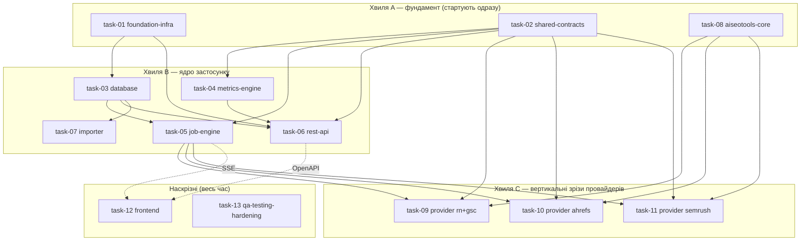

# Декомпозиція проєкту — робочі пакети для паралельних агентів

**Джерело істини:** [`../../../PLAN.md`](../../../PLAN.md) (master blueprint).
**Фронтенд-контракт:** [`../../../frontend/AGENTS.md`](../../../frontend/AGENTS.md) (обов'язковий для всієї роботи у `frontend/`).
**Процес роботи:** [`../../../CLAUDE.md`](../../../CLAUDE.md) (як брати таску, як закривати).

Архітектура з `PLAN.md` — це **модульний моноліт** (FastAPI API + один durable worker + SQLite WAL + vanilla-JS фронт), а не мережа окремих сервісів. Тому «мікросервіси» тут = **bounded modules / робочі пакети**: кожен має власні файли, чіткий вхідний/вихідний контракт і може розроблятися окремим агентом паралельно. Межі проведені по швах архітектури (`app/` дерево з §5.2) так, щоб два агенти не редагували один файл.

## Ключова ідея паралельності

Паралельність тримається на **контрактах, зафіксованих наперед** (`task-02`), а не на черговості. Кожен агент кодує проти оголошених типів/інтерфейсів і **не чекає** інших. Файли поділені так, що зони запису не перетинаються (див. «Owned paths» у кожному плані).

## Модель збору даних (матриця «клієнт × сервіс»)

Окремо від паралельності *розробки* є паралельність *збору* в рантаймі (PLAN §9.1/§9.2), яку реалізує `task-05`:

- 4 сервіси (Ahrefs, Semrush, GSC, Reporting Ninja), у кожному заведені наші клієнти;
- **між сервісами — паралельно** (одна доріжка на сервіс), **усередині сервісу — послідовно** (клієнт за клієнтом), бо один persistent browser-профіль/сесія + metered API на сервіс;
- клітинка `(client, provider)` — атомарна одиниця збору/прогресу/retry (`sync_job_providers`, task-03);
- **нуль падінь:** виняток у клітинці ізольований → `failed`, доріжка триває; новий клієнт без інтеграції → `not_configured` (не краш, не нуль); прогрес персистентний і переживає рестарт.

## Хвилі та залежності

- **Хвиля A** (`task-01`, `task-02`, `task-08`) стартує без залежностей — розблоковує всіх.
- **Хвиля B** стартує, щойно є `task-01` (скелет) і `task-02` (контракти); `task-03` потрібен лише скелет.
- **Хвиля C** (провайдери) стартує, коли є `task-02` (контракт adapter) і `task-08` (namespace у AISeoTools). Кожен провайдер — окремий агент.
- **Наскрізні** `task-12` (фронт) і `task-13` (QA/hardening) працюють паралельно з першого дня на фікстурах і синхронізуються по OpenAPI/SSE, коли ті готові.
- **Хвиля E (v2, таски 14–19)** — розширення після MVP (PLAN §21). Критичний шлях: **`task-16` (розмірні дані GSC) стартує першим**, бо без нього неможливі ні алерти (17), ні таби аналітики (18). Паралельно й без залежностей стартують `task-14` (періоди) і — у частині інлайн-дат — `task-19`. `task-18` замикає хвилю, бо споживає всі чотири бекенд-таски.

> Агент **не бере** таску, доки її `Depends on` не лежать у [`../done/`](../done/). Порядок у межах хвилі — довільний.

## Каталог тасок

| # | Файл | Пакет | Хвиля | Depends on | Головні owned paths |
|---|---|---|---|---|---|
| 01 | ✅ [task-01-foundation-infra.md](../done/task-01-foundation-infra.md) | Скелет, config, Docker/Compose, CI | A | — | `app/main.py`, `app/core/`, `pyproject.toml`, `Dockerfile`, `compose.yaml`, `app/api/health.py` |
| 02 | ✅ [task-02-shared-contracts.md](../done/task-02-shared-contracts.md) | Integration contract + schemas + DTO | A | — | `app/integrations/contract.py`, `app/integrations/registry.py`, `app/schemas/` |
| 03 | ✅ [task-03-database.md](../done/task-03-database.md) | ORM, міграції, репозиторії | B | 01 | `app/db/`, `migrations/`, `alembic.ini` |
| 04 | ✅ [task-04-metrics-engine.md](../done/task-04-metrics-engine.md) | Періоди, catalog, normalize, quality | B | 02 | `app/metrics/` |
| 05 | ✅ [task-05-job-engine.md](../done/task-05-job-engine.md) | Worker, черга, lease/recovery, events, SSE | B | 02, 03 | `app/jobs/`, fake adapter |
| 06 | ✅ [task-06-rest-api.md](../done/task-06-rest-api.md) | FastAPI роутери + OpenAPI | B | 01, 02, 03, 04 | `app/api/dashboard.py`, `app/api/clients.py`, `app/api/jobs.py` |
| 07 | ✅ [task-07-importer.md](../done/task-07-importer.md) | Імпорт історії з AISeoTools + CLI | B | 03, 04 | `app/importers/`, `app/cli.py` |
| 08 | ✅ [task-08-aiseotools-core.md](../done/task-08-aiseotools-core.md) | Additive namespace у AISeoTools (core) | A | — | `AISeoTools/seo_audit/dashboard/{events,models,config}.py` |
| 09 | ✅ [task-09-provider-reporting-ninja-gsc.md](../done/task-09-provider-reporting-ninja-gsc.md) | RN/GA4 + GSC вертикальний зріз | C | 02, 08, 05 | `AISeoTools/.../dashboard/{reporting_ninja,gsc}.py`, `app/integrations/{reporting_ninja,gsc}.py` |
| 10 | ✅ [task-10-provider-ahrefs.md](../done/task-10-provider-ahrefs.md) | Ahrefs Site Audit зріз | C | 02, 08, 05 | `AISeoTools/.../dashboard/ahrefs.py`, `app/integrations/ahrefs.py` |
| 11 | ✅ [task-11-provider-semrush.md](../done/task-11-provider-semrush.md) | Semrush зріз | C | 02, 08, 05 | `AISeoTools/.../dashboard/semrush.py`, `app/integrations/semrush.py` |
| 12 | ✅ [task-12-frontend.md](../done/task-12-frontend.md) | Vanilla-JS dashboard | D | 06 (OpenAPI), 05 (SSE) | `frontend/` (крім `AGENTS.md`) |
| 13 | ✅ [task-13-qa-testing-hardening.md](../done/task-13-qa-testing-hardening.md) | Тести, e2e, live smoke, hardening, деплой | D | усі | `tests/`, `scripts/backup*`, `docs/runbook.md` |

> Хвилі **E** (14–19) і **F** (20–22) мають власні таблиці нижче.

## Хвиля F — auth flow (сесії браузера)

Викликана реальним інцидентом: Semrush показувався як «немає даних», хоча насправді протухла browser-сесія. Послідовна: **20 → 21 → 22** (кожна споживає попередню). Разом вони закривають флоу «запуск збору → перевірка сесій → статус → «Увійти» → авто-продовження».

| # | Файл | Пакет | Depends on | Головні owned paths |
|---|---|---|---|---|
| 20 | ✅ [task-20-browser-session-bridge.md](../done/task-20-browser-session-bridge.md) | Міст до теплого Chrome, liveness, тригер логіну | — | `app/integrations/browser_session.py`, `compose.yaml`, AISeoTools `browser/warm.py` |
| 21 | ✅ [task-21-session-preflight-and-auth-pause.md](../done/task-21-session-preflight-and-auth-pause.md) | Preflight сесій, `auth_required`, пауза/резюм доріжки | 20 | `app/jobs/{lane,dispatcher,runner,recovery}.py`, `app/schemas/enums.py` |
| 22 | [task-22-sync-modal-auth-ux.md](task-22-sync-modal-auth-ux.md) | Попап: стадія сесій, статуси, кнопка «Увійти» | 20, 21 | `frontend/js/sync-modal.js`, `session-status.js` |
| 23 | ✅ [task-23-session-preflight-sse-events.md](../done/task-23-session-preflight-sse-events.md) | Події статусу клітинки в SSE (фікс зависання «Перевірки сесій») | 05, 20, 21, 22 | `app/jobs/{events,runner,lane,control}.py`, `frontend/js/sync-modal.js` |

> **task-21 закрита:** новий нетерміналний `CellStatus.awaiting_auth` (адитивно) — доріжка паузиться на ньому замість провалу, `check_session` (task-20) викликається один раз на провайдера (мемоізація в `lane.py`), profile-lock/lease звільняються самі собою (лише `status == running` тримає їх), таймаут паузи закриває весь `queued`-бэклог провайдера як `failed`/`auth_required`. `app/api/dashboard.py`/`app/api/providers.py` тепер читають стан з *останньої спроби*, а не лише зі snapshot-quality, і лишають останні успішні дані видимими поруч із бейджем. Торкнулась двох файлів поза owned paths (задокументовано, не мовчки): `app/db/repositories/cells.py` (два нових read-методи, той самий патерн, що й наявні «Added by task-05/06» секції) і `app/jobs/worker.py` (одна проводка `check_session=` у `Dispatcher(...)`, інакше фіча не активна в реальному воркері). `tests/unit/schemas/test_enums.py`'s вичерпний набір `CellStatus` доповнено — це очікуваний наслідок контрактної зміни. Job-level `JobStatus` не отримав «paused»-значення (task-05 зона не займали) — косметичний follow-up для task-22. Деталі — Completion report таски.

## Хвиля E — v2 (після MVP, PLAN §21)

Розширення поверх закритого MVP. Стартують, коли їхні `Depends on` лежать у [`../done/`](../done/).

| # | Файл | Пакет | Depends on | Головні owned paths |
|---|---|---|---|---|
| 14 | ✅ [task-14-period-engine-v2.md](../done/task-14-period-engine-v2.md) | Квартал/рік/кастом + агрегація збереженої історії | — (розширює 02/04) | `app/metrics/periods.py`, `app/metrics/aggregate.py`, `PeriodKind`, `CoverageDTO` |
| 15 | ✅ [task-15-health-score-and-sorting.md](../done/task-15-health-score-and-sorting.md) | Health % клієнта + сортування дашборду | 14 (для розширених періодів) | `app/metrics/health.py`, `app/api/dashboard.py` |
| 16 | ✅ [task-16-gsc-dimensional-data.md](../done/task-16-gsc-dimensional-data.md) | Розмірні дані GSC (сторінки/запити) | 14 | `gsc_dimension_metrics`, `DimensionRepository`, `app/api/analytics.py`, `collect_gsc_dimensions`/`collect_dimensions` |
| 17 | ✅ [task-17-alerts-engine.md](../done/task-17-alerts-engine.md) | Алерти: просідання та зростання | 16 | `app/metrics/alerts.py`, `app/api/alerts.py` |
| 18 | ✅ [task-18-client-analytics-page.md](../done/task-18-client-analytics-page.md) | Сторінка клієнта (§21.6) | 14, 16, 17 | `frontend/`, роутер сторінки клієнта |
| 19 | ✅ [task-19-dashboard-card-fixes.md](../done/task-19-dashboard-card-fixes.md) | Картка дашборду: health, sort-контрол | 15 | `frontend/` |
| 24 | ✅ [task-24-card-health-trend-blocks.md](../done/task-24-card-health-trend-blocks.md) | Тренд health на картці: стрілка WoW + денний спарклайн | 15, 19 | `client_health_daily`, `app/db/repositories/health.py`, `app/api/dashboard.py`, `frontend/js/client-card.js` |

> **task-14 закрита:** `PeriodKind` тепер `week | month | quarter | year | custom` (адитивно), з'явився `CoverageDTO` і `aggregate_metrics(...)`. Контрактні деталі — у Completion report таски.

> **task-15 закрита:** `ClientCardDTO` отримав `health` (`ClientHealthDTO`: `value | None`, `coverage_contributing`, `coverage_configured`); `GET /api/v1/dashboard` отримав `sort=` (default `quality`). `MetricSpec` отримав `health_weight: float = 1.0` (адитивно, task-04 зона, рівні ваги на старті). Контрактні деталі — у Completion report таски.

> **task-16 закрита:** нова таблиця `gsc_dimension_metrics` (immutable, top-N + залишок «інше», `quality`/`rank` на рядок; один `ProviderSnapshot` = один період), `DimensionRepository` (`bulk_insert`/`for_period`/`top_pages`/`top_queries`/`for_two_periods`/`purge_older_than`), `GET /api/v1/clients/{id}/analytics/{pages,queries}`. AISeoTools отримала `collect_gsc_dimensions()` (адитивно, `seo_audit/dashboard/gsc.py`); `GscAdapter.collect_dimensions()` — новий метод поза `ProviderAdapter`-протоколом, **ще не підключений** до `app/jobs`-конвеєра (task-05 зона) — task-17/18 читають уже збережені рядки через репозиторій, але живий collection-trigger лишається follow-up. Контрактні деталі — у Completion report таски.

> **task-17 закрита:** `app/metrics/alerts.py` — чиста `detect_alerts(pages_current, pages_previous, thresholds) -> AlertsResult(declining, rising, new, skipped_reason)`, decoupled від ORM через `DimensionRow` (як `StoredMetricValue` у task-14). `GET /api/v1/clients/{id}/alerts?period=…&dimension=page|query` (`app/api/alerts.py`) читає обидва боки через `DimensionRepository.for_two_periods`. Пороги — `Settings.alert_min_relative_change_pct/alert_min_base_impressions/alert_min_base_clicks/alert_top_n_per_group`. Живий збір розмірних даних досі не підключено до `app/jobs` (успадкований follow-up task-16) — ендпоінт чесно повертає `skipped_reason="missing_period_data"`, доки дані не з'являться. Контрактні деталі — у Completion report таски.
>
> **task-18 закрита:** сторінка клієнта на hash-маршруті `#/client/{id}` (`frontend/js/router.js` тепер єдина точка входу в `index.html`, динамічно вантажить `dashboard.js` або `client-page.js`); розширені періоди, таби «Сторінки»/«Запити» з current/previous/дельтою й `truncated`, блок алертів, графік Chart.js з accessible-резюме; увесь стан у URL. `app.metrics.aggregate`/`CoverageDTO` (успадкований TODO з task-14) **досі не підключені** до жодного ендпоінта — розширені періоди чесно показують точні дати й попереджають, що агрегація покриття не підключена, замість вигаданого відсотка; підключення вимагає нового ендпоінта в зоні task-06. `frontend/js/api.js` отримав 3 нові функції (`getClientAnalytics`/`getClientAlerts`/`getClientAnalyticsChart`), адитивно. Контрактні деталі — у Completion report таски.
>
> **task-13 закрита:** з'явився спільний harness (`tests/harness/**` + `tests/conftest.py`) — бери `temp_db`, `api_client`, `seed_client`, `fake_adapters`, `running_worker` замість власного склеювання БД/worker-а. Наскрізні набори: `tests/integration/**`, `tests/contract/**`, `tests/live/**` (останні пропускаються без `--live`). Стан MVP DoD — [`docs/dod-mvp.md`](../../../docs/dod-mvp.md).
>
> **task-19 закрита (done-with-followups):** інлайн-дати (range vs snapshot), health-чіп на картці, sort-контрол зі станом в URL, українська копія в межах owned paths. Торкнулась спільних read-only файлів адитивно (задокументовано, не мовчки): `formatters.js` (переклад лейблів + `en-US → uk-UA` для дат, новий експорт `formatDate()`), `api.js` (`getDashboard({sort})`), `store.js` (`sort` у стані/URL). `index.html` і `sync-modal.js` лишаються англійською — поза owned paths, follow-up. Деталі — Completion report таски.

> **task-23 закрита:** SSE-потік віддає лише рядки `job_events`, а фронт перечитує статуси клітинок тільки на подію — тож клітинка, що вирішилась на преflight (`awaiting_auth`/`not_configured`/`skipped`), не давала жодної події й модалка вічно висіла на «Перевіряємо…». З'явився `append_cell_status_event()` (пишеться в тій самій транзакції, що й зміна статусу) у всіх раніше «німих» переходах. Побічно полагоджено: скасування припаркованої доріжки, queued-cancel дефект task-13 (strict `xfail` знято), `aggregate_status` для повністю скасованого запуску. Деталі — Completion report таски.

> **task-24 закрита:** `ClientHealthDTO` отримав `value_previous`/`delta_pct`/`history` (адитивно) + вкладений `HealthPointDTO`; нова таблиця `client_health_daily` (upsert на `(client_id, day)`, **не** immutable) і `HealthHistoryRepository`. `_build_provider_summary` отримав опційний `as_of`, на якому тримається `yovth-report backfill-health-history`. Наявний спарклайн картки малював інший ряд (Ahrefs `health_score`) і був зламаний проти живого API через розбіжність ключа — замінений на композитний health без зайвого запиту на картку. Контрактні знімки перегенеровано. Деталі — Completion report таски.

## Хвиля G — Technical SEO Audit (machine-only)

Розширення після MVP: детермінований технічний аудит сайту клієнта на базі TechAudit-краулера AISeoTools, **без ШІ**. Категорії→знахідки на сторінці клієнта, повторний запуск, перепровірка окремої знахідки, експорт у XLSX (лише машинні [П]-дані). Зведений в **один** таск-док (рішення користувача); межі під-тасок проведені в «Owned paths» самого файлу.

| # | Файл | Пакет | Depends on | Головні owned paths |
|---|---|---|---|---|
| 25 | ✅ [task-25-technical-seo-audit.md](../done/task-25-technical-seo-audit.md) | Machine-only tech audit: AISeoTools `dashboard/tech_audit.py` + `Provider.tech_audit` + adapter/API + `audit-panel.js` + XLSX-export | — (адитивно розширює 02/03/04/05/06/12/18) | `seo_audit/dashboard/tech_audit.py`, `app/integrations/tech_audit.py`, `app/api/tech_audit.py`, `frontend/js/audit-panel.js` (+ адитивні дотики enums/api/models/migrations/client-page) |

> **Рішення (2026-07-23):** Фаза 1 — **без рендеру** (краул+детект на httpx, без Chromium); реюз `Provider`+`SyncJob`+`AnalyticsDatasetRow` (макс. реюз джоб-рушія/SSE/immutable snapshot). Рендер+CWV (`SLOW_PAGES`) — окрема майбутня task-29 (Chromium в образ). `Provider.tech_audit` **не** метрик-провайдер: гардиться поза дашбордом/health/каталогом і поза рутинним синком.

> **task-25 закрита:** нової таблиці під знахідки/recheck **не знадобилось** — категорії/знахідки/recheck їдуть у наявній `AnalyticsDatasetRow` під ключами `tech_categories`/`tech_findings`/`tech_recheck` (recheck append-only, читається як найсвіжіший рядок на `dimension_value` через новий `AnalyticsDatasetRepository.latest_rows_by_dimension`). Enum-міграції теж не знадобилось: `sa.Enum` тут без `create_constraint`, тож CHECK-констрейнтів на provider-колонках немає. Єдина міграція — `d47b9c1e5a02` (`sync_jobs.params_json`), бо адаптер за контрактом не має доступу до БД, а targeted-recheck потребує per-job параметрів (`CollectionContext.job_mode`/`job_params`, адитивно). З'явився **`METRIC_PROVIDERS`** — усі місця, що ітерували `tuple(Provider)` заради метрик (`api/jobs.py` розгортання `providers="all"`, `api/dashboard.py`, `api/providers.py`), переведені на нього; dispatcher свідомо лишився на повному enum, щоб піднімати доріжку `lane-tech_audit`. Деталі — Completion report таски.

## Мапа володіння файлами (write-зони)

Кожен шлях має **рівно одного** власника. Якщо таска має торкнутись чужого шляху — це зміна контракту: узгодь через `task-02` (див. правила у `CLAUDE.md`).

| Шлях | Власник |
|---|---|
| `app/main.py`, `app/core/**`, `app/api/health.py` | task-01 |
| `pyproject.toml`, `poetry.lock`, `Dockerfile`, `compose.yaml`, `docker/**`, `.env.example`, `README.md`, CI | task-01 |
| `app/integrations/contract.py`, `app/integrations/registry.py`, `app/schemas/**` | task-02 |
| `app/db/**`, `migrations/**`, `alembic.ini` | task-03 |
| `app/metrics/**` | task-04 (крім `periods.py`/`aggregate.py` — task-14, хвиля E) |
| `app/jobs/**` | task-05 |
| `app/api/dashboard.py`, `app/api/clients.py`, `app/api/jobs.py` | task-06 |
| `app/importers/**`, `app/cli.py` | task-07 |
| `AISeoTools/seo_audit/dashboard/{__init__,events,models,config}.py` + additive kwargs у наявних функціях | task-08 |
| `AISeoTools/seo_audit/dashboard/{reporting_ninja,gsc}.py`, `app/integrations/{reporting_ninja,gsc}.py` | task-09 |
| `AISeoTools/seo_audit/dashboard/ahrefs.py`, `app/integrations/ahrefs.py` | task-10 |
| `AISeoTools/seo_audit/dashboard/semrush.py`, `app/integrations/semrush.py` | task-11 |
| `frontend/**` (окрім `frontend/AGENTS.md`, який read-only контракт) | task-12 |
| `tests/**`, `scripts/backup*`, `scripts/restore*`, `docs/**` | task-13 |
| `app/metrics/periods.py`, `app/metrics/aggregate.py`, `app/schemas/enums.py` | task-14 |
| `app/metrics/health.py`, `app/api/dashboard.py`, `app/schemas/api.py` | task-15 |
| `app/db/repositories/dimensions.py`, `app/api/analytics.py`, `app/integrations/gsc.py` (додатки), нові розмірні таблиці + міграція | task-16 |
| `app/metrics/alerts.py`, `app/api/alerts.py` | task-17 |
| `frontend/js/{client-page,router,analytics-tabs,alerts-block,charts}.js`, `frontend/css/client-page.css` | task-18 |
| `frontend/js/{client-card,dashboard,detail-drawer}.js`, `frontend/css/app.css` | task-19 |

> **Успадковані зони (v2).** Таски 14–19 доповнюють файли завершених тасок (`app/schemas/`, `app/db/models.py`, `migrations/`, `app/integrations/gsc.py`, `frontend/`). Кожна відповідає **лише за свої додатки** й не змінює наявну поведінку. Спільні фронт-модулі (`formatters.js`, `api.js`, `tokens.css`, `index.html`) — read-only для 18 і 19: правки узгоджуються, не робляться мовчки.

> **Юніт-тести свого модуля пише сам власник модуля** у `tests/unit/<module>/`. `task-13` володіє **спільним harness**, фікстурами, integration/e2e-наборами, що перетинають модулі, CI-гейтами та ops-hardening.

## Спільні контракти (read-only для всіх, крім task-02)

Повні визначення — у [task-02-shared-contracts.md](../done/task-02-shared-contracts.md). Стисло:

- `ProviderAdapter` Protocol: `preflight()`, `collect(context, emit, is_cancel_requested)`.
- `CollectionContext`, `CollectionResult`, `PreflightResult`, `ProgressEvent`.
- `Provider` enum: `ahrefs | semrush | gsc | reporting_ninja`.
- `MetricSpec` (тип запису каталогу метрик; сам каталог наповнює `task-04`).
- API DTO (Dashboard/Client/Job) — форма відповідей REST.

## Зв'язок із етапами PLAN.md

| Етап (PLAN §16) | Таски |
|---|---|
| Етап 0 — контракти й fixtures | 02, 08, 13 (фікстури) |
| Етап 1 — skeleton | 01, 12 (shell) |
| Етап 2 — БД, clients, import | 03, 06, 07 |
| Етап 3 — job engine, live progress | 05, 12 (sync modal) |
| Етап 4 — RN/GA4 + GSC зріз | 09 |
| Етап 5 — Ahrefs | 10 |
| Етап 6 — Semrush | 11 |
| Етап 7 — UX polish + hardening | 12, 13 |
| Етап 8 — автоматизація після MVP | поза MVP (нові таски пізніше) |
