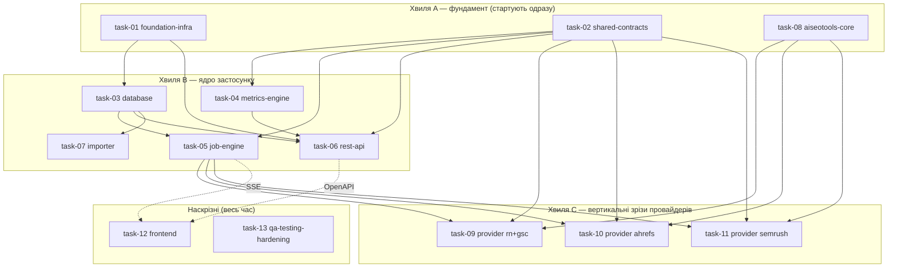

# Декомпозиція проєкту — робочі пакети для паралельних агентів

**Джерело істини:** [`../../../PLAN.md`](../../../PLAN.md) (master blueprint).
**Фронтенд-контракт:** [`../../../frontend/AGENTS.md`](../../../frontend/AGENTS.md) (обов'язковий для всієї роботи у `frontend/`).
**Процес роботи:** [`../../../CLAUDE.md`](../../../CLAUDE.md) (як брати таску, як закривати).

Архітектура з `PLAN.md` — це **модульний моноліт** (FastAPI API + один durable worker + SQLite WAL + vanilla-JS фронт), а не мережа окремих сервісів. Тому «мікросервіси» тут = **bounded modules / робочі пакети**: кожен має власні файли, чіткий вхідний/вихідний контракт і може розроблятися окремим агентом паралельно. Межі проведені по швах архітектури (`app/` дерево з §5.2) так, щоб два агенти не редагували один файл.

## Ключова ідея паралельності

Паралельність тримається на **контрактах, зафіксованих наперед** (`task-02`), а не на черговості. Кожен агент кодує проти оголошених типів/інтерфейсів і **не чекає** інших. Файли поділені так, що зони запису не перетинаються (див. «Owned paths» у кожному плані).

## Модель збору даних (матриця «клієнт × сервіс»)

Окремо від паралельності *розробки* є паралельність *збору* в рантаймі (PLAN §9.1/§9.2), яку реалізує `task-05`:

- 4 сервіси (Ahrefs, Semrush, GSC, Reporting Ninja), у кожному заведені наші клієнти;
- **між сервісами — паралельно** (одна доріжка на сервіс), **усередині сервісу — послідовно** (клієнт за клієнтом), бо один persistent browser-профіль/сесія + metered API на сервіс;
- клітинка `(client, provider)` — атомарна одиниця збору/прогресу/retry (`sync_job_providers`, task-03);
- **нуль падінь:** виняток у клітинці ізольований → `failed`, доріжка триває; новий клієнт без інтеграції → `not_configured` (не краш, не нуль); прогрес персистентний і переживає рестарт.

## Хвилі та залежності

- **Хвиля A** (`task-01`, `task-02`, `task-08`) стартує без залежностей — розблоковує всіх.
- **Хвиля B** стартує, щойно є `task-01` (скелет) і `task-02` (контракти); `task-03` потрібен лише скелет.
- **Хвиля C** (провайдери) стартує, коли є `task-02` (контракт adapter) і `task-08` (namespace у AISeoTools). Кожен провайдер — окремий агент.
- **Наскрізні** `task-12` (фронт) і `task-13` (QA/hardening) працюють паралельно з першого дня на фікстурах і синхронізуються по OpenAPI/SSE, коли ті готові.
- **Хвиля E (v2, таски 14–19)** — розширення після MVP (PLAN §21). Критичний шлях: **`task-16` (розмірні дані GSC) стартує першим**, бо без нього неможливі ні алерти (17), ні таби аналітики (18). Паралельно й без залежностей стартують `task-14` (періоди) і — у частині інлайн-дат — `task-19`. `task-18` замикає хвилю, бо споживає всі чотири бекенд-таски.

> Агент **не бере** таску, доки її `Depends on` не лежать у [`../done/`](../done/). Порядок у межах хвилі — довільний.

## Каталог тасок

| # | Файл | Пакет | Хвиля | Depends on | Головні owned paths |
|---|---|---|---|---|---|
| 01 | ✅ [task-01-foundation-infra.md](../done/task-01-foundation-infra.md) | Скелет, config, Docker/Compose, CI | A | — | `app/main.py`, `app/core/`, `pyproject.toml`, `Dockerfile`, `compose.yaml`, `app/api/health.py` |
| 02 | ✅ [task-02-shared-contracts.md](../done/task-02-shared-contracts.md) | Integration contract + schemas + DTO | A | — | `app/integrations/contract.py`, `app/integrations/registry.py`, `app/schemas/` |
| 03 | ✅ [task-03-database.md](../done/task-03-database.md) | ORM, міграції, репозиторії | B | 01 | `app/db/`, `migrations/`, `alembic.ini` |
| 04 | ✅ [task-04-metrics-engine.md](../done/task-04-metrics-engine.md) | Періоди, catalog, normalize, quality | B | 02 | `app/metrics/` |
| 05 | ✅ [task-05-job-engine.md](../done/task-05-job-engine.md) | Worker, черга, lease/recovery, events, SSE | B | 02, 03 | `app/jobs/`, fake adapter |
| 06 | ✅ [task-06-rest-api.md](../done/task-06-rest-api.md) | FastAPI роутери + OpenAPI | B | 01, 02, 03, 04 | `app/api/dashboard.py`, `app/api/clients.py`, `app/api/jobs.py` |
| 07 | ✅ [task-07-importer.md](../done/task-07-importer.md) | Імпорт історії з AISeoTools + CLI | B | 03, 04 | `app/importers/`, `app/cli.py` |
| 08 | ✅ [task-08-aiseotools-core.md](../done/task-08-aiseotools-core.md) | Additive namespace у AISeoTools (core) | A | — | `AISeoTools/seo_audit/dashboard/{events,models,config}.py` |
| 09 | ✅ [task-09-provider-reporting-ninja-gsc.md](../done/task-09-provider-reporting-ninja-gsc.md) | RN/GA4 + GSC вертикальний зріз | C | 02, 08, 05 | `AISeoTools/.../dashboard/{reporting_ninja,gsc}.py`, `app/integrations/{reporting_ninja,gsc}.py` |
| 10 | ✅ [task-10-provider-ahrefs.md](../done/task-10-provider-ahrefs.md) | Ahrefs Site Audit зріз | C | 02, 08, 05 | `AISeoTools/.../dashboard/ahrefs.py`, `app/integrations/ahrefs.py` |
| 11 | ✅ [task-11-provider-semrush.md](../done/task-11-provider-semrush.md) | Semrush зріз | C | 02, 08, 05 | `AISeoTools/.../dashboard/semrush.py`, `app/integrations/semrush.py` |
| 12 | ✅ [task-12-frontend.md](../done/task-12-frontend.md) | Vanilla-JS dashboard | D | 06 (OpenAPI), 05 (SSE) | `frontend/` (крім `AGENTS.md`) |
| 13 | ✅ [task-13-qa-testing-hardening.md](../done/task-13-qa-testing-hardening.md) | Тести, e2e, live smoke, hardening, деплой | D | усі | `tests/`, `scripts/backup*`, `docs/runbook.md` |

> Хвилі **E** (14–19) і **F** (20–22) мають власні таблиці нижче.

## Хвиля F — auth flow (сесії браузера)

Викликана реальним інцидентом: Semrush показувався як «немає даних», хоча насправді протухла browser-сесія. Послідовна: **20 → 21 → 22** (кожна споживає попередню). Разом вони закривають флоу «запуск збору → перевірка сесій → статус → «Увійти» → авто-продовження».

| # | Файл | Пакет | Depends on | Головні owned paths |
|---|---|---|---|---|
| 20 | ✅ [task-20-browser-session-bridge.md](../done/task-20-browser-session-bridge.md) | Міст до теплого Chrome, liveness, тригер логіну | — | `app/integrations/browser_session.py`, `compose.yaml`, AISeoTools `browser/warm.py` |
| 21 | ✅ [task-21-session-preflight-and-auth-pause.md](../done/task-21-session-preflight-and-auth-pause.md) | Preflight сесій, `auth_required`, пауза/резюм доріжки | 20 | `app/jobs/{lane,dispatcher,runner,recovery}.py`, `app/schemas/enums.py` |
| 22 | [task-22-sync-modal-auth-ux.md](task-22-sync-modal-auth-ux.md) | Попап: стадія сесій, статуси, кнопка «Увійти» | 20, 21 | `frontend/js/sync-modal.js`, `session-status.js` |
| 23 | ✅ [task-23-session-preflight-sse-events.md](../done/task-23-session-preflight-sse-events.md) | Події статусу клітинки в SSE (фікс зависання «Перевірки сесій») | 05, 20, 21, 22 | `app/jobs/{events,runner,lane,control}.py`, `frontend/js/sync-modal.js` |

> **task-21 закрита:** новий нетерміналний `CellStatus.awaiting_auth` (адитивно) — доріжка паузиться на ньому замість провалу, `check_session` (task-20) викликається один раз на провайдера (мемоізація в `lane.py`), profile-lock/lease звільняються самі собою (лише `status == running` тримає їх), таймаут паузи закриває весь `queued`-бэклог провайдера як `failed`/`auth_required`. `app/api/dashboard.py`/`app/api/providers.py` тепер читають стан з *останньої спроби*, а не лише зі snapshot-quality, і лишають останні успішні дані видимими поруч із бейджем. Торкнулась двох файлів поза owned paths (задокументовано, не мовчки): `app/db/repositories/cells.py` (два нових read-методи, той самий патерн, що й наявні «Added by task-05/06» секції) і `app/jobs/worker.py` (одна проводка `check_session=` у `Dispatcher(...)`, інакше фіча не активна в реальному воркері). `tests/unit/schemas/test_enums.py`'s вичерпний набір `CellStatus` доповнено — це очікуваний наслідок контрактної зміни. Job-level `JobStatus` не отримав «paused»-значення (task-05 зона не займали) — косметичний follow-up для task-22. Деталі — Completion report таски.

## Хвиля E — v2 (після MVP, PLAN §21)

Розширення поверх закритого MVP. Стартують, коли їхні `Depends on` лежать у [`../done/`](../done/).

| # | Файл | Пакет | Depends on | Головні owned paths |
|---|---|---|---|---|
| 14 | ✅ [task-14-period-engine-v2.md](../done/task-14-period-engine-v2.md) | Квартал/рік/кастом + агрегація збереженої історії | — (розширює 02/04) | `app/metrics/periods.py`, `app/metrics/aggregate.py`, `PeriodKind`, `CoverageDTO` |
| 15 | ✅ [task-15-health-score-and-sorting.md](../done/task-15-health-score-and-sorting.md) | Health % клієнта + сортування дашборду | 14 (для розширених періодів) | `app/metrics/health.py`, `app/api/dashboard.py` |
| 16 | ✅ [task-16-gsc-dimensional-data.md](../done/task-16-gsc-dimensional-data.md) | Розмірні дані GSC (сторінки/запити) | 14 | `gsc_dimension_metrics`, `DimensionRepository`, `app/api/analytics.py`, `collect_gsc_dimensions`/`collect_dimensions` |
| 17 | ✅ [task-17-alerts-engine.md](../done/task-17-alerts-engine.md) | Алерти: просідання та зростання | 16 | `app/metrics/alerts.py`, `app/api/alerts.py` |
| 18 | ✅ [task-18-client-analytics-page.md](../done/task-18-client-analytics-page.md) | Сторінка клієнта (§21.6) | 14, 16, 17 | `frontend/`, роутер сторінки клієнта |
| 19 | ✅ [task-19-dashboard-card-fixes.md](../done/task-19-dashboard-card-fixes.md) | Картка дашборду: health, sort-контрол | 15 | `frontend/` |
| 24 | ✅ [task-24-card-health-trend-blocks.md](../done/task-24-card-health-trend-blocks.md) | Тренд health на картці: стрілка WoW + денний спарклайн | 15, 19 | `client_health_daily`, `app/db/repositories/health.py`, `app/api/dashboard.py`, `frontend/js/client-card.js` |

> **task-14 закрита:** `PeriodKind` тепер `week | month | quarter | year | custom` (адитивно), з'явився `CoverageDTO` і `aggregate_metrics(...)`. Контрактні деталі — у Completion report таски.

> **task-15 закрита:** `ClientCardDTO` отримав `health` (`ClientHealthDTO`: `value | None`, `coverage_contributing`, `coverage_configured`); `GET /api/v1/dashboard` отримав `sort=` (default `quality`). `MetricSpec` отримав `health_weight: float = 1.0` (адитивно, task-04 зона, рівні ваги на старті). Контрактні деталі — у Completion report таски.

> **task-16 закрита:** нова таблиця `gsc_dimension_metrics` (immutable, top-N + залишок «інше», `quality`/`rank` на рядок; один `ProviderSnapshot` = один період), `DimensionRepository` (`bulk_insert`/`for_period`/`top_pages`/`top_queries`/`for_two_periods`/`purge_older_than`), `GET /api/v1/clients/{id}/analytics/{pages,queries}`. AISeoTools отримала `collect_gsc_dimensions()` (адитивно, `seo_audit/dashboard/gsc.py`); `GscAdapter.collect_dimensions()` — новий метод поза `ProviderAdapter`-протоколом, **ще не підключений** до `app/jobs`-конвеєра (task-05 зона) — task-17/18 читають уже збережені рядки через репозиторій, але живий collection-trigger лишається follow-up. Контрактні деталі — у Completion report таски.

> **task-17 закрита:** `app/metrics/alerts.py` — чиста `detect_alerts(pages_current, pages_previous, thresholds) -> AlertsResult(declining, rising, new, skipped_reason)`, decoupled від ORM через `DimensionRow` (як `StoredMetricValue` у task-14). `GET /api/v1/clients/{id}/alerts?period=…&dimension=page|query` (`app/api/alerts.py`) читає обидва боки через `DimensionRepository.for_two_periods`. Пороги — `Settings.alert_min_relative_change_pct/alert_min_base_impressions/alert_min_base_clicks/alert_top_n_per_group`. Живий збір розмірних даних досі не підключено до `app/jobs` (успадкований follow-up task-16) — ендпоінт чесно повертає `skipped_reason="missing_period_data"`, доки дані не з'являться. Контрактні деталі — у Completion report таски.
>
> **task-18 закрита:** сторінка клієнта на hash-маршруті `#/client/{id}` (`frontend/js/router.js` тепер єдина точка входу в `index.html`, динамічно вантажить `dashboard.js` або `client-page.js`); розширені періоди, таби «Сторінки»/«Запити» з current/previous/дельтою й `truncated`, блок алертів, графік Chart.js з accessible-резюме; увесь стан у URL. `app.metrics.aggregate`/`CoverageDTO` (успадкований TODO з task-14) **досі не підключені** до жодного ендпоінта — розширені періоди чесно показують точні дати й попереджають, що агрегація покриття не підключена, замість вигаданого відсотка; підключення вимагає нового ендпоінта в зоні task-06. `frontend/js/api.js` отримав 3 нові функції (`getClientAnalytics`/`getClientAlerts`/`getClientAnalyticsChart`), адитивно. Контрактні деталі — у Completion report таски.
>
> **task-13 закрита:** з'явився спільний harness (`tests/harness/**` + `tests/conftest.py`) — бери `temp_db`, `api_client`, `seed_client`, `fake_adapters`, `running_worker` замість власного склеювання БД/worker-а. Наскрізні набори: `tests/integration/**`, `tests/contract/**`, `tests/live/**` (останні пропускаються без `--live`). Стан MVP DoD — [`docs/dod-mvp.md`](../../../docs/dod-mvp.md).
>
> **task-19 закрита (done-with-followups):** інлайн-дати (range vs snapshot), health-чіп на картці, sort-контрол зі станом в URL, українська копія в межах owned paths. Торкнулась спільних read-only файлів адитивно (задокументовано, не мовчки): `formatters.js` (переклад лейблів + `en-US → uk-UA` для дат, новий експорт `formatDate()`), `api.js` (`getDashboard({sort})`), `store.js` (`sort` у стані/URL). `index.html` і `sync-modal.js` лишаються англійською — поза owned paths, follow-up. Деталі — Completion report таски.

> **task-23 закрита:** SSE-потік віддає лише рядки `job_events`, а фронт перечитує статуси клітинок тільки на подію — тож клітинка, що вирішилась на преflight (`awaiting_auth`/`not_configured`/`skipped`), не давала жодної події й модалка вічно висіла на «Перевіряємо…». З'явився `append_cell_status_event()` (пишеться в тій самій транзакції, що й зміна статусу) у всіх раніше «німих» переходах. Побічно полагоджено: скасування припаркованої доріжки, queued-cancel дефект task-13 (strict `xfail` знято), `aggregate_status` для повністю скасованого запуску. Деталі — Completion report таски.

> **task-24 закрита:** `ClientHealthDTO` отримав `value_previous`/`delta_pct`/`history` (адитивно) + вкладений `HealthPointDTO`; нова таблиця `client_health_daily` (upsert на `(client_id, day)`, **не** immutable) і `HealthHistoryRepository`. `_build_provider_summary` отримав опційний `as_of`, на якому тримається `yovth-report backfill-health-history`. Наявний спарклайн картки малював інший ряд (Ahrefs `health_score`) і був зламаний проти живого API через розбіжність ключа — замінений на композитний health без зайвого запиту на картку. Контрактні знімки перегенеровано. Деталі — Completion report таски.

## Хвиля G — Technical SEO Audit (machine-only)

Розширення після MVP: детермінований технічний аудит сайту клієнта на базі TechAudit-краулера AISeoTools, **без ШІ**. Категорії→знахідки на сторінці клієнта, повторний запуск, перепровірка окремої знахідки, експорт у XLSX (лише машинні [П]-дані). Зведений в **один** таск-док (рішення користувача); межі під-тасок проведені в «Owned paths» самого файлу.

| # | Файл | Пакет | Depends on | Головні owned paths |
|---|---|---|---|---|
| 25 | ✅ [task-25-technical-seo-audit.md](../done/task-25-technical-seo-audit.md) | Machine-only tech audit: AISeoTools `dashboard/tech_audit.py` + `Provider.tech_audit` + adapter/API + `audit-panel.js` + XLSX-export | — (адитивно розширює 02/03/04/05/06/12/18) | `seo_audit/dashboard/tech_audit.py`, `app/integrations/tech_audit.py`, `app/api/tech_audit.py`, `frontend/js/audit-panel.js` (+ адитивні дотики enums/api/models/migrations/client-page) |

> **Рішення (2026-07-23):** Фаза 1 — **без рендеру** (краул+детект на httpx, без Chromium); реюз `Provider`+`SyncJob`+`AnalyticsDatasetRow` (макс. реюз джоб-рушія/SSE/immutable snapshot). Рендер+CWV (`SLOW_PAGES`) — окрема майбутня task-29 (Chromium в образ). `Provider.tech_audit` **не** метрик-провайдер: гардиться поза дашбордом/health/каталогом і поза рутинним синком.

> **task-25 закрита:** нової таблиці під знахідки/recheck **не знадобилось** — категорії/знахідки/recheck їдуть у наявній `AnalyticsDatasetRow` під ключами `tech_categories`/`tech_findings`/`tech_recheck` (recheck append-only, читається як найсвіжіший рядок на `dimension_value` через новий `AnalyticsDatasetRepository.latest_rows_by_dimension`). Enum-міграції теж не знадобилось: `sa.Enum` тут без `create_constraint`, тож CHECK-констрейнтів на provider-колонках немає. Єдина міграція — `d47b9c1e5a02` (`sync_jobs.params_json`), бо адаптер за контрактом не має доступу до БД, а targeted-recheck потребує per-job параметрів (`CollectionContext.job_mode`/`job_params`, адитивно). З'явився **`METRIC_PROVIDERS`** — усі місця, що ітерували `tuple(Provider)` заради метрик (`api/jobs.py` розгортання `providers="all"`, `api/dashboard.py`, `api/providers.py`), переведені на нього; dispatcher свідомо лишився на повному enum, щоб піднімати доріжку `lane-tech_audit`. Деталі — Completion report таски.

## Хвиля H — Client Blogs (machine-only)

Розширення після MVP: детермінований інвентар блогу клієнта на базі blog-краулера AISeoTools (`discover_urls` + `blog_strategy`), **без ШІ**. Блок «Blogs» угорі сторінки клієнта (кількість + «Refresh data» + посилання), окрема сторінка зі списком постів (Title/Description/Word count/Link/Published date) і експорт у **CSV та XLSX**. Взірець наскрізь — **task-25** (той самий шаблон «machine-only провайдер поза рутинним синком»).

| # | Файл | Пакет | Depends on | Головні owned paths |
|---|---|---|---|---|
| 26 | ✅ [task-26-client-blogs.md](../done/task-26-client-blogs.md) | Machine-only blogs inventory: AISeoTools `dashboard/blogs.py` + `Provider.blogs` + adapter/API + `blogs-page.js` + CSV/XLSX-export | — (адитивно розширює 02/03/05/06/12/18/25) | `seo_audit/dashboard/blogs.py`, `app/integrations/blogs.py`, `app/api/blogs.py`, `frontend/js/blogs-page.js` (+ адитивні дотики enums/api/router/client-page) |

> **Рішення (2026-07-24):** реюз рушія task-25 — `Provider.blogs` **поза** `METRIC_PROVIDERS` і поза рутинним синком; пости в наявній `AnalyticsDatasetRow` (`blog_posts`/`blog_summary`), **без нових таблиць і без міграцій**. Краул стартує з `Client.domain` (автокласифікація блог-постів через `build_inventory`+`classify_role`, override `blog_url` опційний). Експорт **self-contained у застосунку** (`openpyxl` уже пряма залежність, task-07) — CSV+XLSX працюють навіть без AISeoTools.

> **task-26 закрита:** нової таблиці/міграції не знадобилось (як і в task-25) — пости й summary їдуть у наявній `AnalyticsDatasetRow` (`blog_posts`/`blog_summary`). `build_inventory()` в AISeoTools отримав 3 адитивні keyword-only параметри (`max_urls`/`on_page`/`should_stop`) для bound/progress/cooperative-cancel — точковий диф у чужому файлі, задокументований у Completion report. `runner.py`'s вузький `is_tech_audit` перейменовано на `is_self_configured` (охоплює і `tech_audit`, і `blogs`, той самий гейт-виняток). Виявлений і виправлений mobile-баг: `#blogs-page-root` (flex-column) давав горизонтальний page-scroll на 390px попри коректно клипований `.table-scroll` — точковий `overflow-x: hidden` фікс, першопричина відмінності від `#ahrefs-page-root` не з'ясована до кінця. Під час виконання виявлено паралельну незакомічену роботу іншої сесії (batch «Run audits», торкається `app/api/dashboard.py`/`app/api/tech_audit.py`/новий `app/db/repositories/tech_audits.py`) з окремим cache-buster — нормалізовано під єдиний `?v=`, чужі логічні зміни не займані. Деталі — Completion report таски.

## Хвиля I — Tools page + Image Alt Text

Нова верхньорівнева сторінка **Tools** (хаб інструментів: блоки + пошук) і перший інструмент — **Image Alt Text**: таблиця аудиту (CSV/XLSX) → детермінований пошуковий фрагмент для медіатеки WordPress → операторська таблиця з «відкрити/копіювати» → прогрес по кожній картинці в БД → перевірка «alt уже на сторінці?» **без кешу**.

| # | Файл | Пакет | Depends on | Головні owned paths |
|---|---|---|---|---|
| 27 | ✅ [task-27-tools-page-and-alt-text-tool.md](../done/task-27-tools-page-and-alt-text-tool.md) | Сторінка Tools + інструмент Image Alt Text (upload/parse → search key → copy-прогрес → no-cache verify → export) | — (адитивно розширює 02/03/06/12/18) | `app/tools/**`, `app/api/{tools,tools_alt_text}.py`, `app/db/repositories/alt_text.py`, `app/schemas/tools.py`, `frontend/js/{tools-page,alt-text-tool}.js`, `frontend/css/tools.css` (+ адитивні дотики `models.py`/`router.js`/`api.js`/`index.html` + одна міграція) |
| 39 | ✅ [task-39-alt-text-wp-media-id.md](../done/task-39-alt-text-wp-media-id.md) | Точний WordPress `attachment ID` для рядка звіту (REST `wp/v2/media` + матч uploads-шляху), окрема колонка Media ID і кнопка **Find** (copy alt + відкрити `upload.php?item=<ID>`), пакетний resolve по 50 | **27** ✅, **29** ✅ (`http_safety`) | `app/tools/alt_text/wp_rest.py` (новий), `app/api/tools_alt_text.py`, `app/db/repositories/alt_text.py`, `frontend/js/alt-text-tool.js`, `frontend/css/tools.css`, `migrations/versions/fbafa34716a9_alt_text_wp_media.py` (+ адитивні дотики `wp_media.py`/`models.py`/`schemas/tools.py`/`api.js`) |

> **Чому task-39:** `search_key` покриває ~80 % рядків; решта — `1.jpg`, `img_0421.jpg`, де пошук у медіатеці віддає
> сотні збігів. Знахідка з core: `WP_REST_Attachments_Controller::prepare_items_query()` вмикає
> `wp_allow_query_attachment_by_filename`, і `WP_Query` шукає по `_wp_attached_file` (`sq1.meta_value LIKE …`) —
> тобто пошук по **повному uploads-шляху** (`2024/03/1.jpg`), який у нас є з URL, дає точний ID навіть для `1.jpg`.
> Далі — `upload.php?item=<ID>&mode=grid`, що відкриває модалку «Attachment details» одразу.
>
> **task-39 закрита (2026-08-14):** реалізовано точно за планом. Живими табличними тестами до інтеграції знайдено й
> закрито власний дефект класифікації: слабкий («filename») тір матчингу спершу порівнював кандидатів лише по
> basename без огляду на директорію — для `1.jpg`-подібних назв це давало хибний `resolved` на першому-ліпшому
> файлі з тим самим коротким іменем в іншій директорії (та сама проблема, яку задача мала розв'язати). Виправлено:
> слабкий тір спрацьовує лише коли `media_details.file` взагалі відсутній у відповіді REST. Скріншот e2e-прогону
> також показав, що `Open in WP` з `button--primary` в кожному вирішеному рядку дає важку оранжеву смугу — замінено
> на `button--quiet` (frontend/AGENTS.md §2, «один контрольований сигнал»). Відомий, задокументований ліміт:
> `wp_root` для інсталяцій у підкаталозі (`site.com/blog/`) хибно спрощується до кореня домену (спільна причина зі
> старою WebP-Express-евристикою в `wp_media.py`, поза обсягом цієї задачі) — `TODO(task-40)`. 1287 unit/API/repo
> тестів зелені, e2e-скрипт `tools-alt-text.cjs` доповнено секцією на нову колонку. Деталі — Completion report таски.

> **task-27 закрита:** інструмент **не** провайдер і **не** job (парсинг — мілісекунди, перевірка — один HTTP-запит), тож `Provider` enum і `app/jobs/**` не чіпаються; на відміну від task-25/26, тут **потрібні 2 нові таблиці** (`alt_text_reports`/`alt_text_items`), бо дані мутабельні за задумом (статус прогресу, результат перевірки) і не мають провайдера/періоду — в immutable `AnalyticsDatasetRow` вони не вміщаються. **Без нових залежностей і без AISeoTools:** XLSX — наявний `openpyxl`, CSV — stdlib `csv`, перевірка — stdlib `urllib.request` + `html.parser` (`httpx`/`lxml`/`pandas` в образі лише транзитивні через optional-групу `local`, тому на них не спираємось). Legacy `.xls` — свідомо поза обсягом (`415` з дією замість тихої поломки; підтверджено користувачем — експорт іде з Google Sheets). CSP отримав `img-src 'self' data: https: http:` (зона task-01, адитивно): без цього прев'ю картинок клієнта блокувалися повністю; скрипти/стилі/fetch лишились під `'self'`. Живі прогони на реальному Ahrefs-експорті виявили ще три речі, які закриті тут же: об'єднані клітинки URL (939 із 997 рядків інакше йшли у `skipped`), кілька сторінок використання в одній клітинці (тепер список + перевірка обходить до 3 сторінок) і не-ASCII назва звіту, що валила експорт у 500. Деталі — Completion report таски.

## Хвиля J — Portfolio Trends (лінія = клієнт)

Нова верхньорівнева сторінка `#/trends`: один графік на весь портфель, де кожна **лінія — клієнт**, а точки — GSC
Clicks/Impressions і GA4 Sessions/Users по днях/тижнях/місяцях. Дані вже збираються (`gsc_daily`/`ga4_daily` в
`analytics_dataset_rows`) — нових провайдерів і змін в AISeoTools не потрібно, лише агрегація вже наявної денної історії +
разовий бекфіл через наявний `custom`-період.

| # | Файл | Пакет | Depends on | Головні owned paths |
|---|---|---|---|---|
| 28 | ✅ [task-28-portfolio-trends-page.md](../done/task-28-portfolio-trends-page.md) | Portfolio Trends: `app/metrics/portfolio.py` + `GET /analytics/portfolio-series` + `trends-page.js`/`trends-chart.js` + `backfill-daily-history` CLI | — (адитивно розширює 02/03/04/06/07/09/12) | `app/api/portfolio.py`, `app/metrics/portfolio.py`, `frontend/js/{trends-page,trends-chart}.js`, `frontend/css/trends.css` (+ адитивні дотики `schemas/api.py`/`db/repositories/analytics_datasets.py`/`cli.py`/`index.html`/`router.js`/`api.js`) |
| 44 | ✅ [task-44-trends-conversion-metrics.md](../done/task-44-trends-conversion-metrics.md) | Метрики конверсій у Trends: `Total` (уже зібраний — історія з 2024), `Organic`/`Direct` (новий датасет `ga4_daily_channels` на `firstUserDefaultChannelGroup` + backfill CLI), прапорець `additive` проти сумування неадитивних метрик, 4 фікси: нульова база в `Indexed`, `Δ` при нулі, `no_data` ≠ «not connected», група METRIC на 7 кнопок | **28** ✅, **09** ✅, **30** ✅ (узгоджено з **42**) | `app/metrics/portfolio.py`, `app/integrations/reporting_ninja.py`, `frontend/js/{trends-page,trends-chart}.js`, `frontend/css/trends.css` (+ адитивні дотики `schemas/api.py`/`cli.py`/`app/api/portfolio.py` — один рядок кожен) |

> **task-44 закрита (2026-08-17):** реалізовано за планом, з одним уточненням — `app/api/portfolio.py` **довелось** доторкнутись (один рядок `additive=spec.additive`), бо DTO конструюється по іменованих полях і той самий прецедент уже стався для `lag_days` у task-30; початкове формулювання «не змінюється взагалі» було неточним. Живий гейт §6 пройдено повністю: `backfill-ga4-channels --days 400` на реальному портфелі (12 клієнтів, 3940 нових рядків, ідемпотентний повторний прогін), крос-перевірка з клієнтським звітом дала рівно **654 / 391 / 1099** (EFFYS, липень 2026), а `ALPHA`/`GOREPORT`/`LAXTON` тепер показані в живому Trends як `NO DATA YET`, не `NOT CONNECTED`. Деталі — Completion report таски.

> **Рішення (2026-07-27):** реюз даних, які вже пишуть task-09 (GSC/GA4 daily) — жодної нової таблиці, жодної зміни в
> `/home/elon/dev/seo/AISeoTools`. `null` (клієнт без даних цього дня) ніколи не стає `0`; частковий бакет і
> "provisional"-хвіст (GSC/GA4 lag) позначаються окремо й не тягнуть дельту. Кольори — 8 категоріальних слотів,
> валідовані `dataviz`-скриптом під `#1e1e1e`; 9-й клієнт не отримує згенерований колір — режим `All clients`
> (small multiples) замість каші з ліній. Одна вісь Y (портфель порівнюється або в тих самих одиницях, або через
> режим `Indexed`, ніколи через другу шкалу).
>
> **task-28 закрита:** усі 4 ряди (`gsc_clicks`/`gsc_impressions`/`rn_sessions`/`rn_users`) працюють на живому
> `daily_series()` (новий метод `AnalyticsDatasetRepository`, той самий патерн «найсвіжіший рядок на `(client, day)`
> через усі знімки», що й `latest_rows_by_dimension`); `rn_sessions` **не** в `CATALOG` (жоден адаптер не пише таку
> `MetricValue` — додавання намалювало б порожній рядок на кожній картці), решта тягнуть
> `label`/`unit`/`better_direction` з `CATALOG`, щоб назва не розійшлася з карткою. CLI `backfill-daily-history`
> ставить джоб з `mode="force_refresh"` — без цього freshness-гейт (`app/jobs/runner.py`) мовчки пропускає клітинку
> з будь-яким недавнім snapshot незалежно від запитаного періоду. Живий браузерний smoke (playwright-core проти
> Playwright-кешованого Chromium) на 4 фікстурах спіймав 2 реальні баги до здачі: інлайновий `style=` у таблиці
> порушував CSP (`default-src 'self'`, немає `unsafe-inline`) — замінено на CSS-клас; спарклайн-канвас у
> small-multiples без `position: relative`/`width: 100%` змушував Chart.js падати на дефолтні 300px і ховати
> delta-чіп за межами картки — виправлено за взірцем наявного `.chart-wrap`. **Два свідомі відхилення від плану**
> (обсяг): §7-діалог бекфілу з UI не побудований (порожній стан друкує готову CLI-команду замість нового модального
> вікна — той самий прецедент, що й `backfill-health-history`/task-24, теж CLI-only); ручний чекбокс-пікер клієнтів
> (§6.2) замінений на детермінований авто-кап «топ-8 за сумою вікна» + режим `All clients` без ліміту. Контрактні
> зміни суто адитивні: новий ендпоінт + 6 DTO + `daily_series()` + одна CLI-підкоманда; OpenAPI-снапшот
> перегенеровано (+391 рядок, 0 видалень). 807 тестів (807 passed, 1 skipped), `ruff`/`mypy` чисті — усе в Docker.
> Деталі — Completion report таски.

## Хвиля K — Redirect Checker (другий інструмент у хабі Tools)

Другий блок на `#/tools`: оператор вставляє посилання (одне або список) і бачить **повний ланцюжок редіректів підряд,
хоп за хопом** — статус, `Location`, час, що змінилося на кроці (схема/хост/`www`/слеш/query), вердикт по ланцюжку й
прапорці-сигнали (зайвий хоп, тимчасовий редірект, петля, `https→http`, обрив у 404/5xx, canonical ≠ фінальний URL).
Реюз шаблону task-27: не провайдер і не job, нуль нових залежностей, без AISeoTools (Playwright-трейсер там —
лише референс, бо тягне Chromium за bind-mount-ом).

| # | Файл | Пакет | Depends on | Головні owned paths |
|---|---|---|---|---|
| 29 | ✅ [task-29-redirect-checker-tool.md](../done/task-29-redirect-checker-tool.md) | Redirect Checker: stdlib-трейсер хоп-за-хопом + `POST /tools/redirects/trace` + перевірки з історією в БД + `redirect-tool.js` + CSV/XLSX-експорт | **27** ✅ (адитивно розширює 03/12) | `app/tools/http_safety.py`, `app/tools/redirects/**`, `app/api/tools_redirects.py`, `app/db/repositories/redirects.py`, `frontend/js/redirect-tool.js` (+ адитивні дотики `api/tools.py`/`schemas/tools.py`/`models.py`/`tools-page.js`/`api.js`/`tools.css` + одна міграція) |

> **Рішення (2026-07-27):** редіректи трасуються **вручну** (opener без `HTTPRedirectHandler` + passthrough
> `HTTPErrorProcessor`), бо стандартний клієнт ховає проміжні хопи; метод — GET, не HEAD (частина серверів на HEAD
> відповідає інакше і трейс брехав би), тіло читається лише для фінального хопа. Список URL проганяється
> **frontend-driven** циклом по `POST /checks/{id}/targets/{tid}/run` (той самий патерн, що per-row «Verify alt»), а не
> durable-worker-ом — інакше довелося б лізти в закриту зону task-05 заради синхронного інструмента; прогрес живе в БД
> і переживає F5. Politeness-гард (1 запит на хост, 250 мс) — **на сервері**. SSRF-гард застосовується до **кожного**
> хопа, включно з `Location` і `meta refresh`; для цього спільний HTTP-safety шар витягується з
> `app/tools/alt_text/verify.py` у `app/tools/http_safety.py` (поведінка й публічні імена без змін).
> JS-редіректи й бот-блоки — окремі чесні стани (`possible_js_redirect`/`blocked`), Playwright-режим — follow-up.
>
> **task-29 закрита:** інструмент доданий у хаб **одним записом** у реєстрі `app/api/tools.py` + одним рядком у
> `TOOL_MODULES` — маршрут `#/tools/<tool>/<id>` і навігація з task-27 не змінювались, що й було критерієм «каталог,
> що росте». Дві нові таблиці `redirect_checks`/`redirect_check_targets` (міграція `a3f81c62d5b4`), хопи — у
> `chain_json` (ланцюжок завжди читається цілком). Спільний SSRF/UA/no-cache шар витягнутий у
> `app/tools/http_safety.py`; `alt_text/verify.py` реекспортує старі імена, тож усі тести task-27 зелені без правок.
> `claim_target` — атомарний UPDATE (подвійний клік → `409 target_running`), politeness-гард (1 запит/хост, 250 мс) —
> на сервері. Живі прогони на github.com/bit.ly/theyovth.com + SSRF-цілях підтвердили всі вердикти; авто-старт прогону
> при відкритті сторінки прибрано (F5 інакше обстрілював клієнтський сайт без кліку). 997 тестів зелені,
> `ruff`/`mypy` чисті. Деталі — Completion report таски.

## Хвиля L — свіжість даних і паралельний збір

Дві таски одного напряму: **дані мають доганяти «сьогодні» з UI**, і **збір усередині сервісу має йти в 3 доріжки
на одному логіні**. Порядок обов'язковий: 30 дає спільний власник модалки прогресу й «живий прогрес v2», на
якому 31 малює панель доріжок.

Діагноз, що породив хвилю (жива БД, 2026-07-31): останній батч 29.07 `succeeded`, але `gsc_daily`/`ga4_daily`
стоять на **26.07** — бо рутинний sync збирає `week`/`closed`, тобто останній **закритий** тиждень, і денні рядки
за поточний тиждень ніхто не просить. Долити «до вчора» може лише `period_kind=custom` + `force_refresh` — те, що
досі жило тільки в CLI `backfill-daily-history`.

| # | Файл | Пакет | Depends on | Головні owned paths |
|---|---|---|---|---|
| 30 | ✅ [task-30-live-data-refresh.md](../done/task-30-live-data-refresh.md) | «Refresh data» на `#/trends`: rolling-window джоба (`custom` + `force_refresh`), freshness-чип `data through … · N days behind`, спільний `job-progress.js`, живий прогрес v2 (коалесований refetch, no-flicker rerender, ETA) | — (адитивно розширює 03/05/06/09/12/28) | `frontend/js/job-progress.js` (новий), `frontend/js/{sync-modal,sse,trends-page,dashboard}.js`, `app/metrics/portfolio.py`, `app/api/portfolio.py` (+ адитивні поля `schemas/api.py`) |
| 31 | ✅ [task-31-parallel-collection-slots.md](../done/task-31-parallel-collection-slots.md) | Паралельний збір: профільний лок mutex → **семафор** (`capacity`), slot-пул, N потоків на провайдера, один auth-gate на провайдера, адитивний `slot=` в AISeoTools (3 вікна одного теплого Chrome на 1 профілі), панель «Browser lanes» | **30** | `app/jobs/**` (+ нові `auth_gate.py`/`slots.py`), `app/db/repositories/cells.py`, `app/core/config.py`, `app/integrations/{ahrefs,semrush}.py`, `AISeoTools: seo_audit/browser/{profile,session}.py` (+ адитивні `browser_slot`/`slot` через task-02, колонка `slot` через task-03) |
| 32 | ✅ [task-32-live-progress-telemetry.md](../done/task-32-live-progress-telemetry.md) | Живий прогрес: `PhaseTracker` (фазові ваги клітинки + вимірюваний `completed/total`), детальна телеметрія Ahrefs/Reporting Ninja/GSC, CSP-безпечні анімовані смуги, чесний індетермінантний стан, елапс на клітинці, ETA по lane-ах і по-провайдерній медіані, activity log зі SSE | **30**, **31** | `app/integrations/progress.py` (новий), `app/integrations/{ahrefs,reporting_ninja,gsc}.py`, `app/jobs/runner.py` (адитивні emit-и), `frontend/js/{sync-modal,formatters,sse,api}.js`, `frontend/css/app.css` |
| 33 | ✅ [task-33-integration-auto-connect.md](../done/task-33-integration-auto-connect.md) | Auto-connect: «Connect» шукає акаунт провайдера за доменом клієнта замість форми для ручного вписування ID — GSC за доменом, GA4 за назвою (аліас → домен-у-назві → схожість), автозапис лише при рішучому збігу чи явному відриві, звіт із preflight і перехід на «Collect data now» | — (адитивно розширює 02/06/07/12) | `app/integrations/discovery.py` (новий), `app/api/discovery.py` (новий), `app/integrations/aiseotools_sync.py`, `frontend/js/{dashboard,api}.js`, `frontend/index.html`, `frontend/css/app.css` (+ адитивні DTO в `schemas/api.py`) |
| 34 | ✅ [task-34-client-lifecycle-status.md](../done/task-34-client-lifecycle-status.md) | Статус клієнта `active`/`paused` (припинена оплата): колонка `status` + `status_changed_at`/`status_note`, `POST /clients/{id}/status`, `list_collectable()` замість `list_active()` в усіх «all»-розгортаннях (sync, аудити, CLI, portfolio), бейдж-кнопка на картці й на сторінці клієнта, приглушена картка внизу сітки, теги в sync-модалці | — (адитивно розширює 02/03/05/06/07/12/15/25/28) | `app/schemas/enums.py` (+`ClientStatus`), `app/db/models.py`, `migrations/versions/<rev>_client_status.py`, `app/db/repositories/clients.py`, `app/api/{clients,dashboard,jobs,tech_audit,portfolio}.py`, `app/cli.py`, `frontend/js/client-status.js` (новий) + `{client-card,dashboard,client-page,sync-modal,store,api}.js`, `frontend/index.html`, `frontend/css/{app,client-page}.css` |

> **Рішення (2026-07-31):** «оновлення даних» — це **не** новий ендпоінт: наявний `POST /sync-jobs` уже приймає
> `period_kind=custom` + `custom_start/custom_end` + `mode=force_refresh`, тож задача фронтова плюс чесний
> `data_through` в API трендів. Вікно за замовчуванням — **30 днів до вчора** (`today-1`, бо сьогоднішній день у
> джерелі ще пишеться); повторні перетинні вікна безпечні, бо `daily_series` бере найсвіжіший рядок на день.
> «Актуально» ≠ «сьогодні»: GSC фіналізує 3 дні, GA4 — 2, і UI має це показувати, а не приховувати.
>
> **task-30 закрита:** нових ендпоінтів не знадобилось — наявний `POST /sync-jobs` уже приймає `custom` +
> `force_refresh`; єдина серверна зміна — адитивне `PortfolioMetricDTO.lag_days`. `data_through` на бекенді **не**
> додавався: `last_day` уже означає «останній день із даними», решту свіжості рахує фронт. Діалог прогресу став
> спільним синглтоном (`frontend/js/job-progress.js`) — інакше `#/trends` не мав до нього доступу; cache-buster
> уніфіковано, бо два різні `?v=` дали б дві копії модуля модалки (два діалоги, два SSE на одну джобу). Живий
> прогін: 22 клітинки за ~3 хв, `gsc_daily` 26.07 → **29.07**, `ga4_daily` → **30.07**, чип «1 day behind» → «up to
> date». 1006 тестів зелені. Деталі — Completion report таски.
>
> **«3 паралельні браузери, 1 профіль» = 3 ВІКНА одного теплого хостового Chrome**, не 3 процеси: контейнер
> принципово attach-only (`_refuse_launch_when_attach_only`), профіль не змонтований, а три Chrome на одному
> `user-data-dir` неможливі через `SingletonLock`. Серіалізацію тримають **три** шари одночасно (БД-мутекс
> `acquire_profile_lock`, один lane-потік на провайдера, `busy_lock` keyed `{store}.{provider}` в AISeoTools) —
> знімати треба всі три. Завантаження експортів лишаються серіалізованими by design (`download_lock`, бо CDP
> `setDownloadBehavior` — browser-global), тож очікуваний виграш **2–2.5×**, а не 3×: живі числа — semrush 59 с
> середня / 581 с максимум, повний `force_refresh` портфеля 45 хв.
>
> **task-31 закрита:** механіка працює — 3 доріжки, 3 вікна одного профілю, різні CDP `targetId`, нуль перехресних
> ефектів. Виміряно на живому стеку: ті самі 22 клітинки GSC+RN — **180 с → 60 с (×3)**. Але для Ahrefs третя доріжка
> **коштує даних**: усі три детальні експорти впали в таймаут (`partial`), тоді як на двох доріжках обидві клітинки
> `complete` без попереджень — причина структурна (bulk-експорт іде через store-wide `download_lock`). Тому дефолти
> **виміряні, а не на смак**: `ahrefs=2`, `semrush=2`, `gsc`/`reporting_ninja`=3, `tech_audit`/`blogs`=1. Ще один живий
> ефект: три однакові SPA-навігації, стартовані в ту саму мілісекунду, дали 2 з 3 `Page.goto` таймаутів → з'явився
> `lane_start_stagger_seconds=8`. Semrush-якість (`truncated`) збігається з однодоріжковим прогоном 23.07 — це не
> регресія паралельності. 1031 тест зелений. Деталі — Completion report таски.

## Хвиля M — Site Monitor (спостережуваність сайтів клієнтів)

Безперервний нагляд за сайтами: **щогодини** легка перевірка (robots.txt, sitemap, ключові сторінки, DNS),
**що 3 години** — повна (усі URL із sitemap). Кожна версія robots.txt, sitemap, сторінки й DNS-запису
зберігається з часом збору; кожна зміна стає записом зі ступенем серйозності, де `noindex` і втрата
верифікації Google Search Console — максимальний рівень. Порядок обов'язковий: **35 → 36** (UI споживає API двигуна).

| # | Файл | Пакет | Depends on | Головні owned paths |
|---|---|---|---|---|
| 35 | ✅ [task-35-site-monitor-engine.md](../done/task-35-site-monitor-engine.md) | Двигун монітора: fetch/parse/diff/severity, «стан + ланцюг незмінних версій», content-addressed сховище документів, планувальник у worker-процесі, REST API, CLI | **34** | `app/monitor/**`, `app/db/repositories/monitor.py`, `app/api/monitor.py`, `app/schemas/monitor.py`, `migrations/versions/<rev>_site_monitor.py` (+ адитивні дотики `db/models.py`/`core/config.py`/`jobs/worker.py`/`cli.py`) |
| 36 | ✅ [task-36-site-monitor-ui.md](../done/task-36-site-monitor-ui.md) | UI монітора: сторінка `#/monitor`, розділ `#/client/{id}/monitor`, переглядач версій і дифів, червоний бейдж на картці | **35** | `frontend/js/{monitor-page,monitor-client,monitor-diff}.js`, `frontend/css/monitor.css` (+ адитивні дотики `router.js`/`api.js`/`index.html`/`client-page.js`/`client-card.js`/`dashboard.js`/`tools.css`, `app/api/monitor.py`/`app/db/repositories/monitor.py`) |
| 37 | ✅ [task-37-site-monitor-fixes.md](../done/task-37-site-monitor-fixes.md) | Фікси після живої перевірки: 422 на `/monitor/pages` (контракт `sort`), прогрес прогону (зведення ховає `running`), `[object Object]` у помилках, лічильники змін на прогін, повноширинний блок DNS, пагінація стрічки + **живий прохід у e2e** | **35**, **36** | `app/api/monitor.py`, `app/db/repositories/monitor.py`, `app/monitor/runner.py`, `migrations/versions/<rev>_monitor_run_totals.py`, `frontend/js/monitor-client.js`, `frontend/css/monitor.css`, `tests/e2e/frontend/monitor-smoke.cjs` |
| 38 | ✅ [task-38-site-monitor-ux-round2.md](../done/task-38-site-monitor-ux-round2.md) | Вічний скелетон «Check history» (спільний ключ запиту на 4 різні наміри), перевірка окремої сторінки з рядка таблиці, дизайн-раунд 2 (canonical `self`, чіпи статусу, англійська дата, скелетони за формою контенту) | **35**, **36**, **37** | `frontend/js/{api,monitor-client}.js`, `frontend/css/monitor.css`, `app/api/monitor.py`, `app/monitor/runner.py`, `tests/e2e/frontend/monitor-smoke.cjs` |
| 41 | ✅ [task-41-site-monitor-alert-quality.md](../done/task-41-site-monitor-alert-quality.md) | Живий дефект hearwellservices.com: `sitemap_lost` (critical) на разовому фетч-збої замість підтвердженого 404 → новий `sitemap_unavailable` (warning, self-heal); `MonitorSettings.canonical_www` (операторський прапорець www/non-www); `MonitorChange.related_id` нарешті заповнюється — кнопка **View diff** у стрічці змін на `content_changed`/`title_changed`/... | **35**, **36**, **37**, **38** | `app/monitor/{diff,runner,severity}.py`, `app/db/models.py`, `app/db/repositories/monitor.py`, `app/schemas/monitor.py`, `app/api/monitor.py`, `frontend/js/{monitor-client,formatters,api}.js`, `frontend/css/{monitor,client-page}.css`, `migrations/versions/5c3b4a7bda87_monitor_settings_canonical_www.py` |
| 50 | ✅ [task-50-monitor-antibot-lane.md](../done/task-50-monitor-antibot-lane.md) | **Живий дефект ALPHA (alphastyle.store):** Cloudflare/Shopify віддає `429 «Verifying your connection…»`, і монітор пише цю заглушку як справжню версію сторінки — 304 з 355 сторінок «змінилися», 635 warning + 1 critical, `sitemap_health.broken=304`. Пакет: чесний стан `blocked` (блок ≠ дані — перевикористано наявний `monitor_blocked`, WARNING, уже підготовлений task-36 UI; один агрегат замість 304 рядків, раннє гальмо), **окрема повільна antibot-доріжка** — другий пул у планувальнику (`monitor_antibot_workers`) + browser-транспорт на patchright (`response.body()`, а не DOM — `signals_sha256` збігається з HTTP-доріжкою), `MonitorSettings.fetch_mode` (`auto|http|browser`) з авто-ескалацією, реалістичні заголовки (живо: `Accept-Language` — єдиний дискримінатор CF). Живий гейт пройдено: browser-lane full-прогін ALPHA (355 сторінок, ~42 хв) — `blocked_count=0`, `sitemap_health` 354/354 `ok` | **35** ✅, **36** ✅, **37** ✅, **38** ✅, **41** ✅ | `app/monitor/**` (+ новий `browser_fetch.py`), `app/db/repositories/monitor.py`, `app/api/monitor.py`, `app/schemas/monitor.py`, `migrations/versions/658f2eeb029e_monitor_antibot_lane.py`, `frontend/js/{monitor-client,formatters}.js`, `frontend/css/monitor.css` (+ адитивні дотики `db/models.py`/`core/config.py`/`cli.py`; `app/reports/stealth_browser.py` — **read-only**, лише імпорт) |
| 51 | ⏳ [task-51-monitor-redirects.md](task-51-monitor-redirects.md) | **Моніторинг редіректів сайту.** Живий біль: на сайті виник зайвий 301, а «коли і хто» невідомо — плагін Redirection (10 із 14 клієнтів, виміряно 2026-08-19) взагалі не зберігає ані `created`, ані автора. Монітор щогодини знімає повний список правил (authenticated pull `redirection/v1/export/all/json`, для решти сайтів — blackbox-проба через `tools/redirects/trace`), діфає за фінгерпринтом **без** `last_access`/`last_count`, і дає кожному новому правилу **вікно появи** (`window_start` = попередня успішна перевірка → «з'явився між 14:03 і 15:04»). Градація за ризиком: offsite-ціль → critical, накрив живий URL / змінилась ціль / зникло → warning, звичайне додавання → info, > 25 за прогін → один агрегат. Application Passwords — файлом поза БД (0600), у API лише `configured/missing/invalid` | **35** ✅, **36** ✅, **38** ✅, **41** ✅, **не паралелити з 50** (спільна зона `app/monitor/**`) | `app/monitor/redirects/**`, `migrations/versions/<rev>_monitor_redirects.py`, `tests/unit/monitor/test_redirects_*.py` (+ адитивні дотики `app/monitor/{runner,severity,diff}.py`, `app/db/{models.py,repositories/monitor.py}`, `app/api/monitor.py`, `app/schemas/monitor.py`, `app/core/{config,logging}.py`, `app/cli.py`, `frontend/js/{monitor-client,formatters}.js`, `frontend/css/monitor.css`) |

> **Знайдено живою перевіркою 2026-08-12:** секція «Check history» зависає в скелетоні **назавжди**, бо
> `listMonitorRuns` віддає всім чотирьом викликам один ключ `monitor-runs-${clientId}`, а `request()` трактує ключ
> як «скасуй попередній» — відновлення поллінгу вбиває запит історії, гілка `isAbortError → return` виходить не
> знявши `aria-busy`. Той самий корінь ламає і відновлення поллінгу після F5 (два виклики `Promise.all` вбивають
> один одного). Це **третій** випадок класу «ключ запиту виведений з ресурсу, а не з наміру» — деталі й системний
> фікс у task-38.

> **Знайдено живою перевіркою 2026-08-11 (після здачі task-36):** блок Pages падав з 422 **у кожного клієнта з
> першого відкриття** (фронт шле `sort=-last_checked_at`, API приймає лише беспрефіксні значення, а репозиторій і
> зовсім завжди сортує `desc`), а прогрес прогону не з'являвся ніколи, бо зведення віддає лише **завершені**
> прогони — поллер бачив попередній `succeeded` і глушив себе за 2 секунди. Причина, чому це пройшло приймання
> зеленим: `monitor-smoke.cjs` ганяє **тільки фікстури**, де мережевого запиту немає взагалі, тож розбіжність
> контракту фронт↔API там фізично не проявляється. Деталі й порядок робіт — task-37.

> **Рішення (2026-08-11), підкріплені живим виміром по 14 клієнтах із бази:**
>
> - Монітор — **не** провайдер і **не** `SyncJob`. ~450 прогонів/добу поховали б `sync_jobs` (703 рядки за всю
>   історію) і `job_events`, на який дивиться SSE модалки прогресу; до того ж у монітора немає ні періоду, ні
>   метрик, ні browser-профілю. Тому власний легкий рушій `app/monitor/**` у тому ж worker-процесі, з формою
>   доріжок PLAN §9.1 (між клієнтами паралельно, всередині клієнта послідовно й чемно). `app/jobs/**` не чіпаємо.
> - **Триярусний відбиток** замість «хеш сторінки»: `signals` (вирішує алерти) / `text` (контент) / `raw` (доказ).
>   Вимір: сирий хеш стабільний на 5 із 6 сайтів, а `goreport.com` міняє Cloudflare-нонс `__CF$cv$params` щозапиту —
>   наївне хешування кричало б «змінилось» щогодини.
> - **robots.txt парситься по групах user-agent**, не дифиться текстом: у `exxxoticaexpo.com` `Disallow: /` стоїть
>   для `meta-externalagent`, тоді як `*` відкритий — текстовий діф дав би хибну критику вже сьогодні.
> - **«Стан + версія на зміну»** замість рядка на кожен URL на кожен прогін: 2 850 URL × 8 повних прогонів = 22 800
>   рядків/добу, з яких 99 % — «те саме». Усі версії зберігаються повністю, але обсяг росте зі швидкістю **змін**.
> - **Нуль нових залежностей** (`dnspython` в образі немає, `httpx`/`lxml` є лише транзитивно через optional-групу
>   `local` і відсутні на CI): stdlib + DNS через **DoH** до `dns.google` і `cloudflare-dns.com` — два незалежні
>   резолвери показують те, що бачить світ.
> - Вимірювані рамки: sitemap-и 16…608 URL (≈2 850 разом), медіана сторінки 442 KB / 0,51 с → повний прогін
>   ≈10–12 хв при 4 клієнтах паралельно, ≈1,2 GB трафіку на прогін. Ціна видима в лічильниках кожного прогону.
> - Канали доставки сповіщень (Telegram/email/webhook) — свідомо **поза** хвилею (рішення користувача): v1 — UI.
>   Паузовані клієнти (task-34) з розкладу випадають, але мають тумблер «monitor anyway».
>
> **Уточнення користувача (2026-08-11), уже вшиті в план:** перевіряються **всі** URL із sitemap (продуктової межі
> немає — лише аварійний клапан і кільцевий обхід, щоб хвіст списку не лишався непереверненим); **повний код
> сторінок зберігається** — baseline ≈250 MB gzip, далі новий блоб лише на реальну зміну, безстроково; URL, що зник
> із sitemap, лишається під наглядом **30 днів**; **URL у sitemap зі статусом ≠ 200 — окремий алерт** із трьома
> типами (`3xx`/`4xx`/`5xx`), зведенням `critical` на пороговій частці й живим лічильником `sitemap_health`, видимим
> уже з першого прогону.
>
> **Знахідка, що виправдовує хвилю:** розвідка 2026-08-11 знайшла `<meta name='robots' content='noindex, follow'>`
> на головній **`laxton.se`** — рівно той інцидент, який сьогодні ніхто не бачить. Він же — наскрізний
> приймальний тест обох тасок.

## Хвиля N — Reports (генерація клієнтських звітів)

Сторінка **Report** з історією прогонів і генерацією звітів за довільними наборами періодів: місячний
(6 стандартних періодів), річний (порівняння років), кастомний (до 24 місяців) і порівнятор (той самий
місяць у до 4 різних років). Два незалежні шляхи до **однакової** таблиці: **API** (Reporting Ninja REST,
~2 с на колонку) і **PDF** (реальні файли з кабінету через headless-браузер у контейнері, ~40–70 с на колонку)
з авто-логіном, ретраями, кешем закритих періодів і крос-перевіркою. Порядок обов'язковий: **42 → 43**.

| # | Файл | Пакет | Depends on | Головні owned paths |
|---|---|---|---|---|
| 42 | ✅ [task-42-reports-engine.md](../done/task-42-reports-engine.md) | Двигун звітів: 4 набори періодів, API-джерело з **виправленою атрибуцією**, headless-PDF-експортер з авто-логіном і класифікацією збоїв, парсер PDF, XLSX, крос-перевірка PDF↔API, планувальник у worker-процесі, REST + SSE | **34**, **06** | `app/reports/**`, `app/api/reports.py`, `app/schemas/reports.py`, `app/db/repositories/reports.py`, `migrations/versions/83dac485b9c1_reports_engine_task_42.py` (+ адитивні дотики `db/models.py`/`core/config.py`/`jobs/worker.py`/`cli.py`/`Dockerfile`) |
| 43 | ✅ [task-43-reports-ui.md](../done/task-43-reports-ui.md) | UI звітів: сторінка `#/reports`, майстер запуску (тип → параметри → шлях) з чесною оцінкою часу, живий прогрес по колонках + живі логи (SSE), таблиця з походженням клітинок, інлайн-перегляд PDF і завантаження XLSX | **42** | `frontend/js/{reports-page,reports-wizard,reports-run}.js`, `frontend/css/reports.css`, `tests/e2e/frontend/reports.cjs` (+ адитивні дотики `index.html`/`router.js`/`api.js`/`formatters.js`, точковий адитив `app/api/reports.py`/`app/schemas/reports.py`) |
| 45 | ✅ [task-45-reports-round2.md](../done/task-45-reports-round2.md) | Reports раунд 2 після живої перевірки: прогрес стає **даними** (`report_runs.periods_json` замість реконструкції стану з тексту логів — на API-шляху періоду взагалі не бачили `Running`), бейджі діапазонів дат на колонках періодів, **XLSX для API-прогонів** (`build_xlsx` викликався лише в `_run_pdf` → «No files were saved»), друга таблиця **Historical Data** (місяць · Clicks · Impressions · CTR · Organic Conversions) в UI та XLSX, заборона прив'язати клієнтові **чужий** звіт кабінету, і `None ≠ 0` для GSC-періодів без даних | **42** ✅, **43** ✅ | `app/reports/{runner,api_source,history,xlsx,table}.py`, `app/api/reports.py`, `app/schemas/reports.py`, `migrations/versions/<rev>_report_run_periods.py`, `frontend/js/{reports-run,reports-wizard}.js`, `frontend/css/reports.css` (+ адитивні дотики `db/models.py`/`core/config.py`) |
| 47 | ✅ [task-47-reports-batch-client-pdf.md](../done/task-47-reports-batch-client-pdf.md) | **Масовий місячний звіт**: батч на весь портфель (`report_batches` + `report_runs.batch_id`, тротлінг під ліміт RN 300/хв, матриця прогресу клієнт × період, картка батчу + картка клієнта), **клієнтський документ** (KPI-тайли з дельтами, 4 SVG-графіки динаміки, YOY-блок) і **клієнтський PDF** — один рендерер на екран і на файл (`/runs/{id}/document` → `page.pdf()`), ZIP на батч | **42** ✅, **43** ✅, **45** ✅ | `app/reports/{document,svg_charts,client_pdf,batch}.py`, `app/api/reports.py`, `app/schemas/reports.py`, `migrations/versions/<rev>_report_batches.py`, `frontend/css/report-doc.css`, `frontend/js/reports-batch.js`, доведення **фільтра історії** (стиль контролів до рівня застосунку, пошук по клієнту, завжди видимий `Clear filters`, `Scope` одиночні/батчі) (+ адитивні дотики `reports-{wizard,page,run}.js`/`reports.css`/`db/models.py`/`core/config.py`) |
| 48 | ✅ [task-48-data-accuracy.md](../done/task-48-data-accuracy.md) | **Точність даних PDF↔API**: розслідування завершене — API правильний (44/48 збігів у EFFYS), а прогін-«катастрофа» був порівнянням двох різних клієнтів (SWM прив'язаний до `EFFYS-Internal report`). Закриваємо причини: пошуковий дискаверинг замість зчиту першого екрана таблиці кабінету, аудит і санація прив'язок (SWM-прив'язку знято наживо), вердикт `no_data` замість фальшивих mismatch/match на порожніх періодах, повторюваний `accuracy`-звіт. **done-with-followups:** жива перевірка нового дискаверингу проти кабінету не відбулась — `app.reportingninja.com` був недоступний увесь час виконання | **42** ✅, **43** ✅, **45** ✅ | `app/reports/{ninja_browser,pdf_parse,verify}.py`, `app/api/reports.py`, `app/schemas/reports.py`, `app/cli.py`, `frontend/js/reports-run.js`, `frontend/css/reports.css` |
| 49 | ✅ [task-49-batch-bindings-rebuild.md](../done/task-49-batch-bindings-rebuild.md) | **Батч: прив'язки видимі до запуску + кероване перезбирання.** Живий інцидент 2026-08-19: 9 із 12 клієнтів упали за 0 с (`report_name_missing`), бо форма не має звідки знати про прив'язку — у клієнтському DTO поля немає. Додаємо `GET /reports/ninja-bindings` і таблицю прив'язок у формі з inline `Connect`/`Exclude` (`Select all` більше не втягує наперед провальних), `Rebuild` на трьох рівнях (період/прогін/батч), ретрай **усередині** батчу замість сиріт, і видимість кешу (2 клієнти зібралися з вчорашніх PDF, у матриці це виглядало як звичайний `succeeded`) | **47** ✅, **45** ✅ | `app/api/reports.py`, `app/schemas/reports.py`, `app/reports/{batch,period_retry,runner,document}.py`, `frontend/js/{reports-wizard,reports-batch,reports-run,api}.js`, `frontend/css/reports.css` |

> **Живий батч `c9c6665a` (2026-08-19), на якому стоїть task-49:** 12 клієнтів, `monthly · pdf · force_refresh=false`,
> 6 хвилин → `partial` (3 done / 9 failed).
>
> - **9 клієнтів упали за 0 с** із `report_name_missing` — не збій збору, а відсутня прив'язка. Форма не попередила, бо
>   `clientDisabledReason()` перевіряє лише «чи є інтеграція взагалі», а **поля `ninja_report_name` у клієнтському DTO
>   не існує** (перевірено: немає ні в `schemas/api.py`, ні в `api/dashboard.py`, ні в `api/clients.py`). Межа, яку
>   фіксуємо: ізоляція збоїв — це про те, чого **не можна знати наперед**; те, що читається з БД за мілісекунду, мусить
>   бути показане **до** Start.
> - **Текст помилки називає REST-ендпоінт** (`…via PUT /clients/{id}/ninja-report`) — оператор побачив це 9 разів і не
>   мав куди клікнути.
> - **`Retry this client` для цих 9 — гарантований повторний провал:** причина не усунена, `...batch.params` несе
>   `force_refresh: false`, і прогін створюється **поза батчем** → батч назавжди `partial` + сироти в історії.
> - **Двоє «успішних» клієнтів не відкривали браузер:** 12 подій `Reused cached PDF … (downloaded 2026-08-18)` — 3XE і GRP
>   зібралися повністю з кешу, а в матриці це `succeeded 6/6`, нічим не відрізняючись від справжнього збору.
> - **«Перезібрати» не існує:** `force_refresh` є лише на створенні; per-period retry кеш обходить (`_refetch_pdf` кличе
>   `download_periods` напряму), але ендпоінт віддає `409` для всього, крім `failed`, а період із кешу має стан `cached`
>   — тобто шляху з UI немає взагалі.

> **Розслідування 2026-08-18 (жива база + Reporting Ninja API) — читати перед будь-якою роботою над точністю:**
>
> - **API-шлях правильний.** Три повні PDF-прогони EFFYS дали **44 збіги з 48**, причому точні (`6251/6251`, `654/654`,
>   `2528/2528`). Виправлення полів із task-42 працює.
> - **🔴 Прогін, який виглядав як «44 values differ», порівнював двох різних клієнтів.** `SWM.ninja_report_name =
>   "EFFYS-Internal report"`. Живий контрольний запит: API-колонка = **8 з 8** справжніх чисел SWM (1 027 / 372 / 634 /
>   321 / 111 / 204 / 291 / 33 840), PDF-колонка = числа EFFYS. Крос-перевірка не знайшла помилку в даних — вона зловила
>   **хибну прив'язку**. Аудит портфеля: 3 збережені прив'язки, 1 хибна, 11 клієнтів без прив'язки.
> - **Єдина справжня розбіжність EFFYS — семантична:** 4 клітинки `Users`/`Total Conversions` за YOY-періоди, де
>   `pdf=0`, `api=None`. Один і той самий PDF кодує «немає даних» **двома способами**: у «Overall performance» друкує `0`,
>   а в таблиці каналів просто не має рядків (звідти коректний `None`).
> - **Дзеркальний випадок:** `Clicks`/`Impressions` за `Month YOY` були `0` з обох боків → фальшивий `match` на
>   неіснуючому числі. API-бік task-45 уже полагодила (`date`-розмірність), тож **наступний PDF-прогін покаже 8 mismatch
>   замість 4** — гучніше саме тому, що даних стало точніше. Це і закриває task-48.
> - **Механізм хибної прив'язки:** `list_report_names` читає віртуалізовану Vaadin-таблицю **один раз, без скролу й
>   пошуку** → живий зчит дав 32 назви з обривом на `GRP-…`, тобто клієнти після літери G (`HWELL`…`SWM`) у кандидати не
>   потрапляють; а майстер **пре-чекає першого кандидата**. При цьому завантаження працює для будь-якого звіту, бо
>   `_open_report` шукає назву **через пошук** — механізм завантаження вміє те, чого не вміє дискаверинг.
> - **Guard із task-45 має дві дірки:** не лікує вже збережені прив'язки і бере `known_names` із того ж усіченого
>   списку, тож для клієнта після G відхилить **правильну** назву як `report_name_unknown`, а чужу пропустить.
> - **3 з 9 PDF-прогонів упали з інфраструктурних причин, які вже усунено** (ефемерний Chromium у `/tmp`, відсутній
>   `pdftotext`) — сліди задокументовані, переслідувати їх не треба.

> **Нумерація:** `46` зарезервовано під follow-up'и task-44 (`TODO(task-46)`: таб Channels на `firstUserDefaultChannelGroup`
> + бакетний збір `Users` замість сумування денних уніків) — план ще не написаний, номер не перевикористовувати.

> **Розвідка 2026-08-18, живі виміри в контейнері `api` (на чому стоїть task-47):**
>
> - **PDF генерується запеченим Chromium за 0,8 с** і виходить **векторним**: `pdfimages -list` не показує жодного растру,
>   крім самого бренд-фону `ribbon.webp`; `pdffonts` — усі три фірмові шрифти `embedded+subset` (бо woff2 лежать локально);
>   `pdftotext` витягує текст. 117 KB на повну сторінку. Ніяких нових залежностей: ні wkhtmltopdf, ні LaTeX.
> - **🔴 CSP вирішує архітектуру шаблону.** Перший прототип з інлайновим `<style>` і Chart.js у інлайновому `<script>`
>   дав **порожній canvas** і **serif замість фірмових шрифтів** — `default-src 'self'` без `unsafe-inline`. Це третій
>   випадок цього класу в проєкті (після інлайн `style=` у task-28 і `.style.top/left` у task-43). Тому шаблон = зовнішній
>   `report-doc.css` + **inline SVG** графіки, і на це є тест-регресія.
> - **Одна сторінка — вимірюванням, не вгадуванням:** висота `.report-doc__page` читається з DOM і передається в
>   `page.pdf(height=…)` → `Pages: 1`. Це рівно той формат, який агенція вже віддає клієнтам («9.8 × 18.11»).
> - **Нових даних не треба:** 16 тайлів беруться з колонок `monthly`-звіту (This/Last Month, This/Last Quarter + YOY і
>   відсоткові зміни), 4 графіки — з таблиці **Historical Data** (task-45). Один прогін на клієнта дає весь документ.
> - **Ліміт провайдера близько:** батч на 14 клієнтів = **280** запитів проти стелі RN **300/хв** → обов'язковий
>   токен-бакет (`reports_api_max_rpm=240`). Час: API ≈60 с при 3 клієнтах паралельно; `Ninja PDFs` ≈70 хв (браузер
>   серіалізований by design); клієнтські PDF — 11 с на весь портфель.
> - **Колізія назв:** `source=pdf` (вихідні PDF кабінету як доказ) ≠ клієнтський PDF-делівербл. Enum не міняємо,
>   копірайт розводимо: `API` / `Ninja PDFs` для джерела, `Client PDF` для делівербла, новий тип файлу `client_pdf`.

> **Розвідка 2026-08-17, живі виміри з контейнера `api` (усе, на чому стоїть план):**
>
> - **Браузер у Docker — так.** `chromium.launch(headless=True)` у наявному образі працює, авто-логін у Reporting Ninja
>   з `REPORTING_NINJA_EMAIL`/`PASSWORD` проходить, повний цикл «відкрити звіт → Edit template → GA4/GSC popup → PDF»
>   дав валідний **846 KB** PDF, парсер витяг **8/8 метрик**. CDP-міст до хостового Chrome (task-20) звітам **не потрібен**.
> - **🔴 API може збігатися з PDF до останньої цифри.** На EFFYS/липень 2026 нинішній API-шлях AISeoTools розходиться з
>   PDF на organic/direct до **15 %** — але причина не «свіжість API», а вибір полів: `sessionMedium` замість
>   `firstUserDefaultChannelGroup` і тотали як сума по рядках розмірності. З виправленими полями — **8/8 збіг** за
>   **1,9 с** замість 67 с. Тому PDF-шлях перевизначається як **доказ** (файли, які бачить клієнт) + крос-перевірка,
>   а не як «правильніші числа».
> - **Ціна PDF-шляху виміряна:** 41–67 с на колонку (open 5–8 с, дати 24 с, reopen 5 с, завантаження 7–30 с) → місячний
>   звіт 4–7 хв, максимальний кастом на 24 місяці — **17–28 хв**. Звідси кеш закритих періодів (PDF минулого місяця
>   не змінюється ніколи) і скасування як умови придатності режиму, а не як прикраси.
> - **Образу бракує двох речей:** `pdftotext` (немає взагалі) і **вбудованого** Chromium — нинішній лежить у
>   `/tmp/.cache/ms-playwright` (бо `HOME=/tmp`) і зникне при першому `--force-recreate`. Нових Python-залежностей
>   не треба: `playwright` і `openpyxl 3.1.5` в образі вже є.
> - **Назви звітів у кабінеті не вгадуються:** `Client.name` тут уже короткий код (`EFFYS`, `SAPHNY`, `3XE`), і живий
>   список кабінету містить рівно `EFFYS-Internal report`. Назва зберігається в `ClientIntegration.config_json` через
>   дискаверинг, а не здогад — PDF-прогон без неї дає `422` за мілісекунди замість 4 хвилин браузера в нікуди.
> - **GSC є в 11 із 14 клієнтів** (немає в `ALPHA`, `GOREPORT`, `LAXTON`) → `Clicks`/`Impressions` там `None`, **не `0`**.

> **task-42 закрита (2026-08-17):** обидва шляхи перевірені **живо** проти реального кабінету
> Reporting Ninja. API-шлях EFFYS: 6/6 колонок за ~15 с, 8/8 метрик побайтово збіглись із §1.3.
> PDF-шлях EFFYS: 6 реальних PDF, XLSX з усіма 4 аркушами, крос-перевірка обчислена коректно
> (2 старі колонки дають очікуваний `mismatch` — рахунок до налаштування акаунта, `None` проти `0`,
> не дефект). Скасування (15 с), recovery після рестарту worker і повторний запуск = кеш (0
> завантажень) — усі підтверджені живо. П'ять живих дефектів знайдено й виправлено під час гейту
> (SSE-адаптер без `.percent`, відсутній `filename=` на `FileResponse` → `Content-Disposition`
> ніколи не ставився, `_ensure_session` не чекала рендеру SPA → читала неавторизовану сесію як
> залогінену, відсутня подія `reused cached PDF`, і сам блокер §1.5 — `Dockerfile` не мав
> `poppler-utils`/бекованого Chromium, перевірено повним `build && up --force-recreate`). Одна
> знахідка не в моєму обсязі: `LAXTON` **не має жодного PDF-звіту в кабінеті** (16 унікальних
> звітів на 8 клієнтів; LAXTON серед них немає) — PDF-шлях для нього структурно недоступний, доки
> хтось не побудує звіт у Reporting Ninja; API-шлях працює штатно. `report_name_missing` для нього
> повертається за мілісекунди, як і задумано. Контрактні зміни суто адитивні. Деталі — Completion
> report таски.

> **task-43 закрита (2026-08-17):** `#/reports` (історія + фільтри), 3-крокий майстер (усі 4 типи,
> точний превʼю періодів — порт `periods.py` на JS, бо dry-run ендпоінта нема), деталь прогону
> (живий SSE-лог + прогрес по колонках, похідний із самого потоку подій — `ReportRunDTO` не має
> по-періодного стану), фінальна таблиця з крос-перевіркою, файлами й походженням клітинки (inline
> рядок, не floating-попап). Живий гейт на реальному API-стеку зелений (усі стани + один справжній
> прогон). Два живі дефекти впіймано й виправлено під час гейту: (1) CSP блокує будь-який
> `el.style.top/left`/`style=""` — floating-попап походження переписано на inline `<tr>` без жодного
> позиціювання; (2) `GET /runs/{id}/files` 404-в на реальному стеку — контейнер `api` не мав
> `--reload`, і мій новий роут не підхопився без рестарту (`docker compose restart api worker`
> виправило; підказка на майбутнє тим, хто тестує live проти вже піднятого стека). Контрактні зміни
> — суто адитивні, обидві поза `app/api/reports.py`/`app/schemas/reports.py` (task-42, закрита) з
> явним обґрунтуванням у Completion report: `GET /runs/{id}/files` (списку файлів не було жодного
> REST-виходу) і поле `params` на `ReportRunDTO` (без нього Retry не міг відтворити параметри
> нічого, крім `monthly`).

> **task-45 закрита (2026-08-17):** прогрес звіту став **даними** — нова колонка
> `report_runs.periods_json` (одна міграція `a1c58d7e26b4`) заповнюється **вже при постановці в
> чергу**, тож список періодів із реальними датами повний із першої секунди, а `derivePeriodRows()`
> (парсинг тексту логів) видалено цілком. Головна знахідка гейту підтверджена живо: GSC без
> розмірності віддає **рядок нулів** для періоду, де даних немає, тому запити перейшли на
> розмірність `date` — 0 рядків → `None`. На реальному 3XE `Month YOY`/`Quarterly YOY` тепер `—`, а
> не `0`. `build_xlsx` переїхав у спільний хвіст `run()`, тож API-прогін теж дає книгу (живо:
> EFFYS, 3 аркуші). Нова `Historical Data` (12 повних місяців, CTR — формула, `Conversions` =
> Organic через `firstUserDefaultChannelGroup`, **не** `sessionMedium`, як у порті AISeoTools)
> збіглася з основною таблицею до одиниці: липень 2026 = 2 528 / 31 564 / 8,01 % / 654. Прив'язку
> чужого звіту кабінету закрито з трьох боків: `matches`/`others` у відповіді, чекбокс підтвердження
> в майстрі, серверна валідація `PUT` (живо: `422 report_name_mismatch` і `422
> report_name_unknown` проти реального кабінету з 32 звітів). Контрактні зміни — адитивні, крім
> `NinjaReportNameDTO.candidates` → `matches`/`others` (розділення й було суттю фіксу); деталі —
> Completion report таски.

> **task-47 закрита (2026-08-18):** батч = батьківський рядок `report_batches` + N звичайних
> `report_runs` — жодного нового двигуна, увесь наявний функціонал прогону (періоди, події, XLSX,
> скасування, recovery) працює без зміни. Окремий пул конкурентності `reports_batch_client_workers`
> для батчевого API-шляху не змагається з одиночними прогонами. Клієнтський документ і PDF — **один
> рендерер**: `GET /runs/{id}/document` і на iframe-прев'ю, і на вхід `page.pdf()`. Живо знайдено й
> виправлено три дефекти, не видимі з коду: (1) DOM-виміряна висота сторінки систематично не
> збігалась із висотою друк-конвеєра Chromium — `client_pdf.py` тепер сам перевіряє результат через
> `pdfinfo` і донарощує висоту, поки сторінка не стане одна; (2) iframe-прев'ю малював порожній
> прямокутник — `/document` не знімав блоковий `X-Frame-Options: DENY` (той самий клас багу, що й
> §1.2 дослідження таски, третій випадок у проєкті); (3) дельта-тайл із відсутнім значенням показував
> зайву іконку поряд із «—». Живий гейт §7 на реальному портфелі **не пройдено** (немає доступу до
> облікових даних Reporting Ninja в середовищі виконання) — статус `done-with-followups`, деталі й
> рекомендація оператору — у Completion report.

## Хвиля O — операційна стійкість (хмарне сховище)

Уся історія проєкту сьогодні лежить на одному диску: 548 МБ SQLite + 672 МБ артефактів, і навіть бекап —
поруч із оригіналом. Хвиля виносить критичне **поза машину** (Backblaze B2) і робить із локального
веб-архіву моніторингу довготривалий: щоденний off-site бекап БД, копія всіх звітів клієнтів
(наші PDF/XLSX + PDF з Reporting Ninja) і тіла сторінок клієнтських сайтів.

| # | Файл | Пакет | Depends on | Головні owned paths |
|---|---|---|---|---|
| 52 | ✅ [task-52-cloud-storage-b2.md](../done/task-52-cloud-storage-b2.md) | **Хмарне сховище (B2).** Приватний бакет `theyovth-vault` (створено й перевірено: анонімно 401), два обмежені application-ключі замість master (`RestrictedBucket` структурно не пускає ключ бекапів у публічний бакет). Щоденний бекап БД (548 МБ → **110 МБ gz за 9 с**, виміряно) з GFS 30/12/12 і манифестом, дзеркало `report_files`, веб-архів «тільки нове». Ключове рішення — **pull-sweeper** поверх наявних реєстрів `monitor_blobs`/`report_files` замість хуків у точках запису: нуль правок у `app/monitor/**` і `app/reports/**`, тож **паралельно з task-50/51**; збій хмари не валить збір, рестарт наздоганяє сам. Шифрування з власним ключем свідомо відхилене — ключ, втрата якого вбиває бекапи, гірший за приватний бакет | **13** ✅, **35** ✅, **42** ✅ | `app/cloud/**`, `app/api/cloud.py`, `app/schemas/cloud.py`, `app/db/repositories/cloud.py`, `migrations/versions/08824e25f060_cloud_objects.py`, `tests/unit/cloud/**` (+ адитивні дотики `core/{config,logging}.py`, `db/models.py`, `jobs/worker.py`, `main.py`, `cli.py`, `docs/backup-restore.md`) |

## Хвиля P — Content QA: Strategy Check + Framework Check (два тули, один рушій)

Стратегія (XLSX) і page/blog-фреймворк (DOCX) — два документи, що виходять **за межі агенції**: перший
узгоджується з клієнтом, другий іде копірайтеру як джерело знань. Обидва сьогодні проходять лише людське
вичитування, і на живому файлі це видно: **7 із 9** meta-титулів у чинній GoReport-стратегії довші за 60
символів і гарантовано обрізаються в SERP — через три ревізії файлу поспіль. Хвиля робить із house-правил
(`seo_audit.policy`, `framework-rules.md`, `brand-voice.md`) детермінований прогін у хабі Tools — двома
окремими картками, бо оператор звіряється зі стратегією й фреймворком на різних етапах роботи (§4a таски).

| # | Файл | Пакет | Depends on | Головні owned paths |
|---|---|---|---|---|
| 53 | ⏳ [task-53-content-qa-slop-seo.md](task-53-content-qa-slop-seo.md) | **Content QA — два тули, один рушій.** **Strategy Check** (`#/tools/strategy-check`, XLSX) і **Framework Check** (`#/tools/framework-check`, DOCX) — окремі картки в хабі Tools, бо оператор звіряється з ними на різних етапах роботи (стратегія — до старту копірайту, фреймворк — після, як бриф копірайтеру); спільний `app/contentqa/**` рушій (модель/ридери/8 лейнів правил — meta, structure, links, slop, brand voice, readability, data integrity, cross-doc sync) **вже написано й верифіковано на живих файлах клієнта 2026-08-21** (Completion report у плані). Ключове рішення — **`seo_audit.policy` імпортується, а не копіюється** (`AI_SLOP_PHRASES`, `BANNED_OPENERS`, `FILLER_TERMS`, `em_dash_hits`, `process_leak_hits`, `TITLE_MAX`/`DESC_MAX` уже написані); нове тут — ридери під **ручні** воркбуки і standalone-DOCX (`framework-qa` вимагає сусіднього `framework_data.json`, якого в них немає) плюс правила, що досі жили тільки прозою: Hemingway 7–10, answer-first 40–80 слів, E-E-A-T-сигнал, секція >300 слів. Живий прогін одразу зловив і власний баг рідера (аркуш із двома незалежними таблицями одна під одною — URL читався як title, поки заголовок шукався лише в перших 5 рядках; тепер — по всьому аркушу блоками), і реальний, раніше непомічений дефект клієнтського файлу (2 em-dash у H3-заголовках SOC-фреймворку). **Нуль нових Python-залежностей** (`openpyxl` уже прямий; DOCX — stdlib `zipfile`+`ElementTree`; Flesch–Kincaid власний, замість `textstat`+`nltk`) — `poetry lock` у пісочниці заблоковано. Дві названі користувачем ліби (`sloppylint`, `ai-slop-detector`) — **лінтери коду, не тексту**: до документів стосунку не мають, `sloppylint` дає ~28 хибних `high` із 30 на SQLAlchemy (`.first()` → «Ruby pattern») і в CI не йде. API — **один** спільний модуль на обидва тули (95% логіки ідентичні), дані — **одна** таблиця `content_qa_reports` (`doc_type` розрізняє). **Персистенція, list+detail UI (`#/tools/<key>/<id>`, той самий роутинг, що alt-text) і `Finding.value`** (фактичний текст title/description/heading, не лише довжина) додані 2026-08-21 за прямим запитом користувача; міграцію `84699ec3400d` таска створила сама — живий прецедент (task-27/29/50/51/52 так само) спростував початкове читання CLAUDE.md «міграції лише task-03» як «кожна фіча йде через вічну task-03-сесію». Верифіковано живим Playwright проти реального бекенду: upload → findings зі значеннями → URL з report-id переживає reload → «Copy link» копіює точний URL → звіт у списку «Reports» | **27** ✅, **06** ✅, **13** ✅ (не конфліктує з 51) | `app/contentqa/**`, `app/api/tools_content_qa.py`, `app/schemas/content_qa.py`, `app/db/repositories/content_qa.py`, `migrations/versions/84699ec3400d_content_qa_reports.py`, `frontend/js/{content-qa-render,strategy-check-tool,framework-check-tool}.js`, `frontend/css/content-qa.css`, `tests/unit/contentqa/**`, `docker/vale/**` (+ адитивні дотики `app/api/tools.py` (2 записи), `frontend/js/tools-page.js` (2 записи), `app/db/models.py` (1 модель), `frontend/index.html` (1 `<link>`), `Dockerfile`) |

## Хвиля Q — Monthly Performance (місячна таблиця клієнта)

Оператор веде місячну таблицю клієнта **вручну в Google Sheets** — рядок на місяць, аркуш на клієнта. Живий
зріз того аркуша (SDS, Dec 2024 → Jul 2026, виміряно 2026-08-21) показує, чому це не тримається: визначення
колонок дрейфували (`Total organic Users` збігається з живою моделлю лише з Jan 2026, і то точно 7/7),
атрибуції змішані в одному рядку (`721 users` — first-user, `Book Now 70` того ж місяця — session), частина
клітинок ручна (`Impressions` за May/June округлені, `CTR` за July протягнутий копіпастом), а рядки
Dec 2024 – Mar 2025 **уже незворотні** — GSC тримає 16 місяців. Хвиля робить із цього аркуша блок на
сторінці клієнта з одним зафіксованим визначенням на колонку і **заморожуванням кожного закритого місяця**,
щоб вікно GSC більше ніколи не з'їдало історію.

| # | Файл | Пакет | Depends on | Головні owned paths |
|---|---|---|---|---|
| 54 | ✅ [task-54-client-monthly-performance-table.md](../done/task-54-client-monthly-performance-table.md) | **Monthly Performance — місячна таблиця клієнта «1 в 1».** Компактна картка (4 KPI) одразу під шапкою `#/client/<id>` (вище період-панелі) + кнопка **Open Monthly Performance** → під-сторінка `#/client/<id>/monthly` з повною таблицею (місяць × 7 метрик: `Total organic Users`, `Impressions`, `Clicks`, `Organic Conversions`, `Conversion rate`, `Organic "<label>"`, `CTR`) у світлій sheet-fidelity поверхні + **Export to Excel** (той самий колірний код, живо звірено). Ключові рішення з живих вимірів: **накопичувальний реєстр місяців** (`client_monthly_metrics`) — закритий місяць морозиться і не перезапитується (24/24 заморожено, повторний `/refresh` = 0 запитів, виміряно); **тільки `date`-дименсія GSC** (місячна дименсія бреше нулями поза 16-місячним вікном); **`conversions`/`keyEvents` ніколи в одному запиті** (детермінований `INTERNAL`); названа подія приймає **набір** імен (PJC — 4 локації), авто-вибір заборонений (LAXTON: топ подія — `cookie_consent_*`); атрибуція — налаштування на клієнта з провенансом у рядку. Живий гейт: усі 14 клієнтів рефрешнуті без падінь, SDS числа точні. Живий баг знайдено й закрито під час верифікації: `_event_limit` занижував PJC/SHB (не рахував крос-канальну кардинальність) і page-level horizontal scroll від широкої `<table>` в `overflow-x:auto` (фікс `contain: paint`) | **42** ✅, **45** ✅, **18** ✅, **06** ✅, **13** ✅ (не конфліктує з 51/53) | `app/reports/{monthly_table,monthly_xlsx}.py`, `app/api/client_monthly.py`, `app/schemas/client_monthly.py`, `app/db/repositories/client_monthly.py`, `migrations/versions/40d3a23f853d_client_monthly_metrics.py`, `frontend/js/{monthly-table,monthly-performance-page}.js`, `frontend/css/monthly-table.css`, `tests/unit/reports/{test_monthly_table,test_monthly_xlsx}.py`, `tests/unit/api/test_client_monthly_api.py`, `tests/e2e/frontend/client-monthly-table.cjs` (+ адитивні дотики `db/models.py` (2 моделі), `core/config.py`, `frontend/js/{client-page,api,router}.js`, `frontend/index.html`; `app/main.py` не торкались — self-registering router) |

## Мапа володіння файлами (write-зони)

Кожен шлях має **рівно одного** власника. Якщо таска має торкнутись чужого шляху — це зміна контракту: узгодь через `task-02` (див. правила у `CLAUDE.md`).

| Шлях | Власник |
|---|---|
| `app/main.py`, `app/core/**`, `app/api/health.py` | task-01 |
| `pyproject.toml`, `poetry.lock`, `Dockerfile`, `compose.yaml`, `docker/**`, `.env.example`, `README.md`, CI | task-01 |
| `app/integrations/contract.py`, `app/integrations/registry.py`, `app/schemas/**` | task-02 |
| `app/db/**`, `migrations/**`, `alembic.ini` | task-03 |
| `app/metrics/**` | task-04 (крім `periods.py`/`aggregate.py` — task-14, хвиля E) |
| `app/jobs/**` | task-05 |
| `app/api/dashboard.py`, `app/api/clients.py`, `app/api/jobs.py` | task-06 |
| `app/importers/**`, `app/cli.py` | task-07 |
| `AISeoTools/seo_audit/dashboard/{__init__,events,models,config}.py` + additive kwargs у наявних функціях | task-08 |
| `AISeoTools/seo_audit/dashboard/{reporting_ninja,gsc}.py`, `app/integrations/{reporting_ninja,gsc}.py` | task-09 |
| `AISeoTools/seo_audit/dashboard/ahrefs.py`, `app/integrations/ahrefs.py` | task-10 |
| `AISeoTools/seo_audit/dashboard/semrush.py`, `app/integrations/semrush.py` | task-11 |
| `frontend/**` (окрім `frontend/AGENTS.md`, який read-only контракт) | task-12 |
| `tests/**`, `scripts/backup*`, `scripts/restore*`, `docs/**` | task-13 |
| `app/metrics/periods.py`, `app/metrics/aggregate.py`, `app/schemas/enums.py` | task-14 |
| `app/metrics/health.py`, `app/api/dashboard.py`, `app/schemas/api.py` | task-15 |
| `app/db/repositories/dimensions.py`, `app/api/analytics.py`, `app/integrations/gsc.py` (додатки), нові розмірні таблиці + міграція | task-16 |
| `app/metrics/alerts.py`, `app/api/alerts.py` | task-17 |
| `frontend/js/{client-page,router,analytics-tabs,alerts-block,charts}.js`, `frontend/css/client-page.css` | task-18 |
| `frontend/js/{client-card,dashboard,detail-drawer}.js`, `frontend/css/app.css` | task-19 |
| `app/reports/**`, `app/api/reports.py`, `app/schemas/reports.py`, `app/db/repositories/reports.py` + власна міграція | task-42 |
| `frontend/js/{reports-page,reports-wizard,reports-run}.js`, `frontend/css/reports.css` | task-43 |
| `app/reports/history.py`, `migrations/versions/a1c58d7e26b4_report_run_periods.py` | task-45 (round-2 доробка зони task-42/43: `app/reports/**`, `app/api/reports.py`, `app/schemas/reports.py`, `app/db/repositories/reports.py`, `frontend/js/reports-{run,wizard}.js`) |
| `app/reports/{document,svg_charts,client_pdf,batch}.py`, `frontend/css/report-doc.css`, `frontend/js/reports-batch.js`, `migrations/versions/d8f42b9e6c17_report_batches.py` | task-47 (round-3 доробка зони task-42/43/45: `app/reports/{runner,scheduler,ninja_api}.py`, `app/api/reports.py`, `app/schemas/reports.py`, `app/db/models.py`, `app/db/repositories/reports.py`, `app/core/config.py`, `frontend/js/reports-{page,wizard,run}.js`, `frontend/css/reports.css`) |
| `app/monitor/**`, `app/api/monitor.py`, `app/schemas/monitor.py`, `app/db/repositories/monitor.py`, `frontend/js/monitor-client.js`, `frontend/css/monitor.css` + власна міграція | task-35/36/37/38/41 → **task-50** (antibot-доріжка) → **task-51** (редіректи; `app/monitor/redirects/**` — власна зона, решта дотиків адитивні; стартує після 50) |
| `app/cloud/**`, `app/api/cloud.py`, `app/schemas/cloud.py`, `app/db/repositories/cloud.py` + власна міграція | task-52 (хмарне сховище B2; читає `monitor_blobs`/`report_files` **тільки на читання**, у зони task-35/42 не пише) |
| `app/contentqa/**`, `app/api/tools_content_qa.py`, `app/schemas/content_qa.py`, `frontend/js/{content-qa-render,strategy-check-tool,framework-check-tool}.js`, `frontend/css/content-qa.css`, `docker/vale/**` | task-53 (два тули, один рушій — Strategy Check + Framework Check; `seo_audit.policy` і `seo_audit/framework/**` — **тільки на читання**, розширення словників іде адитивною PR в AISeoTools, не форком) |

> **Успадковані зони (v2).** Таски 14–19 доповнюють файли завершених тасок (`app/schemas/`, `app/db/models.py`, `migrations/`, `app/integrations/gsc.py`, `frontend/`). Кожна відповідає **лише за свої додатки** й не змінює наявну поведінку. Спільні фронт-модулі (`formatters.js`, `api.js`, `tokens.css`, `index.html`) — read-only для 18 і 19: правки узгоджуються, не робляться мовчки.

> **Юніт-тести свого модуля пише сам власник модуля** у `tests/unit/<module>/`. `task-13` володіє **спільним harness**, фікстурами, integration/e2e-наборами, що перетинають модулі, CI-гейтами та ops-hardening.

## Хвиля R — Editorial (редакційний план із Notion)

Редакційний план агенції живе в Notion-сторінці «Blog Management» і практично не читається. Причина структурна,
а не косметична (скріншот користувача, 2026-08-26): **база на кожен місяць** (21 вкладка `0126`…`1225`),
**wide-формат** — рядок це клієнт, а блоги розкладені в повторювані групи колонок `Blog topic N | Framework N |
Images N | Status N`, через що таблиця скролиться на два екрани вправо, а **сортувати за статусом неможливо
в принципі** (статусів у рядку чотири, кожен у своїй колонці). Плюс схема дрейфує між роками — набір колонок
2025 і 2026 різний. Хвиля робить із цього read-only дзеркало з нормалізацією «один блог = один рядок» і
**власну історію змін**: Notion API page history не віддає взагалі, тому історія будується вперед від першого
синку — це треба говорити користувачу прямо, а не імітувати ретроспективу.

| # | Файл | Пакет | Depends on | Головні owned paths |
|---|---|---|---|---|
| 56 | ✅ [task-56-schema-markup-tool.md](../done/task-56-schema-markup-tool.md) | **Schema Markup Checker.** Оператор кидає URL — тул екстрактить наявну structured data (JSON-LD + Microdata, stdlib `html.parser`/`json`, без `extruct`/`lxml`), валідує проти вендореного дистиляту вокабуляру schema.org v30 (`scripts/build_schema_vocab.py`) трьома рівнями (L0 синтаксис, L1 тип+властивість існують з обходом subclass-ланцюга, L2 Google required/recommended з датованим профілем — `FAQPage` позначено `no_rich_result_but_valid` після вимкнення 07.05.2026, retired-типи виключені) і, де розмітки бракує, **генерує** JSON-LD із фактів сторінки — кожне поле має `source`, недоведене йде в `needs_input`, ніколи не вигадується. `validator.schema.org`/Rich Results Test програмного API не мають (живо перевірено: POST на офіційний валідатор віддає 302 → `google.com/sorry`) — валідація повністю власна. Список minus дозволених типів навмисно вузький (`Organization`/`LocalBusiness`/`WebSite`/`BreadcrumbList`/`Article`/`Product`/`Service`/`Person`) — решта живих Google-фіч нерелевантна агенційному SEO | **27** ✅, **06** ✅, **13** ✅ (не конфліктує з 51/53/55) | `app/tools/schema_markup/**`, `app/api/tools_schema_markup.py`, `app/schemas/schema_markup.py`, `app/db/repositories/schema_markup.py`, `migrations/versions/*_schema_markup_checks.py`, `frontend/js/schema-markup-tool.js`, `frontend/css/schema-markup.css`, `tests/unit/tools/schema_markup/**`, `scripts/build_schema_vocab.py` (+ адитивні дотики `app/api/tools.py` (1 запис), `frontend/js/{tools-page,api}.js`, `app/db/models.py` (1 модель), `frontend/index.html`) |
| 55 | ⏳ [task-55-notion-blog-plan.md](task-55-notion-blog-plan.md) | **Blog Plan — read-only дзеркало Notion + історія змін.** Щогодинний синк (`BlogPlanScheduler`, патерн `CloudScheduler`) розкладає wide-таблиці Notion у плоскі `blog_plan_items` (`client × period_month × slot`), веде append-only `blog_plan_changes` (**одна зміна = одне поле**, щоб «Status: Not started → Framework ready» рендерився без клієнтського парсингу) і чесний `blog_plan_sync_runs`. Головний зріз — **клієнт → таймлайн місяців** (`#/client/<id>/blog-plan`), бо саме «по 1 клієнту путаєш» була скаргою; портфоліо-зріз `#/blog-plan` другорядний. Ключові рішення: **read-only як інваріант коду** — білий список HTTP-методів (`GET`, `POST` лише на `/search` і `/databases/*/query`), будь-який write → `NotionWriteForbidden` до відкриття сокета, з тестом, що перебирає всі публічні методи клієнта; **розпізнавання схеми регулярками**, не хардкод колонок (набори 2025 і 2026 різні), нерозпізнані колонки повідомляються, а не ігноруються; **`status_raw` зберігається завжди** поруч із нормалізованим `status_key` (невідомий статус показуємо як є, а не «Unknown»); **11 з 11 клієнтів вкладки 0926 мапляться** на `clients.json`, незмаповані імена (`Advanced Dental Art`, `Anita`, `BVI`) відсіюються **гучно** — в `unmapped_names` і в UI. Одиниця збою — одна місячна база: падіння `0326` не валить решту (`partial`). **Нуль нових Python-залежностей** — Notion REST через stdlib `urllib.request`, як увесь `app/monitor/**` (`poetry lock` у пісочниці заблоковано). Розведено з наявним `blogs` (task-26): **Blogs** = що опубліковано на сайті, **Blog Plan** = що заплановано; зіставлення план↔факт (`blog_publish_check`) — follow-up, не скоуп | **06** ✅, **03** ✅, **05** ✅, **13** ✅ (не конфліктує з 51/53) | `app/blogplan/**`, `app/api/blog_plan.py`, `app/schemas/blog_plan.py`, `app/db/repositories/blog_plan.py`, `migrations/versions/*_blog_plan.py`, `frontend/js/{blog-plan-page,blog-plan-timeline,blog-plan-history}.js`, `frontend/css/blog-plan.css`, `tests/unit/blogplan/**`, `tests/unit/api/test_blog_plan.py` (+ адитивні дотики `db/models.py` (4 моделі), `core/config.py`, `jobs/worker.py`, `main.py`, `frontend/js/{router,client-page}.js`, `frontend/index.html`, `.env.example`) |

## Хвиля S — Content Inventory (архітектура сайту клієнта одним аркушем)

Таблицю «Pages | URL | Breadcrumbs | Title | Description | Keywords» оператор сьогодні набиває руками —
на ALPHA це 443 унікальні сторінки, і жодне поле в ній не перевіряється на SEO-правила. Хвиля будує її
з даних, які монітор уже зібрав, і додає другу вкладку з вердиктом по **кожному полю**.

| # | Файл | Пакет | Depends on | Головні owned paths |
|---|---|---|---|---|
| 57 | ✅ [task-57-page-inventory-seo-table.md](../done/task-57-page-inventory-seo-table.md) | **Page Inventory + per-field SEO/slop QA.** Під-сторінка `#/client/<id>/pages` із двома вкладками (Inventory / SEO QA) і двоаркушевим XLSX-експортом, live-перевірено на ALPHA. Джерело — `monitor_pages` + `monitor_blobs` **тільки на читання**, `build_signals()` **не чіпається** (нове поле дало б тисячі фальшивих `page_changed`). Breadcrumbs — з `BreadcrumbList` JSON-LD (438/491 живих сторінок), DOM `#breadcrumbs` — фолбек. Дедуплікація по canonical: 657 живих сторінок → **491** унікальних рядки (повний інвентар свідомо включає й `broken`/`redirect`/`not_checked`, не лише `200`). Keywords — **тільки `<meta name="keywords">`**: на цьому сайті покриття 0%, чесний стан, без вигаданих значень; GSC page×query — `TODO(task-58)`. QA — рушій task-53 як є (read-only споживач, `app/contentqa/**` без жодного диффу), у **двох режимах**: `strict` показує все 1:1 (живо: одна сторінка отримала 6+ попарних `meta-desc-duplicate`), `calibrated` згортає їх у кластери (union-find, живо: **19 кластерів**, найбільший — **249 сторінок** з однаковим описом) і понижує floor-порушення довжини title/desc до `info`. Прив'язка finding→поле — детермінована (`FIELD_BY_CHECK` + ізольований прохід по полю), з окремим виявленим підводним каменем: `meta-title-duplicate`/`meta-desc-duplicate`/`url-duplicate`/`keyword-duplicate-across-pages` віддають comma-joined multi-URL `ref`, не URL одного рядка. `None`/`""` — навмисна інверсія `app.contentqa.model.ContentItem`: на живій сторінці відсутній тег — дефект (`""`), `None` — лише «ще не перевірено». `Rebuild` (з кешу монітора, ~2.6с) і `Re-crawl site` (справжній full-краул через наявний `POST .../monitor/runs?kind=full`, task-36, з поллінгом і авто-Rebuild) — обидві кнопки, жодної правки в `app/monitor/**`. Playwright e2e проти реального бекенду зелений (`tests/e2e/frontend/page-inventory.cjs`). **Комміт відкладено** — паралельна сесія (task-56) тримає незакомічені зміни в тих самих файлах (`db/models.py`, `frontend/js/api.js`, `index.html`) | **35** ✅, **36** ✅, **53** ✅, **54** ✅, **06** ✅, **13** ✅ (не конфліктує з 51/55/56) | `app/pageinventory/**`, `app/api/client_pages.py`, `app/schemas/page_inventory.py`, `app/db/repositories/page_inventory.py`, `migrations/versions/a064ff1f082f_page_inventory.py`, `frontend/js/{page-inventory-page,page-inventory-table,page-inventory-qa}.js`, `frontend/css/page-inventory.css`, `tests/unit/pageinventory/**`, `tests/unit/api/test_client_pages_api.py`, `tests/e2e/frontend/page-inventory.cjs` (+ адитивні дотики `app/db/models.py` (2 моделі, в кінець), `frontend/js/{router,client-page,api}.js`, `frontend/index.html`) |

## Хвиля T — швидкість обходу монітора (HTTP-first + паралельність)

Монітор ходить по сторінках **строго послідовно** всередині клієнта, а транспорт (дешевий `urllib` чи Chromium) обирається **один раз на весь прогін** клієнта. Наслідок, заміряний живо 2026-09-04: повний обхід портфеля впирається в найдовшого клієнта (~62 хв), ALPHA на браузерній смузі взагалі ніколи не доходила до кінця (обрізалася на ~45% зі стелі 90 хв). Паралелізм зараз структурно неможливий: `HostThrottle` — це м'ютекс на хост, а не rate limiter (16 URL: послідовно 54.3 с, у 4 потоки 56.4 с — прискорення ×1.0). Хвиля робить транспорт властивістю **сторінки**, а обхід — паралельним на двох рівнях.

| # | Файл | Пакет | Depends on | Головні owned paths |
|---|---|---|---|---|
| 58 | ⏳ [task-58-monitor-http-first-and-parallel-crawl.md](task-58-monitor-http-first-and-parallel-crawl.md) | **HTTP-first + per-page browser-fallback + паралельний обхід.** (1) Дешевий `urllib` пробується завжди й першим; Chromium піднімається **лениво і лише на тій сторінці**, що не віддала `200` — замість нинішнього «весь клієнт цілком на браузері». Правило повтору уточнене проти буквального «не-200 → Chromium»: `429/403/503/blocked/5xx/timeout` — завжди; `404` — **лише якщо раніше було `200`** (підтвердити зникнення перед `page_status_error`), бо інакше Chromium щотригодини ганяється по мертвих URL (живо: рівно 39 таких у ALPHA); фінальний `3xx` — ніколи. Стеля `monitor_browser_fallback_max_per_run=50` + глобальний семафор Chromium на портфель. (2) Паралельність двома рівнями: `monitor_page_workers=6` усередині клієнта × `monitor_client_workers` 4→16 (усі активні клієнти разом), `HostThrottle` отримує **адитивний** `concurrency=1` (дефолт зберігає стару семантику для `app/tools/redirects` і `alt_text`). Виміряно, що НЕ є вузьким місцем: `html.parser` 41 мс, SQLite commit 0.3 мс, 16 CPU — стеля серіалізованої ділянки ~100 стор./с проти цільових 22. Передумови безпеки, без яких паралельність псує дані: читання `Session` поза `_COMMIT_LOCK` ([runner.py:1207](../../../app/monitor/runner.py#L1207)), `consecutive_blocked` → ratio у ковзному вікні, атомарні лічильники прогресу, gzip з-під локу. Прибираються `_antibot_pool` і липкість `auto` на `monitor_antibot_sticky_days` — обидва були компенсацією за рішення «транспорт на весь прогін». Ціль: повний обхід портфеля **62 хв → ≤ 15 хв**, ALPHA без `truncated`. Поза скоупом: `lastmod` як фільтр (**відхилено власником**: sitemap недостовірний), `ETag`/`If-Modified-Since` (заміряно: не віддає жоден із 8 сайтів) | **35** ✅, **37** ✅, **38** ✅, **41** ✅, **50** ✅ | `app/monitor/{runner,scheduler,browser_fetch,fetcher}.py`, `app/db/repositories/monitor.py` (`pages_in_ring_order`), `tests/unit/monitor/**` (+ адитивні дотики `app/tools/http_safety.py` (новий kwarg із дефолтом), `app/core/config.py` (нові ключі)) |

## Хвиля U — Web Archive (власна копія сайтів клієнтів)

Site Monitor відповідає на питання «що щойно зламалось». Він **не** відповідає на «як ця сторінка виглядала 14 серпня о 19:30 і хто тоді додав цей редірект» — зберігає лише SEO-сигнали й сире HTML без жодного асета. Після переїзду ALPHA саме ця дірка коштує годин ручного ресерчу. Хвиля закриває її окремим модулем: повний self-hosted веб-архів із replay, аналітикою і стрічкою змін.

| # | Файл | Пакет | Depends on | Головні owned paths |
|---|---|---|---|---|
| 69 | ✅ [task-69-archive-heartbeat-and-frontier-dedup.md](../done/task-69-archive-heartbeat-and-frontier-dedup.md) | **Heartbeat капчура поза `DbWriteGate`, дедуп фронтиру за trailing slash.** Живий інцидент ALPHA 2026-09-06 (`failed/interrupted`, 220/1565 URL, 131с тиші перед reclaim): корінь-дедлок закрила паралельна task-67, але два залишкові дефекти — ні. (1) `heartbeat_at` — єдиний сигнал живості для `_reclaim_dead_captures` — досі йшов через ТУ Ж серіалізовану чергу, що й масові коміти, тож під bootstrap-сплеском стає першою жертвою черги, і живий капчур гине як мертвий; фікс — `app/webarchive/heartbeat.py:refresh_heartbeat_best_effort` — прямий `sqlite3`-запис з non-blocking `flock`, додатковий (не замінний) крок перед gate-записом, у двох точках `capture.py`. (2) Фронтир клієнта ріс дублікатами за кінцевий слеш — виміряно живо: **312 з 1565 URL ALPHA (20%), 329 по портфелю**; фікс — `trailing_slash_variant()` в `urls.py`, використана лише в `get_or_create_url` (перевірка ПЕРЕД створенням нового рядка) — `normalize_url` і вже збережені `url_key` **не змінені** (та сама причина, що й `app.urlinspector.urlkey`, task-61, свідомо обійшла цю ж прогалину — зміна `normalize_url` мігрувала б ідентичність ~1500 живих рядків трьох UNIQUE-таблиць). Побічно тим самим розслідуванням — UI прогресу/логів капчура (`archive-capture.js`): реальний % пройдених URL, темп/ETA, клієнтський детектор застигання (45с — раніше за 90с-поріг reclaim, який сам стає жертвою contention), пояснення `error_code` навіть коли `error_message` — порожній рядок. Живий інцидент ПІД ЧАС розробки: колізія імен тестових фікстур (`settings`) підмінила БД для `test_capture.py` на бойову — тестовий клієнт `Acme` потрапив у прод і воркер почав по ньому реальний monitor-цикл; закрито (бекап → підтвердження користувача → `DELETE ... CASCADE` → 0 залишку, 15/15 клієнтів до/після). Повний прогін: 2437 passed, 2 pre-existing failed (не пов'язані), 1 skipped. Міграція **не потрібна** | **59** ✅, **60** ✅, **62** ✅, **65** ✅ (не залежить від 66/67/68 — інші owned paths) | `app/webarchive/heartbeat.py` (новий), `app/webarchive/urls.py` (+`trailing_slash_variant`), `app/webarchive/capture.py` (2 виклики), `app/db/repositories/web_archive.py` (тільки `get_or_create_url`), `tests/unit/webarchive/{conftest,test_heartbeat,test_urls,test_web_archive_repo}.py`, `frontend/js/{archive-capture,router}.js` |
| 65 | ✅ [task-65-archive-deferred-flush.md](../done/task-65-archive-deferred-flush.md) | **`WebArchiveRepository` перестає флашити передчасно — прибирає залишкову лок-контенцію після хотфіксу `ca8d388`.** Той хотфікс (2026-09-05, той самий день) закрив гостріший баг: `run_client_capture` обходив `ArchiveWriteController` напряму, лок-шторм повернувся один-в-один, живо впіймано на `POST /captures/all` (ALPHA впала). Ця таска — про залишок: 26 місць `self._session.flush()` у репозиторії, 25 із них чисто зайві (мутація вже завантаженого рядка, значення читається з того самого Python-об'єкта, флаш нічого не додає), але одне — реальний, живо підтверджений баг: `get_or_create_asset` флашить (бере єдиний SQLite writer-лок) **до** мережевого `fetch()` того ж ассета в `_check_or_fetch_asset` — лок тримається через мережевий round-trip для кожного НОВОГО ассета, точно той клас дефекту, що task-59's «Post-release hotfix #2» вже закривав на рівні сторінки, тут відкрився заново на рівні ассета. Фікс: `id=new_uuid()` явно в конструкторі (замість покладання на те, що флаш реалізує Python-side `default=`) для `create_capture`/`get_or_create_settings`/`get_or_create_url`/`create_snapshot`/`create_asset_version`/`create_change` — тоді `.id` доступний одразу, і жоден флаш не потрібен; решта — просте видалення. Той самий `get_or_create_asset` викликається і з `backfill_css_assets` (CLI `archive-backfill-assets`) — фікс на рівні репозиторію закриває обидва місця одним рухом. Міграція не потрібна: жодної нової колонки, `default=new_uuid` у моделі лишається як є | **62** ✅ (хотфікс `ca8d388`), **60** ✅, **59** ✅ | `app/db/repositories/web_archive.py` (уся суть), `tests/unit/webarchive/test_web_archive_repo.py`, новий `tests/unit/webarchive/test_no_eager_flush.py` |
| 63 | ⏳ [task-63-archive-replay-fidelity-and-urls.md](task-63-archive-replay-fidelity-and-urls.md) | **Web Archive — справжні URL в'ювера, вірність replay і календар версій.** Чотири дефекти, усі відтворені на бойових даних 2026-09-05. (1) **Перемикання версій зламане**: `format_ts` пише секунди, `observed_at` має мікросекунди, `resolve_snapshot` шукає `observed_at <= at` — власний `ts` знімка ніколи не проходить умову, тож `/archive/r/<ts>/` **завжди** віддає на одну версію старіший знімок (перевірено на 4 версіях `exxxoticaexpo.com`: 4/4 зсунуті). Оператор бачить «нічого не сталося», бо `shim.js` повідомляє чрому реально відрезолвлений `data-snapshot`, і `adoptFrameSnapshot` слухняно **відкочує банер назад**; одиничні знімки працюють випадково — через фолбек на найранішу версію. (2) **Зі скриптами УВІМКНЕНИМИ сторінка гірша, ніж із вимкненими**: без JS браузер малює `<noscript>`-копію з реальним `src`, з JS — LazyLoad мусить промоутити `data-lazy-src`, але бібліотеку тягне кастомний лоадер через LAB.js, який рахує корінь від `location.href`, а всередині replay це **наш** origin → `/archive/r/<ts>/https://seo.theyovth.space/wp-content/…`. Це №1 промах у бойовому `archive_replay_misses` (11 звернень), тоді як той самий файл під правильним хостом віддає `200`. Фікс — точковий аналог `wombat.js` у шимі (перевішування власного origin на архівний), **без** проксі `window.location`: він недосяжний без `allow-same-origin`, а це безпекова межа replay. (3) **Артефакти внизу сторінки** (нестилізований футер, кошик, розгорнутий Elementor-попап) — `load_css('…widget-woocommerce-menu-cart.min.css?v=<timestamp>')`: ассет ніколи не був заархівований (URL існує **лише як рядковий літерал у JS**, статична розвідка його не бачить) **і** не збігся б ключем (query з cache-buster'ом; по портфелю **59 унікальних промахів мають query**). Фікс двома незалежними шарами: fallback резолву ассета по ключу без query + евристична розвідка URL у тілах JS з allowlist розширень і бюджетом. (4) **Промах віддає 500, а не 404**: `_resolve_replay` пише `record_replay_miss` + `commit()` **на GET-шляху**, і поки worker тримає write-lock — `database is locked` → 500 без CSP і CORS цього модуля (4 з 89 посилань сторінки HWELL). Плюс адресація: `#/archive/view?snapshot=…&url=…` → серверний шлях `/archive/view/snapshot/<id>/<ts>/<url>` (оболонка з бекенда, `pushState` + перерендер на переходах, стара хеш-форма лишається робочою) і календар версій у банері в'ювера — винесенням готового компонента з хабу, без нового UI. Міграції **не потрібні**: усі чотири фікси — логіка, не схема | **59** ✅, **60** ✅, **62** ✅, **06** ✅ | `app/api/{archive_replay,archive_view}.py`, `app/api/archive.py`, `app/webarchive/{rewrite,urls,assets,replay}.py`, `app/db/repositories/web_archive.py` (тільки resolve_*/record_replay_miss), `frontend/js/{archive-viewer,archive-calendar}.js`, `frontend/css/archive.css`, `tests/unit/webarchive/**`, `tests/unit/api/test_archive_{api,replay_api,view_api}.py`, `tests/e2e/frontend/archive-viewer.cjs` (+ адитивні дотики `frontend/js/{router,archive-page}.js`, `frontend/index.html`, `app/core/config.py`, `tests/unit/api/data/openapi_snapshot.json`) |
| 62 | ✅ [task-62-archive-capture-queue.md](../done/task-62-archive-capture-queue.md) | **Web Archive — черга капчурів, живий прогрес і лог замість віяльного запуску.** Виміряно на бойовій історії (62 капчури): **69% провалені** (43/62), жоден код помилки не про зовнішній сайт (`interrupted` 27, `crashed` 8, `interrupted_by_restart` 8); черги не існує — `queued_captures()` без `ORDER BY`/ліміту, планувальник віддає **всі** чергові рядки в пул одразу, пік — **10 одночасних** капчурів (52/60 перетиналися), найдовші висіли **по 13 год** і були прибиті на 76/860, 62/263. Корінь — задокументований у самому коді борг: критерій живості капчуру = членство в `_in_flight`, пам'яті **одного процесу**; CLI-капчур в іншому процесі планувальник не бачить і за хвилину оголошує `failed/interrupted`, хоча капчур живий і працює далі — **відтворено живо 2026-09-05**, і повторно на межі SIGKILL під час верифікації. Логу немає взагалі (`run_client_capture` не пише жодного рядка; per-URL слід є лише для змінених сторінок через `ArchiveSnapshot.capture_id`). Масштаб: 4407 URL портфелем, медіана 5.8с/URL → повний послідовний прогін **≈7 год**. Рішення користувача мідсесії («паралельно всі, а запис через контролер та чергу») змінило архітектуру: збір лишається паралельним (наявний `archive_client_workers`), лише запис серіалізовано новим `ArchiveWriteController` (drop-in заміна `commit_with_retry`, без власної сесії) — вузьке місце не мережа, а єдиний SQLite-writer. `owner`+`heartbeat_at` замінили `_in_flight` (переживає межу процесів), admission control усередині `claim_capture`, `archive_capture_events` за лекалом `ReportRunEvent`, кооперативне скасування, капчур **одного URL** (`scope="client"\|"url"`) для кнопки на конкретній сторінці. Живий регрес-баг знайдено й закрито під час верифікації: планувальник клеймив `scope="url"` рядок, але не проводив `only_url_id` — "Refresh now" на одному URL GOREPORT обробляв 2 сторінки замість 1. Міграція `b3f8a91c2d47` (6 колонок + нова таблиця) написана й застосована самостійно, з бекапом (той самий прецедент, що й task-59 для своєї міграції) | **59** ✅, **60** ✅, **05** ✅, **06** ✅, **43/45** ✅ (патерн прогрес-як-дані) | `app/webarchive/{scheduler,capture,writequeue}.py`, `app/db/repositories/web_archive.py`, `app/api/archive.py`, `app/schemas/web_archive.py`, `migrations/versions/b3f8a91c2d47_archive_capture_queue.py`, `frontend/js/archive-{page,capture}.js`, `frontend/css/archive.css`, `tests/unit/webarchive/**`, `tests/unit/api/test_archive_api.py` (+ адитивні дотики `app/cli.py`, `app/core/config.py`, `frontend/index.html`, `frontend/js/{router,api}.js`, `tests/unit/api/data/openapi_snapshot.json` — **коміт відкладено**: ці файли вже мали незакомічені зміни інших сесій задовго до старту цієї таски (HEAD-версія `router.js` не має жодного маршруту з task-57/59/61 узагалі), дивись Completion report) |
| 60 | ✅ [task-60-archive-assets-and-embeds.md](../done/task-60-archive-assets-and-embeds.md) | **Web Archive — повнота ассетів (CSS-картинки, шрифти) і живі ембеди замість зламаних iframe.** Két дірки в replay: (1) ресурс, підключений **лише через CSS** (`background-image`/`@font-face` в інлайн `<style>` або в тілі завантаженого CSS-файлу), ніколи не потрапляв у розвідку — виміряно **1 456 унікальних файлів** відсутні по портфелю (HWELL: 50, EFFYS: 18, живо перевірено й пролікувано); (2) кожен `<iframe>` переписувався на `/archive/r/...` й падав у «Not archived» — карти/відео/аудіо показували порожню рамку. Рішення користувача для iframe: **не бекапити** (довше + антибот), лишати `src` живим — підтверджено даними (§0.6: ~85 змістовних ембедів проти 1 521 `about:blank` і 349 GTM-маячків) і спайком (§0.7: строгий sandbox без `allow-same-origin` НЕ ламає вкладений Google Maps, 9/9 200, 0 console errors — ламає лише власний рерайт і CSP). Фікс: `discover_html_assets` + інлайн `<style>`, черга з одним рівнем розгортання CSS у `_capture_assets_for_page` (дедуп підтверджено юніт-тестом на аліас-посиланнях), CLI `archive-backfill-assets [--client-id\|--all] [--dry-run]` лікує старі знімки заднім числом (fallback-на-найранішу-версію в `resolve_asset_version` означає один прогін на весь час). Iframe: `<iframe>`/`<frame>` стешаться цілком і повертаються байт-у-байт тим самим плейсхолдер-механізмом, що вже захищає `<script>`/`<style>`, окрім аналітичних хостів (GTM/GA/Meta pixel/doubleclick — лишаються переписаними й 404-ять); `frame-src 'self'`→`https:` — єдине послаблення CSP; `shim.js` більше не патчить `HTMLIFrameElement` (критично для **лінивого** завантаження — жива EFFYS-мапа сидить у `data-lazy-src`, і саме JS-промоушн у `src` мусив іти повз рерайт, живо перевірено Playwright-скролом у sandbox: 3/3 запити до google.com `200` лише після скролу в зону видимості). Обидві поведінки — за фіче-флагами (`archive_live_iframes`, `archive_iframe_analytics_hosts`), не хардкод. Вимірюваність: Meta-панель — `N missing` (warning) і `Live embeds: N (хости)`; хаб — плитка **Asset coverage** (живо 14 428/14 430). GTM-перевірка живим Playwright підтвердила: жоден запит із реальним hostname `googletagmanager.com` не пішов у мережу. **Комміт `app/cli.py`/`app/core/config.py` відкладено** — обидва файли вже мали незакомічені зміни паралельної task-58-сесії до старту цієї таски (той самий випадок, що task-59 задокументував для `cli.py`; тепер стосується і `config.py`) | **59** ✅ | `app/webarchive/**`, `app/api/archive_replay.py`, `app/api/archive.py`, `app/schemas/web_archive.py`, `app/db/repositories/web_archive.py`, `frontend/js/archive-{page,viewer}.js`, `frontend/css/archive.css`, `tests/unit/webarchive/**`, `tests/unit/api/test_archive_*.py` (+ адитивні дотики `app/cli.py` (+1 команда, коміт відкладено), `app/core/config.py` (2 нові ключі, коміт відкладено), `tests/unit/api/data/openapi_snapshot.json`) |
| 59 | ✅ [task-59-web-archive.md](../done/task-59-web-archive.md) | **Web Archive — власний Wayback портфеля.** Два проходи на добу (13:30 і 19:30 Europe/Kyiv) знімають кожну сторінку клієнта **разом із підресурсами** (CSS/JS/картинки/шрифти) і віддають її назад у replay: інпут URL → календар версій (як на веб-архіві) → повноекранна відкрита копія, по якій ходиш посиланнями. Біль: після переїзду ALPHA історія сайту зникла, а монітор її не тримає — він сторожовий пес (SEO-сигнали + сире HTML без жодного асета), а не архів. Ключові рішення, **перевірені живо на реальному клієнті EFFYS** (2026-09-04): нормалізований фінгерпринт (ігнорує Cloudflare Zaraz `nonce`, cf-ray, випадкові SVG-`id`, коментар WP Fastest Cache) дав **0% нових знімків на негайному повторному прогоні** (52/52 unchanged) при коректному вилові кожної реальної правки; умовний GET на асетах ревалідується без повторного скачування; replay переписується **на віддачі**, живе в `sandbox`-iframe без `allow-same-origin` із власним CSP — на реальній сторінці EFFYS жоден зовнішній хост не лишився поза `/archive/r/<ts>/` (перевірено побайтово). Блоб живо підтверджено в B2 (`webarchive/` префікс). **Два живі дефекти знайдено й закрито під час верифікації**: (1) конкурентний write-lock SQLite під час bootstrap-сплеску всіх шедулерів одразу — фікс: `commit_with_retry` (`app/webarchive/db_retry.py`) + рефетч `ArchiveUrl` за id на кожній ітерації замість reuse ORM-об'єкта, який `session.rollback()` невалідовує для ІНШИХ, ще не оброблених URL; (2) не-ASCII символ у реальному href (en-dash) валив `urllib` на всю сторінку — фікс: `_ascii_safe` percent-encoding в `app/webarchive/urls.py` + ізоляція одного активу від решти сторінки. Третій, дрібніший: сторонній Cloudflare RUM-маяк не проходить CORS preflight всередині sandboxed origin — свідомо прийнятий (виправлення означало б послаблення CORS для всього застосунку). Порядок після User-фідбеку на живому деплої: viewer на всю сторінку (`position:fixed`, шапка застосунку прихована), адреса — редагований `<input>`, що оновлюється при переходах усередині replay (postMessage від шима), і `#/archive/view` тепер несе `url=` поруч зі `snapshot=`. Нуль правок у `app/monitor/**`, нуль нових Python-залежностей, pywb свідомо відхилено (§1.7) | **35** ✅, **52** ✅, **06** ✅, **13** ✅, **54/57** ✅ (патерн під-сторінки), **58** ✅ | `app/webarchive/**`, `app/api/{archive,archive_replay}.py`, `app/schemas/web_archive.py`, `app/db/repositories/web_archive.py`, `migrations/versions/ce1c2680dfbe_web_archive.py`, `frontend/js/{archive-page,archive-viewer,archive-changes}.js`, `frontend/css/archive.css`, `tests/unit/webarchive/**`, `tests/unit/api/test_archive_{api,replay_api}.py` (+ адитивні дотики `app/db/models.py` (10 моделей, у кінець), `app/core/config.py`, `app/jobs/worker.py` (1 проводка); `app/cli.py`, `frontend/js/{router,api}.js`, `frontend/index.html`, `frontend/css/app.css`, `tests/unit/api/data/openapi_snapshot.json` — торкнуто, але **коміт відкладено**: ці файли вже містили незакомічені зміни інших сесій до старту цієї таски, дивись Completion report) |

## Хвиля V — URL Inspector (вхід за URL, а не за клієнтом)

Дані про **одну сторінку** живуть у шести місцях (GSC page-дименсія, GA4 landing pages, monitor pages/versions/changes, archive snapshots, page inventory, tech-audit findings), і **жодне з них не приймає URL як вхід** — оператор завжди починає з клієнта, хоча в роботі починає з посилання. Хвиля дає глобальне поле в шапці: вставив URL → одна сторінка з усім, що система знає, з чесно розрізненими станами «даних немає» / «не сконфігуровано» / «збір упав».

| # | Файл | Пакет | Depends on | Головні owned paths |
|---|---|---|---|---|
| 61 | ✅ [task-61-url-inspector.md](../done/task-61-url-inspector.md) | **Пошук за URL у шапці + сторінка `#/url?u=…`.** Панелі: identity + матриця покриття, GSC/GA4 серії саме цієї сторінки, таймлайн Web Archive, стан і стрічка змін монітора, мета + копірайт-QA, живий мікро-технічний аудит на вимогу. Три знахідки з бойових даних, які визначили дизайн: (1) `normalize_url` **не** нормалізує кінцевий слеш, а GSC віддає `/a/` проти GA4 `/a` — наївний ключ дає перетин GSC↔GA4 **4 з 859** URL (3XE), із slash-нечутливим — **690** (×172), тобто без цього модуль показував би «GA4: немає даних» майже скрізь; (2) на один `(client,url,period)` припадає **до 12** конкуруючих рядків із різними значеннями (GSC дозріває заднім числом: 396→470 кліків за два дні) — серія будується тільки з останнього снапшота на період; (3) у таблиці лежать періоди 7/14/26/30/90/365 днів упереміш (для однієї сторінки SAPHNY — 63 точки), тож графік має перемикач гранулярності і **ніколи** не кладе 7-денну точку поруч із 30-денною. Міграцій нема (виміряно: варіантний `IN`-lookup 0.8–66 мс по наявних індексах), нових залежностей нема, живий аудит **не персистується** (сьома таблиця з мета-сигналами не зробила б жодну з шести правдивішою; фіксація стану — наявною кнопкою монітора). Поза скоупом: денна крива по URL — **неможлива за даними** (`gsc_daily`/`ga4_daily` не мають розбивки по сторінках) | **16** ✅, **09** ✅, **35/58** ✅, **57** ✅, **56** ✅, **59** ✅, **06** ✅, **25** ✅ | `app/urlinspector/**`, `app/api/url_inspector.py`, `app/schemas/url_inspector.py`, `frontend/js/url-inspector.js`, `frontend/css/url-inspector.css`, `tests/unit/urlinspector/**`, `tests/unit/api/test_url_inspector_api.py` (+ адитивні дотики `frontend/index.html`, `frontend/js/{router,api}.js`, `frontend/css/app.css`, `tests/unit/api/data/openapi_snapshot.json`) |
| 64 | ✅ [task-64-url-inspector-screenshots-and-keywords.md](../done/task-64-url-inspector-screenshots-and-keywords.md) | **URL Inspector v2: скріншоти (desktop/tablet/mobile), запити/ключі, двоколонковий layout.** Дві живі знахідки визначили дизайн: (1) Reporting Ninja **не дає** GSC-запитів per-URL — доведено двома пробами: крос-вимір `page`+`query` відхиляється прямо (`only one dimension at a time`), а `{"filter":{"page":...}}` повертає `200 OK` з **ідентичними** рядками для реальної й неіснуючої сторінки — тихий no-op, не робочий фільтр; панель «Site queries» тому — топ запитів САЙТУ, зіставлені з текстом сторінки за повним покриттям токенів, з постійним дисклеймером у DOM, ніколи не подані як per-URL дані; (2) один запуск Chromium на всі 3 вьюпорти (заміряно 19.3с разом проти рознесених запусків — старт браузера домінує, сам знімок 0.1–0.3с). Скріншоти — власний content-addressed корінь (`artifacts_dir/urlshots/`), НЕ спільний `monitor_blobs`/`archive_*`, щоб `app.cloud.sweeper` не підмів їх як «непосилані». Одна нова таблиця `url_screenshots` (пряма міграція, без `batch_alter_table`, бекап зроблено). Двоколонковий layout: sticky-сайдбар (Live audit / Meta & copy / Tech audit) від 1200px | **61** ✅, **16** ✅, **57** ✅, **58** ✅, **53** ✅ | `app/urlshots/**`, `app/urlkeywords/**`, `app/urlinspector/sources/{keywords,screenshots}.py`, `app/api/url_screenshots.py`, `app/schemas/url_screenshots.py`, `app/db/repositories/url_screenshots.py`, `migrations/versions/59d3e7ceaec2_url_screenshots.py`, `tests/unit/urlkeywords/**`, `tests/unit/urlshots/**`, `tests/unit/api/test_url_screenshots_api.py` (+ адитивні дотики `app/db/models.py` (у кінець), `app/schemas/url_inspector.py`, `app/urlinspector/service.py`, `frontend/js/url-inspector.js`, `frontend/css/url-inspector.css`, `frontend/js/api.js`, `frontend/index.html`, `frontend/js/router.js` (2 bump-рядки), `tests/unit/api/data/openapi_snapshot.json` — комміт `index.html`/`router.js`/`api.js` відкладено, той самий прецедент, що task-59/60/62) |

> **Паралельність із task-60:** та таска володіє `app/webarchive/**`. task-61 туди **не пише** — лише імпортує `normalize_url`.
>
> **task-64 закрита:** див. Completion report у самому файлі — деталі проб Reporting Ninja, вимірів захоплення скріншотів і повного переліку тестів.

## Хвиля W — інфраструктура даних (пропускна здатність БД)

SQLite перестала витримувати бойове навантаження. Живий вимір 2026-09-05: під час звичайного archive-capture + cloud-sync writer-лок **зайнятий 97% часу**, за добу 292 `database is locked` в api-процесі, cloud-sync втрачає вивантаження блобів. Хвиля — **не** про Web Archive (він лише найгучніший потерпілий), а про спільний DB-шар: один глобальний обробник записів на всю систему замість некоординованих записувачів у двох процесах.

| # | Файл | Пакет | Depends on | Головні owned paths |
|---|---|---|---|---|
| 66 | ⏳ [task-66-db-throughput-single-writer-gate.md](task-66-db-throughput-single-writer-gate.md) | **Один глобальний обробник записів + тюнінг SQLite/пулів + оцінка libSQL.** Чотири виміряні причини, жодної гіпотези. (1) **`synchronous=FULL`** — бенчмарк на копії бойової бази: 1.42 мс/коміт проти **0.02 мс** при `NORMAL` (**×70**), і цей податок платиться **всередині** утримуваного writer-лока, тобто множиться на всіх, хто стоїть у черзі. (2) **Пули**: до ~140 потоків (monitor 16×6, archive 6×4, reports 7, cloud 4, dispatcher 12, плюс 40 anyio-потоків api) претендують на **15 з'єднань** (`QueuePool size=5 + overflow=10`) з `pool_timeout=30 c`, а `busy_timeout` ще **30 c** зверху — один застряглий записувач тримає з'єднання пів хвилини й **отруює весь пул**, після чого навіть чисте читання стає в чергу; це і є механіка «27 секунд і біла сторінка», яку живо зловив оператор. (3) **Немає глобальної координації записувачів**: `ArchiveWriteController` (task-62) серіалізує записи лише **всередині свого процесу** — api і worker між собою не координуються взагалі, тож черга вибудовується сліпим polling'ом `busy_timeout` замість явної. (4) **`sqlite_stat1` порожня** — `ANALYZE` не запускався жодного разу на 761-МБ базі, планувальник вибирає між 3–4 індексами на гарячих таблицях без статистики. Фікс трьома фазами: **A** — PRAGMA (`synchronous=NORMAL`, `mmap_size`, `cache_size`, `temp_store=MEMORY`), розділення read-engine (48 з'єднань — WAL-читачі одне одному не заважають) і write-engine (`pool_size=1` як **структурний** інваріант), `pool_timeout` 30→5 c, `busy_timeout` 30 c→5/10 c, `ANALYZE` + CLI `db-maintenance`; **B** — `DbWriteGate`: черга з одним потоком-обробником на процес **плюс `flock`** на `app_data/db.write.lock` навколо `BEGIN IMMEDIATE … COMMIT`, тобто у всій системі рівно одна записувальна транзакція, а очікування живе в ядрі, не в polling'у; `ArchiveWriteController` стає тонким shim із **тим самим підписом** (жоден із ~20 наявних викликів не переписується); інваріант «жодного I/O під локом» стає виконуваним (WARNING зі стеком, hard-fail у тестах); **C** — батчинг (cloud-sync комітить на **кожен** блоб із 16 170). Окремо **D** — libSQL/Turso як **реверсивний експеримент за бенчмарк-гейтом** (перемикач `database_driver`, робота на копії, gate ≥2× до A+B), з чесною оцінкою: вузьке місце — не пропускна здатність двигуна (лок береться за 0.05 мс, читання 0.3–75 мс), а наша власна некоординованість, тож очікуваний виграш близький до нуля, а `sqlalchemy-libsql` — Beta; MVCC (`journal_mode='mvcc'`, Turso v0.5 beta) у скоуп **не** входить. Postgres свідомо відкинуто **з тригером на перегляд**: якщо після A+B+C лок і далі >40% зайнятий — це стеля, і тоді він обґрунтований. Міграція **не потрібна** | **03** ✅, **62** ✅, **65** ⏳ (блокує **лише** фазу C — той самий `capture.py`/`cloud_sync.py`; A/B/D паралельні) | `app/db/session.py`, `app/db/writegate.py` (новий), `app/webarchive/writequeue.py`, `scripts/db_bench.py` (новий), `tests/unit/db/test_{writegate,session_pragmas}.py` (+ адитивні дотики `app/core/config.py`, `app/cli.py`; фаза C — `app/webarchive/{cloud_sync,capture}.py` **тільки після task-65**) |
| 67 | ⏳ [task-67-db-write-path-deadlock-and-checkpoint.md](task-67-db-write-path-deadlock-and-checkpoint.md) | **Дедлок gate'а task-66, чекпойнт WAL поза шляхом запису, read-only повз write-лок.** Впровадження task-66 §2 **завісило бойову систему**: `commit_with_retry` почала віддавати в gate увесь `fn()`, а `capture.py` передає туди повний захват сторінки, який **сам** викликає `submit()` — потік gate'а став у власну чергу й чекав на себе, **не відпускаючи крос-процесний flock** (`/proc/locks`: воркер тримає, uvicorn чекає; захват завмер на **0 URL**, усі api-ендпойнти на sync-сесії висіли >90 c). Фікс: реентрантний `submit` + `fn()` на потоці викликача. Далі — три виміряні речі, яких task-66 не побачила: (1) **`wal_autocheckpoint=1000` — домінантна вартість**: коміт, що переповнив WAL, платить за чекпойнт **тримаючи writer-лок 334–432 мс**; при `0` + idle-чекпойнтер у потоці gate'а — **×4–5 по wall і до ×50 по найдовшому хвату**; (2) **read-only сесії платили за write-лок** — `worker_session_scope` гнав no-op коміт `GET /monitor/changes` через flock (живо: `slow_job duration_ms=2686/4901 queue_wait_ms=0`, тобто чисте очікування flock); (3) **async-пул лишався стоковим 5+10**, хоча task-66 §1.2 його планувала. Живий результат: `/monitor/changes` **60+ c → 0.055 c**, під справжнім захватом стабільно **4–8 мс**, `database is locked` і `slow_job` — **0**. **Redis/libSQL відкинуто вимірюванням**, не думкою: база вже **на 100% у page cache** (762 МБ), стеля одного записувача **23 766 txn/s** проти реальних **0.38 рядка/с** (0.0016% ємності), а JSON round-trip (проксі Redis) стабільно **на 10–15 мс дорожчий** за список у пам'яті з ідентичним профілем лока. Міграція **не потрібна** | **66** (той самий DB-шар), **62** ✅, **65** ✅ | `app/db/writegate.py`, `app/db/session.py`, `app/webarchive/db_retry.py`, `tests/unit/db/test_{writegate,session_pragmas}.py`, `tests/unit/webarchive/test_db_retry.py` (+ адитивні налаштування в `app/core/config.py`) |
| 68 | ⏳ [task-68-dashboard-latency.md](task-68-dashboard-latency.md) | **`GET /api/v1/dashboard` 1.27с → 0.32-0.57с живо (§1-§3 done), ціль <150мс ще не досягнута.** §1 `ANALYZE` у постійному розкладі (`DbMaintenanceScheduler`) — живо на бойовій БД **1.2с → 0.58-0.89с**. §2 `latest_rows_by_dimension`: дедуп переведено з Python (`setdefault` по необмеженому скану) у SQL (`ROW_NUMBER() OVER (PARTITION BY dimension_value ...)`) + опційне вікно `since/until` — звірено побітово зі старою логікою на всіх 15 бойових клієнтах, 0 розбіжностей; `_build_client_card` **985.9→219.2 мс**. §3 (частина) — `CellRepository.latest_for_client_providers`, той самий ROW_NUMBER-прийом з партицією `(client_id, provider)`: `sync_job_providers` **55 запитів → 1**. `latest_success` (122 виклики) **не** батчено — `_build_provider_summary` викликає його тричі на пару з `before`, де `previous_snapshot`'s межа залежить від щойно резолвленого `current_snapshot.observed_at` (справжня послідовна залежність, не просто N однакових запитів) — потребує двофазного батчингу, окрема підзадача. §4 (GET, що пише в БД на кожен запит) **заблоковано знахідкою**: найпростіший фікс (перевикористати `backfill_health_history(days=0)` як щоденний тік воркера) тихо змінює поведінку — `list_collectable()` виключає paused-клієнтів (task-34), тоді як поточний per-GET шлях пише для будь-якої картки з `health.value is not None`; і частота «сьогоднішньої» точки з «щоразу при відкритті» стає «раз на добу» — продуктове рішення, не суто перформанс. §5 (tech audit findings, 115мс на 5503 рядки) — реальний обсяг + бізнес-логіка (`count_findings` крос-референсить дві таблиці по JSON-полях), не query-tuning. Живий підсумок in-process: **1184.7мс → 361.5мс (×3.3)**. Повний прогін тестів: 2437 passed (ті самі 2 передіснуючі падіння, не пов'язані). Міграція не потрібна | **67** ⏳, **15** ✅, **25** ✅, **28** ✅ | **перехоплення зон task-15/25/28:** `app/api/dashboard.py`, `app/db/repositories/{analytics_datasets,cells,snapshots,health,tech_audits}.py`, `app/cli.py`, `app/db/maintenance.py` (новий), `app/db/maintenance_scheduler.py` (новий), `app/jobs/worker.py`, `tests/unit/{api/test_dashboard*,db/test_analytics_datasets*,db/test_maintenance*}.py` |
| 76 | ✅ [task-76-freshness-gate-period-blind.md](../done/task-76-freshness-gate-period-blind.md) | **Гейт свіжості порівнював лише дату снапшота з кінцем періоду, ігноруючи діапазон.** Живий інцидент: 14-денний custom `force_refresh` (rolling-window preset) лишав `data_through` свіжішим за будь-який пізніший закритий тиждень — штатний `collect_missing` йшов у `skipped` назавжди, тиждень не збирався ніколи; дашборд (точний збіг `period_start`/`period_end`) показував `unavailable`. 8 із 15 клієнтів простояли так ~3 тижні. Фікс: для range-провайдерів (`comparison_kind="range"`, PLAN §12) `latest_success` тепер скоуплено на `periods.current`, як це вже робить дашборд; snapshot-провайдери (Ahrefs/Semrush) лишились period-сліпими навмисно. `skipped` тепер пише людиночитний `error_message` із причиною — раніше він був невидимий (`error_code=NULL`), тому інцидент і жив непоміченим. Разова ліквідація наслідків на бойовій базі — 6 вересня, batch `045a997f`, 16/16 клітинок `succeeded`. §3 (мертві `client_integrations.last_success_at`/`last_attempt_at`, читаються у 6 місцях, не пишуться ніде) і §4 (немає штатного планувальника збору метрик — PJC/19CLV зламані з іншої причини) свідомо залишені follow-up: §3 потребує міграції (запит до **task-03**), §4 — окрема таска. Міграція не потрібна | — | `app/jobs/runner.py`, `tests/unit/jobs/test_freshness_gate.py` (новий) |

> **Порядок робіт свідомо з паузою:** після фази A і після фази B результат **переміряється** тим самим харнесом (`scripts/db_bench.py`, baseline знято 2026-09-05). Якщо DoD #1–#3 виконані вже на A+B — фази C і D стають опційними, і це чесний результат, зафіксований числами, а не привід робити решту «бо в плані».

## Хвиля post-63 — UX архіву (lookup, примусовий капчур, чесна 404)

| # | Файл | Пакет | Depends on | Головні owned paths |
|---|---|---|---|---|
| 70 | ✅ [task-70-archive-lookup-force-capture-and-replay-404.md](../done/task-70-archive-lookup-force-capture-and-replay-404.md) | **Повноширинний lookup, кнопка «Archive now» поруч із пошуком, чесна 404 у реплеї.** Три виміряні дефекти. (1) `.archive-lookup-form` штучно обрізана `max-width: 720px` — головна дія сторінки займає третину ширини. (2) Примусово заархівувати сторінку можна **лише** з панелі промаху lookup'у, і навіть тоді ад-хок капчур падає в 409, якщо по клієнту вже йде плановий обхід (`has_active_capture` перевіряє `running`/`queued` по **всьому клієнту**) — хоча черга це витримує: `claim_capture` сама несе інваріант «один `running` на клієнта», зайвий `queued` просто чекає тика; фікс — дедуп за `(client_id, archive_url_id)` замість клієнт-рівневого блока, кнопка в hero, перехід на вже наявну сторінку живого прогресу (task-62). (3) `/archive/view/snapshot/<id>/<ts>/<url>` **ігнорує URL-сегмент**: в'ювер бере з адреси лише `snapshot_id` і потім `replaceArchiveViewPath` переписує адресу на URL снапшота — запит неархівованої `…/uhjbedhb` тихо показує **головну** під запитаною адресою (найгірший клас багу для архіву; це свідоме рішення task-63 §1.1, і воно скасовується). Віднині роут — адреса СТОРІНКИ: URL головніший за `snapshot_id`, невідомий URL → **404** від шелу + панель «Not in the archive» з кнопкою архівації; промах усередині iframe перестає бути `text/plain` і стає стилізованою 404 з `postMessage` у хром в'ювера (без виходу з пісочниці). Архівування лишається **тільки для наших клієнтів** (`resolve_client_for_url` над `list_active()`), і UI дізнається про це **до** кліку — адитивні поля `client_id`/`client_name`/`capturable` у `ArchiveLookupDTO`. Міграція **не потрібна** | **59** ✅, **60** ✅, **62** ✅, **63** ⏳ (той самий WIP у робочому дереві) | `frontend/js/{archive-page,archive-viewer,archive-not-archived(новий),api}.js`, `frontend/css/archive.css`, `app/api/{archive,archive_view,archive_replay}.py`, `app/schemas/web_archive.py` (адитивно), `tests/unit/api/test_archive_{api,view_api,replay_api}.py` |
| 80 | ✅ [task-80-archive-forced-recapture.md](../done/task-80-archive-forced-recapture.md) | **Кнопка «Recapture»: примусова нова копія всього сайту клієнта.** Ні «Capture all», ні «Capture now», ні «Archive now» сьогодні не дають нової версії незміненої сторінки — `capture_url` виходить раніше і лише піднімає `confirmed_count` на старому рядку, тобто оператор бачить `ok` і думає, що свіжа копія є. Прапорець `force` живе **колонкою** `archive_captures.force`, бо обхід робить воркер уже після HTTP-запиту (та сама причина, що й `scope`/`archive_url_id`; ключовий рядок — прочитати поле назад із `claimed` у планувальнику, інакше кнопка тихо робить звичайний капчур — цей дефект уже був живим у task-62 §2.7). Нове значення `store_reason="forced"` — без нього таймлайн брехав би «weekly refresh». Виміряно, що ціна примусової копії — час і трафік, а **не** сховище: блоби контентно-адресовані (`store_blob` не пише вже наявні байти), тож незмінена сторінка додає нуль байтів артефактів і один рядок снапшота; прунінга снапшотів у проєкті немає, тож примусові версії нічого не витісняють. Примусовий прохід заразом ревалідує підресурси (переважно 304), але **не** обходить `capture_assets=false`/`ignore_patterns` клієнта і не знімає бюджет нових асетів. Портфельний «Recapture all» свідомо поза обсягом (admin-only клас, як батчі) | **59** ✅, **60** ✅, **62** ✅, **63** ✅, **65** ✅, **69** ✅, **70** ✅ | `app/webarchive/{capture,scheduler}.py`, `app/api/archive.py`, `app/schemas/web_archive.py` (адитивно), `app/audit/actions.py`, `app/cli.py`, `app/db/repositories/web_archive.py`, `migrations/versions/` (нова), `frontend/js/{archive-page,archive-capture,archive-viewer,api}.js`, `frontend/css/archive.css`, `tests/unit/webarchive/test_capture.py`, `tests/unit/api/test_archive_api.py` |
| 81 | ✅ [task-81-archive-replay-fidelity-fixups.md](../done/task-81-archive-replay-fidelity-fixups.md) | **Replay не має залежати від того, чи виконався JS сторінки.** Три незалежні, живо виміряні причини, усі на боці рендера. (1) **unlazy** — WP Rocket везе картинку у двох копіях (лінива `data-lazy-src` + `<noscript>` зі справжнім `src`); власний відкладений лоадер сайту гине на першому рядку в sandbox без `allow-same-origin`, тож зі скриптами ON немає жодної картинки. `unlazy_html()` промоутить ліниві атрибути й знімає суто адьяцентну `<noscript>`-копію (99.83% покриття) — SDS: 12→85 запитів, `document.images.length` однакова (124) в обох станах перемикача. (2) **fix-up CSS** — Elementor-клас `elementor-invisible` (`visibility:hidden`) ніколи не знімається в replay, тож блок лишається схованим НАЗАВЖДИ (SHB-головна була суцільним чорним прямокутником); один інжектований `<style id="archive-replay-fixups">` поруч із шимом — без хірургії по `class="..."`. (3) **CSP `blob:`** — власний replay-CSP різав `blob:`-скрипти (`URL.createObjectURL`, 3275/5638 сторінок); додано в `script-src`, де вже є `'unsafe-inline' 'unsafe-eval'` — нової можливості не додає. A/B на живому стеку показало, що unlazy й fix-up НЕ замінюють один одного: SHB/LAXTON лікує лише fix-up, SDS — лише unlazy, EFFYS потребує обох. Живо перевірено на SDS/SHB/EFFYS/LAXTON + регресія на ALPHA/GOREPORT (noop) і GTM-`<noscript>` (недоторкано). «Погані копії» (сміттєвий фронтир LAXTON, фальшиві версії SHB) — інша причина, капчур, не рендер, винесено в task-82. Міграція **не потрібна** | **59** ✅, **60** ✅, **63** ✅, **70** ✅ | `app/webarchive/rewrite.py`, `app/api/archive_replay.py`, `app/core/config.py` (два адитивні прапорці), `tests/unit/webarchive/test_rewrite.py`, `tests/unit/api/test_archive_replay_api.py` |
| 82 | ✅ [task-82-archive-frontier-and-false-changes.md](../done/task-82-archive-frontier-and-false-changes.md) | **Сміттєвий фронтир і фальшиві версії («погані копії»).** Три виміряні дефекти капчуру, які рендер task-81 не бачить. (1) `extract_links` бере `href` **як є**, без `html.unescape` — WordPress екранує амперсанд, тож у LAXTON лежить **1869** URL із буквальним `&amp;`/`&#038;`: ми питаємо в сайту параметр `amp;add-to-cart`, дістаємо `200` і зберігаємо знімок **під адресою, якої на сайті немає**; заразом це отруює діфи `SnapshotFields.links`. Виправлено — `unescape()` перед `resolve()`. (2) Фронтир ковтав екшн-лінки: **2944 із 3194** URL LAXTON (92%) — це `?add-to-cart=…`. Нова `frontier_decision()` у `urls.py` відкидає дію (`add-to-cart`, `wc-ajax`, `replytocom`), зрізає трекінг (`utm_*`, `fbclid`), лишає сортування/фільтри (`orderby`, `taxonomy`) і сайтмап недоторканим; `_discover_same_host_links` викликає її за прапорцем `archive_frontier_param_policy`. (3) Головна SHB отримувала нову «версію» кожні 5 годин без жодного редагування — `value` прихованого `<input>` (Gravity Forms `gform_currency`, base64) виключено з фінгерпринта, `_B64ISH_RE` додано поруч із `_HEXISH_RE`. **Перевірено переобчисленням реальних 6 бойових знімків SHB: 6 → 3 різні фінгерпринти**, рівно як передбачав план. Плюс разовий `scripts/archive_prune_junk_urls.py` (`--dry-run` за замовчуванням, `--i-have-a-backup` обов'язковий, `source="sitemap"` ніколи не чіпається) — dry-run на LAXTON підтвердив **2949 сміттєвих із 3194** живцем; реальне видалення свідомо залишено на рішення оператора. **Семантична зміна:** перший капчур після деплою позначить сторінки як «змінені» — разово, дешево (блоби не дублюються). Міграція **не потрібна** | **59** ✅, **62** ✅, **69** ✅, **80** ✅ | `app/webarchive/{changes,urls,fingerprint}.py`, `app/webarchive/capture.py` (**лише** `_discover_same_host_links`), `app/core/config.py` (адитивно), `scripts/archive_prune_junk_urls.py` (новий), `tests/unit/webarchive/test_{changes,urls,fingerprint,capture}.py` |

## Хвиля release — авторизація, користувачі, журнал дій

Тул здається всій компанії. Сьогодні аутентифікації немає **на жодному рівні**: `Actor` у `app/api/deps.py` — заглушка `id="system"` з нульовим використанням, усі 164 ендпоінти й уся статика відкриті, а інсталяція вже проксується назовні через Cloudflare-тунель. До закриття task-71 перед тулом обов'язковий зовнішній гейт (Cloudflare Access / basic-auth на тунелі).

| # | Файл | Пакет | Depends on | Головні owned paths |
|---|---|---|---|---|
| 71 | ✅ [task-71-auth-users-and-admin.md](../done/task-71-auth-users-and-admin.md) | **Логін, ролі, адмінка користувачів.** Cookie-сесії (opaque токен, у БД лише sha256), `hashlib.scrypt` замість нової залежності (`poetry lock` тут не проходить), `AuthMiddleware` із **закритим за замовчуванням** allowlist'ом — гейт покриває API, статику фронта і replay архіву однаково. Ролі `admin/member/viewer` в одній точці, CSRF double-submit поверх `SameSite=Lax`, лок-аут і однакова відповідь на невідомий email та невірний пароль. Адмін **генерує** користувача → одноразовий пароль показано рівно один раз → примусова зміна при першому вході. Користувачів не видаляють (лише `is_active=false`) — інакше 72 втрачає авторів. Ключовий запобіжник — параметризований тест по всіх `app.routes`: новий відкритий ендпоінт від будь-якої майбутньої таски падає в тестах, а не на проді. `last_seen_at` троттлиться до 1/5хв через `DbWriteGate` — після 66/67 зайвий запис у гарячому шляху коштує локом усій системі. Міграція **потрібна** (`users`, `user_sessions`, тільки `op.create_table`) | **03** ✅, **06** ✅, **12** ✅, **13** ✅ | `app/core/auth/**` (новий), `app/db/repositories/users.py`, `app/api/{auth,admin_users}.py`, `app/schemas/auth.py` (нові), `app/api/deps.py`, `app/core/{security,config,logging}.py`, `app/cli.py`, `docker/entrypoint.sh`, `frontend/login.html`, `frontend/js/{login,session,admin-users-page}.js`, `frontend/css/login.css`, точкові дотики `frontend/{index.html,js/api.js,js/router.js}` (⚠️ спільні з **70**), `tests/unit/auth/**`, `tests/unit/api/test_{auth,admin_users}_api.py` |
| 72 | ✅ [task-72-audit-log.md](../done/task-72-audit-log.md) | **Журнал «хто що коли зробив».** `job_events` цього не покриває — це прогрес джоба, без актора й без HTTP-дій. Нова append-only `audit_events` з **денормалізованими** email/name/role на момент дії (деактивований співробітник не має ставати «unknown»). Знімається двома шарами: `AuditMiddleware` (усі мутуючі HTTP + `auth.*` + кожен 401/403 як `denied` + експорти) і `record_audit()` для фонових дій воркера/CLI. Назва дії — з **явної** мапи `route → action`, бо її читає людина. Запис іде через `AuditSink`: обмежена черга + один флашер, батч ≤200/≤1с однією транзакцією через `DbWriteGate`, переповнення → лічильник у `/healthz`, а не тиха втрата; запит на журналі **не блокується ніколи** (після 97% зайнятості writer-лока синхронний дозапис повернув би лок-шторм). Секрети редагуються тим самим списком, що й `RedactionFilter`. UI: `#/admin/audit` з фільтрами, курсорною пагінацією, CSV-експортом (з екрануванням formula injection) і «History» по конкретному клієнту. Ретенція 365 д. через `DbMaintenanceScheduler` + місячний JSONL у B2 перед purge. Перформанс-гейт: +≤5% зайнятості лока, +≤5 мс до p95. Міграція **потрібна** | **71**, **68** ⏳, **67** ⏳ | `app/audit/**` (новий), `app/db/repositories/audit.py`, `app/api/admin_audit.py`, `app/schemas/audit.py` (нові), `app/db/maintenance.py`, `app/core/config.py`, `app/cli.py` (адитивно), `frontend/js/admin-audit-page.js`, `frontend/css/admin.css`, точкові дотики `frontend/js/{router,api}.js`, `tests/unit/audit/**`, `tests/unit/api/test_admin_audit_api.py` |

## Хвиля post-72 — доступ агентів-розробників

| # | Файл | Пакет | Depends on | Головні owned paths |
|---|---|---|---|---|
| 73 | ✅ [task-73-agent-dev-bypass-token.md](../done/task-73-agent-dev-bypass-token.md) | **Dev-only bearer-токен для агентів + localhost-байпас для оператора.** Проєкт активно розробляють кілька агентів одночасно (CLAUDE.md «Правила паралельності»); кожен цикл перевірки живого стеку інакше вимагає повного `POST /auth/login` + cookie-жар, а сам оператор на `http://localhost:6524/` теж упирався у форму входу. Обидва механізми **структурно мертві**, коли `ENVIRONMENT=production` — незалежно від значення прапорця/токена. Агент: секрет з `.env` (git-ignored), заголовок `Authorization: Bearer <token>`. Оператор: `AUTH_LOCALHOST_BYPASS=true` — але сама адреса `127.0.0.1` нічого не доводить (`network_mode: host` означає, що Cloudflare-тунель форвардить на ту саму адресу), тож довіру дає **відсутність** заголовків тунелю/проксі на з'єднанні (`is_trusted_loopback`), не адреса окремо; тунель-подібний запит (з `Cf-Connecting-Ip` тощо) відхиляється навіть з loopback-адреси. Обидва минають CSRF-перевірку (жоден спосіб браузер не підробляє за чужим сайтом), але проходять ту саму рольову перевірку, що й людина, і лишають слід у журналі (task-72) з `actor_kind=agent`/`local`. Побічно виявлено й виправлено: `.masthead{overflow:hidden}` різав будь-який popover у шапці незалежно від z-index (перевірено пікселем — фірмова стрічка не змінилась). Жодної нової таблиці/CLI/UI — per-agent облік через `agent_tokens`+CLI залишено follow-up'ом (тепер вихідна точка для **74**). Міграція **не потрібна** | **71** ✅, **72** ✅ | `app/core/config.py`, `app/core/auth/{middleware,sessions}.py`, `app/api/{deps,auth}.py`, `app/audit/middleware.py` (точкові дотики), `frontend/css/app.css` (точковий дотик), `.env`/`.env.example`, `CLAUDE.md`, `tests/unit/auth/test_dev_bypass.py`, `tests/unit/api/test_dev_bypass_api.py`, `tests/e2e/frontend/dev-bypass.cjs` |

## Хвиля post-75 — доступ AI-асистента (MCP)

| # | Файл | Пакет | Depends on | Головні owned paths |
|---|---|---|---|---|
| 74 | ⏳ [task-74-mcp-server.md](task-74-mcp-server.md) | **MCP-сервер: дашборд як інструмент для AI.** 164 ендпоінти доступні лише людині через браузер — питання «коли ми переписали цю сторінку», «що мінялось за тиждень», «дай цифри за серпень» коштують по 15–30 хв кліків, хоча дані вже в системі. Фасад перекладає ~90 ендпоінтів у **28 тулів, сформульованих як питання** (не дзеркало 1:1 — 90 описів у контексті означають хибний вибір тула). Жорсткий інваріант: `app/mcp/**` — **звичайний клієнт нашого REST**, без доступу до БД, провайдерів і `AISeoTools`; тому ролі task-71 і журнал task-72 працюють без жодного нового рядка, і не з'являється другий пул до Postgres поза рахунком task-75 §6.2. Запис у зовнішні сервіси — **заборонений**; єдиний шлях до провайдерів лишається наявний job-движок. Ревізія протоколу **тільки `2026-07-28`** (stateless): без хендшейку, без сесій, без server-initiated запитів; довгі операції — `run_*` → `job_id` → **один** `get_job_status` із дискримінатором `kind` на всі чотири підсистеми. Реалізація — **офіційний SDK `mcp` ^2.1.1** (перша редакція плану помилково відмовлялась від нього: `poetry lock` тут працює, Dockerfile сам пише build-time stub для `seo-audit`). Ціна вже заплачена й записана: `mcp` тягне `starlette>=0.48` на python≥3.14, тож знадобився бамп `fastapi ^0.115 → ^0.141`, а той **тихо зламав обхід маршрутів** — `include_router()` кладе в `app.routes` обгортку `_IncludedRouter`, і guard task-72 проходив зеленим, не перевіряючи жодного маршруту (guard task-71 впав голосно лише завдяки своєму `assert len > 100`). Обидва виправлені через новий `tests/harness/routes.py`, обидва тепер бачать 180 маршрутів. Питання «чи давати моделі write» вирішує **роль токена**: дефолт `member`, батчі лишаються admin-only; після Postgres обережність тримається лише на зовнішніх квотах і браузерних слотах, не на БД. Хвиля 1 — stdio + 12 тулів + 2 prompts + ресурс `catalog://metrics`, міграція не потрібна; хвиля 2 — `agent_tokens` (продовий машинний токен, follow-up із task-73) + `/mcp` для claude.ai, міграція **потрібна**. ⚠️ Гейт (§14): крок 8 task-75 відкритий, повний pytest дає 16 чужих падінь — DoD цієї таски звужений до `tests/unit/mcp` + два guard-тести | **71** ✅, **72** ✅, **73** ✅, **42/47** ✅, **59–62** ✅, **35–38** ✅; **75** — гейт, не блокер | `app/mcp/**` (новий), `app/api/mcp.py`, `app/db/repositories/agent_tokens.py`, `app/schemas/mcp.py` (нові), `migrations/versions/*_agent_tokens.py`, адитивно `app/core/config.py`, `app/cli.py`, `app/core/auth/sessions.py` (`resolve_agent_token`), `compose.yaml`, `.env.example`, `tests/unit/mcp/**`, `tests/harness/routes.py` (створений) |

## Хвиля X — переїзд на PostgreSQL (зняття стелі одного писача)

| # | Файл | Пакет | Depends on | Головні owned paths |
|---|---|---|---|---|
| 75 | ⏳ [task-75-postgres-migration-and-parallelism.md](task-75-postgres-migration-and-parallelism.md) | **Переїзд на PostgreSQL, паралельні воркери, справжній async у FastAPI.** SQLite вичерпана: `GET /api/v1/dashboard` віддає **500 `database is locked` у 2 запитах із 3** прямо зараз (§0.1), а під 8 паралельними писачами по бойовій базі SQLite дає **12 txn/s і 7.4% втрачених транзакцій** проти **2266 txn/s і нуля помилок** у Postgres на тих самих даних (§0.4, ×190). Це скасовує висновок task-67 §0.2 («міряти інший рушій нема сенсу»): та міряла стелю ОДНОГО писача й була права, що сумарної пропускної вистачає — вузьке місце завжди було в конкурентності, а не в обсязі. Живо перевірено ще до плану: схема створюється на PG **без жодної зміни коду** (54 таблиці, 123 індекси — заслуга портативних `TypeDecorator` з task-03; нуль діалектних імпортів, нуль `ON CONFLICT`, увесь сирий SQL зводиться до `SELECT 1`/`ANALYZE`), усі **1 243 811 рядків переносяться за 49 с**, підсумкова БД **652 МБ проти 737 МБ**. Знайдено два блокери, яких не видно з коду: (1) SQLite не перевіряє довжину `VARCHAR`, тож у бойових даних живуть `description` по **8385 символів у колонці `varchar(1000)`** — 22 рядки × 3 таблиці, міграція падає на них; (2) `job_events.seq` як SSE-курсор **тихо губить події** під кількома писачами (sequence видає номер при INSERT, а видимість настає при COMMIT — порядки різні), і юніт-тест цього не спіймає. Заразом видаляється **~1700 рядків риштування, яке існує ЛИШЕ як обхід одного писача**: `DbWriteGate` + крос-процесний flock (346), `db_retry` (121), `ArchiveWriteController` (72), `heartbeat` на сирому sqlite3 (104), `DbMaintenanceScheduler` (154 — на PG це autovacuum), 18 `sqlite_*` налаштувань. Паралелізм за рішенням користувача — усі чотири осі: N процесів воркера (claim-логіка **вже** compare-and-swap і готова — перевірено), `uvicorn --workers` (сьогодні ОДИН процес на 16 ядер), справжній async у БД-шарі (176/178 хендлерів формально `async def`, але **121** виклик `worker_session_scope` жене синхронні сесії через threadpool на 40 потоків), доріжки збору. Бекапи — `pg_dump -Fc`, **не** JSON (втрачає типи, вбиває `DecimalString`) і **не** SQLite-файл (щоденна конвертація = щоденний ризик міграції без нагляду). Побічно знайдено: **35 ГБ бекапів на 90% заповненому диску**, вісім 2.5-ГБ тарболів за сьогодні, два останні побайтово однакові — лагодиться кроком 0, інакше `pgdata` не матиме куди рости. | 66 ✅, 67 ✅, 68 (§1-§3) | `app/db/session.py`, `app/db/writegate.py` (видалення), `app/db/base.py`, `app/db/models.py`, `app/core/config.py`, `app/cloud/backup.py`, `app/webarchive/{db_retry,writequeue,heartbeat}.py`, `app/jobs/worker.py`, `app/db/repositories/events.py`, `app/api/jobs.py`, `app/cli.py`, `compose.yaml`, `Dockerfile`, `pyproject.toml`, `docker/entrypoint.sh`, `migrations/`, `scripts/migrate_sqlite_to_pg.py` (новий), `tests/harness/db.py`, `tests/conftest.py` |

| 77 | 🟡 [task-77-mcp-catalog-page.md](task-77-mcp-catalog-page.md) | **Сторінка `#/mcp`: каталог тулів для людини.** Живий перелік того, що вміє MCP-сервер, читаний із самого сервера, а не з документації, яка розходиться з кодом. Картки однакової висоти, промти вгорі, пошук по тулах; «Як підключити» винесено на окрему сторінку `#/mcp/connect`. 🟡 = працює й перевірено живо, лишився Completion report | 74 ✅ | `app/api/mcp_catalog.py`, `app/schemas/mcp_catalog.py`, `frontend/js/mcp-page.js`, `frontend/css/mcp.css` |
| 79 | 🟡 [task-79-personal-access-tokens.md](task-79-personal-access-tokens.md) | **Особисті токени: «кожен видає собі сам».** Замість «попроси адміна» — `#/account`, де будь-яка роль (включно з `viewer`) створює собі токен, бачить його рівно один раз і відкликає одним кліком. Ключове рішення: фактичні права рахуються **живо** — `min(роль токена, ПОТОЧНА роль власника)`, тому пониження людини або `is_active=false` вбиває токен негайно, без окремого механізму відкликання. `SELF_SERVICE_PATHS` відкриває мутації `/api/v1/me` для `viewer`, не послаблюючи загальне правило деінде. Міграція `ea2070f4c343`. 🟡 = працює й перевірено живо, лишився Completion report | 71 ✅, 72 ✅, 73 ✅ | `app/api/me.py`, `app/schemas/me.py`, `app/db/repositories/agent_tokens.py`, `app/core/auth/{sessions,policy,middleware}.py`, `frontend/js/account-page.js`, `frontend/css/account.css` |
| 78 | ✅ [task-78-mcp-remote-oauth-connector.md](../done/task-78-mcp-remote-oauth-connector.md) | **MCP прямо в чатах на claude.ai.** stdio-транспорт хвилі 1 працював лише там, де стоїть docker, — тобто на одній машині. Тепер тул віддає MCP по HTTP на `https://seo.theyovth.space/mcp` і підключається як **custom connector**: людина вставляє один URL, логіниться своїм паролем, тисне Approve. Документація конекторів не лишає вибору — `static_headers` це бета для адміна ОРГАНІЗАЦІЇ, тож для окремої людини працює лише `oauth_dcr`; тому тул став власним OAuth-сервером (DCR + PKCE S256 + ротація refresh). Головне рішення: **токен доступу = рядок `agent_tokens`** (task-79), тож роль, відкликання й журнал працюють без жодного нового механізму, а конектор видно й вимикається в `#/account`; стеля навмисно `member` навіть для адміна. Міграція `d6d668fe8d53` | 74 ✅, 77 ✅, 79 ✅ | `app/mcp/{oauth,asgi,server,apiclient}.py`, `app/api/oauth_consent.py`, `app/schemas/oauth.py`, `app/db/repositories/oauth.py`, `app/core/auth/policy.py`, `frontend/js/{oauth-consent-page,router,login,mcp-page}.js`, `frontend/css/oauth-consent.css` |
| 83 | ✅ [task-83-google-api-direct-transport.md](../done/task-83-google-api-direct-transport.md) | **Прямий Google API (GSC + GA4) як транспорт для `#/trends`.** Сторінка не має власного джерела — вона читає рівно три датасети (`gsc_daily`, `ga4_daily`, `ga4_daily_channels`), і всі три сьогодні йдуть через платний Reporting Ninja, включно з GSC. Ключове рішення: **транспорт ≠ провайдер** — `Provider` не чіпаємо, транспорт живе необов'язковим ключем `config_json["transport"]` і в `provenance`. Наслідок: **жодного файлу у `frontend/`, жодної міграції**. `account_id` уже лежить у форматі Google API (`sc-domain:…` / `properties/…`), мапінг будувати не треба. Cutover безшовний, бо `daily_series` бере найновіший рядок за день; відкат = один конфіг (`set-transport`). Gate — `compare-transports` (звіряє обидва джерела **не пишучи в БД**, 0% допуску на цілі метрики): **пройдено живо на SHB/EFFYS/SAPHNY/3XE, усі цілі метрики байт-у-байт**. Знайдено живим: `engagement_rate` треба ×100 для паритету (RN дає відсоток, API — частку) — той самий клас, що `ctr` ×100. `google_api` веде лише 3 trends-датасети; решта GA4 (breakdowns/GBP) і далі через RN у тому ж зборі — рішення користувача, щоб не було регресії на сторінці клієнта (task-84 перенесе решту). Follow-up: живий cutover ≥48 год + відкат на практиці (команди готові) | 09 ✅, 28 ✅, 30 ✅, 44 ✅ | `app/integrations/google_api/` (новий), `app/integrations/{gsc,reporting_ninja}.py` (розвилка), `app/core/config.py` (адитивно), `app/cli.py`, `scripts/google_oauth_bootstrap.py`, `tests/unit/integrations/google_api/` |
| 84 | ✅ [task-84-reports-google-api-source.md](../done/task-84-reports-google-api-source.md) | **Третє джерело даних для звітів: Google API.** Сьогодні `ReportSource = Literal["api","pdf"]` — це два **транспорти до одного постачальника**: RN REST і RN-кабінет у браузері з парсом PDF. Відключення Reporting Ninja вбиває звіти обома шляхами. Ключова знахідка при розборі: розбіжність SAPHNY, з якої почалася таска, — це **різниця періодів, а не даних** (скрін RN = липень, наш звіт = серпень; звірено з БД число в число, 4/4 по GSC). Тому gate перевернутий: не «цифри виправляться», а «цифри **не зрушать**» — і живо підтверджено на 4 клієнтах (SHB/SAPHNY/EFFYS/3XE): усі 48 клітинок `google_api` vs `api` **байт-у-байт** ідентичні. Нове джерело повторює модель атрибуції `api_source.py` (тотали без дименсії; organic/direct окремим запитом по `firstUserDefaultChannelGroup`; точний збіг каналу). Дві пастки закриті: `runner.py` мав `else` = pdf (тепер `if/elif/elif/else raise`), а `scheduler` отримав власний четвертий пул (`reports_google_api_workers`). **План помилявся щодо міграції:** `report_runs.source`/`report_batches.source` виявились `VARCHAR(8)` на живій Postgres — `"google_api"` (10 символів) не влазив, знадобилась міграція `b7d3f9a24e18` (розширення до `VARCHAR(16)`, підтверджено користувачем) | 42 ✅, 45 ✅, 47 ✅, 48 ✅, 49 ✅, **83** ✅ | `app/reports/google_source.py` (новий), `app/reports/{runner,scheduler,period_retry}.py`, `app/schemas/reports.py` (адитивно), `app/core/config.py`, `frontend/js/reports-{wizard,page}.js`, `tests/unit/reports/test_google_source.py`, `migrations/versions/b7d3f9a24e18_widen_report_source_task_84.py` (не планувалась), адитивні дотики `app/db/models.py`/`frontend/js/{formatters,reports-run,reports-batch,router}.js`/`frontend/css/reports.css`/`frontend/index.html` |
| 85 | ✅ [task-85-client-report-document-design.md](../done/task-85-client-report-document-design.md) | **Дизайн клієнтського документа звіту.** Головна вада — не естетика: у `<h1>` документа, який іде **клієнту**, стояв внутрішній код агенції (`SAPHNY`, `SHB`, `3XE`) — виправлено новим nullable `clients.display_name` (`display_name or name`, внутрішні поверхні лишились на `name`). Дві 8-тайлові секції отримали реальні `<h2>` («Monthly & Quarterly» / «Year over Year») з візуальною ієрархією (крупніший шрифт + primary-секція), і кожен із 4 tile-block і кожна chart-картка тепер показують **обидва боки** порівнюваного періоду з `is_partial`-міткою — заявлена вимога від інциденту «дані не збігаються» (насправді різні місяці). Живо виміряний контраст: `--ink-dim` (3.54:1 на `--surface`) провалював AA для дрібного тексту (delta--flat, chart ticks, footer) — замінено на `--ink-muted` (6.88:1). Футер джерела став похідним від `run.source` (`via Reporting Ninja` / `direct from Google`) — стик із task-84 односторонній, перевірено живо на реальному `google_api`-прогоні. Перевірено живо на SAPHNY (реальний `<h1>`, PDF 1 сторінка) і GOREPORT (порожній стан без GSC, `—` не `0`) на 1440/1024/768 | 42 ✅, 47 ✅, 48 ✅ | `app/reports/{document,svg_charts,client_pdf}.py`, `frontend/css/report-doc.css`, `app/db/models.py` (один стовпчик), `migrations/versions/9cf24fe2cb3e_clients_display_name_task_85.py`, `app/api/{reports,clients}.py`, `app/schemas/api.py` (адитивно), `frontend/js/client-page.js`, `tests/unit/reports/test_document.py`, адитивні дотики `frontend/js/{api,router}.js` |
| 86 | ✅ [task-86-saphny-cross-source-proof.md](../done/task-86-saphny-cross-source-proof.md) | **Доказова звірка SAPHNY: одне число, сім джерел, фото-підтвердження.** Замовник: «тулу вже ніхто не вірить», тож deliverable — не фіча, а документ, який можна показати людині **без доступу до БД**. Ключове рішення, проти інтуїції: **Reporting Ninja — НЕ арбітр**, він сам похідне джерело (читає ті самі GSC/GA4 API у власний кеш); порівнювати наш звіт з RN означає вірити дорожчій копії. Арбітр — **інтерфейс Google** (GSC UI + GA4 UI), бо туди дивиться клієнт і там немає посередника. Сім джерел від перводжерела до похідного: GSC UI (`browser-gsc --screenshots`), GA4 UI, прямий Google API (task-83), сирий RN PDF (`ninja-pdfs`), RN API через AISeoTools (`client-report`), наш `source=api`, наш `source=pdf`, плюс контроль по БД. **Період доводиться ДО значень** — попередній інцидент був саме різницею періодів (скрін RN = липень, наш звіт = серпень, 8/8 збігів для кожного місяця окремо), тож скріншот без дати в кадрі не приймається як доказ. Дві пастки прогону: дві паралельні RN-браузерні сесії тихо збивають одна одній фільтр і можуть підв'язати звіт ІНШОГО клієнта; Chrome живе на хості, не в контейнері. Вердикт — рівно один із трьох (`МАТЧ`/`РОЗБІЖНІСТЬ`/`НЕПЕРЕВІРЕНО`), причому **`РОЗБІЖНІСТЬ` — успішний результат, якщо правдивий**; підганяти заборонено. Окремо зафіксовано, що `pdf-verify` не може закрити цю таску — обидві його сторони йдуть через один парсер, що він і сам визнає в докстрінгу. **Read-only для всього продуктового коду**: аудит, який мимохідь щось «підправив», перестає бути аудитом | — (працює на задеплоєному) | `doc/verification/saphny-2026-08/` (новий), `scripts/verify_saphny_sources.py` (новий) |
| 87 | ✅ [task-87-strategy-check-locale-sheets-filters.md](../done/task-87-strategy-check-locale-sheets-filters.md) | **Strategy Check: шведська локаль, вибір аркуша, фільтр/сортування findings, пікер клієнта.** Бойова експлуатація виявила три дефекти живого тула (task-53): швецький воркбук LAXTON перевірявся англійськими правилами (136 хибних `voice-em-dash` на коректному tankstreck, 0 хибних-англійських лейнів замість десятків); ридер зливав усі аркуші workbook в один документ (41 крос-аркушевий "duplicate"/"cannibalization" finding між Q2- і Q3-стратегією того самого файлу); UI мав лише 3 severity-чекбокси на звіт із 2066 findings, 73% яких — один чек. Мовний реєстр (`app/contentqa/lexicon/`, лінькве завантаження за `Profile.language`) розводить кожен лейн за мовою — англійські лейни (banned-opener/slop-phrase/filler-term/US-GB spelling) замінюються шведськими списками, en dash перестає бути помилкою (лишається лише em dash), keyword-in-title отримує власний стем-матч (AISeoTools' поріг «5 спільних символів» надто суворий для коротких шведських слів), читабельність рахується LIX (Björnsson), не Flesch-Kincaid, — банд 30-45 відкалібровано на 141 живому описі laxton.se. Живо: 136→37 (лишились справжні em dash) `voice-em-dash`, з'явились ненульові шведські `slop-filler-term`/`meta-desc-banned-opener`/`slop-phrase`. Вибір аркуша — новий stateless `POST …/inspect` (прев'ю без персисту) → повторна відправка байтів у `/check` з `sheet=`/`cross_sheet=`; три чесні стани аркуша (`checked`/`not_selected`/`no_recognized_columns`) у блоці Scope, а не мовчазне зникнення. Findings-панель (`content-qa-render.js`, спільна з Framework Check) переписана на живий view-model: чипи за чеком/аркушем з лічильниками, пошук, `Group by`/`Sort`, згортання великих груп. За прямим запитом користувача додано й пікер клієнта + автолокаль з домену (`.se`→`sv-SE`), той самий UX-патерн, що `alt-text-tool.js` (продубльовано, не імпортовано — файл поза owned paths). Міграція `c50ce678bee1` (nullable `content_qa_reports.sheets_json`, застосована після `pg_dump`-бекапу) | 53 ✅ | `app/contentqa/lexicon/**` (новий), `app/contentqa/{engine,model,rules,policy_rules,readability,readers/xlsx}.py`, `app/api/tools_content_qa.py`, `app/schemas/content_qa.py`, `app/db/{models,repositories/content_qa}.py`, `migrations/versions/c50ce678bee1_content_qa_sheets_task_87.py`, `frontend/js/{content-qa-render,strategy-check-tool,framework-check-tool}.js`, `frontend/css/content-qa.css`, адитивно `app/audit/actions.py`, `frontend/js/{api,router,tools-page}.js`, `frontend/index.html`, `tests/unit/api/data/openapi_snapshot.json` |
| 88 | ✅ [task-88-url-inspector-google-api.md](../done/task-88-url-inspector-google-api.md) | **Сторінка `#/url` переходить із Reporting Ninja на прямий Google API.** Четверта таска лінії 83→84→88. Панель Search Analytics сьогодні читає не серію, а **журнал того, коли випадково запускався збір**: для одного URL у БД лежать 31 GSC- і 29 GA4-рядків із вікнами 14/30/90 днів, накладеними одне на одне, плюс дублі снапшотів; і **83% GSC page-рядків портфеля мають `quality=truncated`** (top-N RN), тобто тиха сторінка чесно показує «не знаємо» там, де Google знає точно. Ключова знахідка розбору: RN **у принципі** не вміє page×query (`You can only use one dimension at a time`), через що keywords-панель task-64 показує сурогат — топ-запити САЙТУ, збіглі за токенами; прямий GSC API дає реальні запити сторінки, виміряно **499/568/692** на топ-сторінках HWELL. Так само вперше стає доступним стан індексації (URL Inspection API працює з наявним scope `webmasters.readonly`, нічого перевидавати не треба): `coverageState`, `lastCrawlTime`, `robotsTxtState`, канонікал Google vs заявлений, `referringUrls`, rich-results вердикт — рядок, який task-61 позначив «ніде — тільки живий curl». ⚠️ **Головна пастка, знайдена вимірюванням:** GSC із фільтром по `page` **вигадує нульові рядки** — 321 із 365 днів приходять як `impressions=0, position=0`; узяті як є, вони дають середню позицію **1.17 замість 9.68**, тобто наївна реалізація намалювала б сторінку першою в Google, і графік виглядав би правдоподібно. Друга пастка — trailing slash з обох боків: GSC `equals` без слеша віддає синтетичний нуль (рятує лише `includingRegex …/?$` з `re.escape`), а в GA4 `landingPage` варіанти зливає сама, тоді як `pagePath`/`landingPagePlusQueryString` — ні (EXACT губить 13–19% сесій). Латентність виміряна: 8 запитів паралельно — **0.4–1.6 с**, але URL Inspection сам-один **6.6 с**, звідси три ендпоінти замість одного. Транспорт ≠ провайдер (успадковано з 83): без `config_json["transport"]` панель лишається на збережених RN-даних, нуль регресії. **Міграція не потрібна** — read-through, нічого не персиститься. Заразом знайдено вбудований арбітр у стилі task-86: `organicGoogleSearch*` у GA4 дає 3/47/9.5531948 — збіг із прямим GSC до значущої цифри. Дослідження + таблиця з 30 позицій «що ще можна додати» — у §0 і §4 плану | **83** ✅, **84** ✅, **61** ✅, **64** ✅, **56** ✅ | `app/urlinspector/google/**` (новий), `app/urlinspector/sources/google_{gsc,ga4,index}.py` (нові), `app/urlinspector/service.py`, `app/api/url_inspector.py`, `app/schemas/url_inspector.py` (адитивно), `frontend/js/url-inspector.js`, `frontend/css/url-inspector.css`, `tests/unit/urlinspector/**`, адитивні дотики `app/integrations/google_api/auth.py` (+`get_json`), `app/core/config.py`, `frontend/js/{api,router}.js`, `tests/unit/api/data/openapi_snapshot.json` |
| 89 | ⏳ [task-89-client-page-google-api.md](task-89-client-page-google-api.md) | **Сторінка клієнта на прямому Google API + розширення даних.** task-83 закрила рівно одну з шести поверхонь даних — ту, що живить `#/trends`; сторінка клієнта досі йде через платний Reporting Ninja **чотирма з п'яти шляхів** (GSC-агрегат, GSC-дименсії page/query, GA4-KPI `rn_*`, п'ять GA4-breakdown-датасетів). Виміряно живо на HWELL 2026-09-09: усі вони покриваються прямим API (18 викликів = 8.78 с проти ~22 с RN+GSC клітинок), а `transport=google_api` **не ввімкнений ніде** — `config_json->>'transport'` = NULL у всіх 27 інтеграцій, тож механізм task-83 у проді не працює; тому cutover тут — частина DoD, а не follow-up. Побічно знайдено живий дефект: на `quarter`/`year`/`custom` KPI-картки GA4 показують числа **тижня** без жодної позначки (`client-page.js#L1075` не запитує дашборд для цих періодів; API при цьому віддає правильні 10 695 проти показаних 1 257). Друга половина таски — те, чого RN-шлях не має взагалі й що коштує **нуль** нових викликів: розклад конверсій по НАЗВАХ подій (`Phone 29`, `purchase 20`, `Email 9`, `Insurance Form 1` замість «Total Conversions 100») і engagement-метрики (`bounceRate` Direct 0.771 / Organic 0.236, `averageSessionDuration` 43 с проти 184 с); далі за прапорцем — GSC search types (`image` 34 кліки / 25 110 показів, сьогодні відкинуті), Sitemaps API (вердикт Google замість думки власного краулера), GA4 Admin API (офіційний список key events + виявлена розбіжність таймзони: property `America/Los_Angeles` проти `clients.timezone America/New_York`). Живого читання в обхід БД **не буде** (§2.3: історія, `provenance`/`quality`, квоти); збір лишається збором, дешевіє транспорт. GBP лишається на RN — 403 `ACCESS_TOKEN_SCOPE_INSUFFICIENT`, потрібен scope `business.manage` + затвердження Business Profile APIs у Google, а дані є в 1 клієнта з 15 і застаріли на два місяці | 09 ✅, 16 ✅, 18 ✅, 28 ✅, 30 ✅, 44 ✅, **83** ✅, **84** ✅ | `app/integrations/google_api/{gsc_client,ga4_client,auth,compare}.py`, `app/integrations/google_api/admin_client.py` (новий), `app/integrations/{gsc,reporting_ninja}.py` (розвилки), `app/api/analytics.py`, `app/core/config.py` (адитивно), `app/cli.py`, `frontend/js/reporting-ninja-panel.js` → `ga4-panel.js`, `frontend/js/{client-page,analytics-tabs}.js`, `frontend/css/client-page.css`, `tests/unit/integrations/google_api/`, `tests/e2e/frontend/client-page-google-api.cjs` |
| 90 | ✅ [task-90-strategy-package-check-google-drive.md](../done/task-90-strategy-package-check-google-drive.md) | **Strategy Package Check: третій тул Content QA, вхід — одне посилання на Google-стратегію.** Стратегія (Google Sheet) лінкує Framework-документи (Google Docs, вкладки Frame/Copy) через смарт-чипи — перше сканування рахувало лише 4/25 аркушів із посиланнями, бо не запитувало `chipRuns`; з ним — 9/25 аркушів, 148 чипів проти 61 звичайних hyperlink. Постановка Framework-рідера не підтвердилась документацією: поля живуть у ТАБЛИЦЯХ (лейбл|значення), не в послідовності абзаців, а заголовки Copy закодовані літеральними `<h1>/<h2>/<h3>` у тексті абзаців — 0% живих документів використовують нативний `namedStyleType` для копії. Живий баг знайдено й виправлено до релізу: `check_frame_strategy` вгадувала зв'язок Frame↔Strategy за URL/назвою і хибно казала «не знайдено» на реальних даних SHB (аркуш без розпізнаної колонки `URL`, лише `New URL`) — фікс `known_row` передає точний рядок від `find_framework_links`, минаючи вгадування. Дизайн БД живо переглянутий: перший чорновик — дочірній рядок звіту на кожен фреймворк (`content_qa_reports.package_id`), застосована міграція; зрозумів, що звіт пакета показує вкладки зведено по ВСІХ фреймворках одразу — переписано на один рядок `content_qa_packages` із `frameworks_json` інлайн (`alembic downgrade -1`, бекап `pg_dump -Fc` перед повторним застосуванням). Наскрізно перевірено живо через `AGENT_DEV_TOKEN` на 6 ендпоінтах (`resolve`→`inspect`→`check`→`reports`), 5 реальних фреймворків SHB за 4.4с (`max_workers=4`). Copy QA дешевий структурно: наявні лейни D/E/F (slop/voice/readability) працюють на прозі Copy без жодного нового правила, щойно `body` заповнено. Лейн H (sync-title/h1/keyword-drift, оголошений у task-53 §3) досі ніде не реалізований — найдорожча звірка лишається на людині. §4.1–4.7 (бек, БД, API) готові й перевірені; §4.8 (фронтенд) — залишок | 53 ✅, 83 ✅ | `app/integrations/google_api/{drive_client,docs_client,sheets_client}.py` (нові), `app/contentqa/readers/{tabular,gsheet,gdoc}.py`, `app/contentqa/{sections,site,crosscheck,package}.py` (нові), `app/db/models.py` (адитивно, `ContentQaPackage`), `migrations/versions/b63ac07bcbc3_content_qa_packages_task_90.py`, `app/db/repositories/content_qa_packages.py`, `app/schemas/strategy_package.py`, `app/api/tools_strategy_package.py` (нові), адитивно `app/api/tools.py`, `app/audit/actions.py`, `tests/unit/{integrations/google_api,contentqa,api}/**`, залишок: `frontend/js/strategy-package-tool.js`, `frontend/css/strategy-package.css` (нові), адитивно `frontend/js/{tools-page,router}.js`, `frontend/index.html` |
| 91 | ✅ [task-91-strategy-framework-site-matrix.md](../done/task-91-strategy-framework-site-matrix.md) | **Порівняльна матриця Стратегія/Фреймворк/Сайт/Вердикт у Strategy Package Check.** Заміна findings-центричного подання на буквальну таблицю користувача: для кожної сторінки (URL) — Стратегія/Фреймворк/Сайт (по 6 полів: URL/Title/Description/H1/Keywords/Outgoing links) + Вердикт. Живий баг знайдено й виправлено: `_ALIASES` не розпізнавав колонку "New URL" (реальна назва в SHB) — висновок "SHB не має URL" з task-90 виявився хибним, симптомом одного пропущеного аліасу. `FieldVerdict.outlier_sources` фарбує лише те джерело, що реально розійшлось (2 згодні = зелені, 1 інше = червоне), не все поспіль. Excel-експорт (`matrix.xlsx`) із посиланнями розбитими на підколонки. Три раунди живого фідбеку на UX (групування по сторінці, не по джерелу; однакова ширина клітинок; читабельність файлу) | 90 ✅ | `app/contentqa/{matrix,matrix_xlsx,site,package}.py`, `app/schemas/strategy_package.py`, `app/api/tools_strategy_package.py`, `app/db/models.py` (одна колонка), `migrations/versions/bef57326e291_content_qa_matrix_task_91.py`, `frontend/js/strategy-package-tool.js`, `frontend/css/strategy-package.css`, `tests/unit/contentqa/test_matrix.py`, `tests/e2e/frontend/tools-strategy-package.cjs` |
| 92 | ✅ [task-92-copy-site-sentence-matrix.md](../done/task-92-copy-site-sentence-matrix.md) | **Вкладка Copy: посегментна звірка copy-вкладки з живою сторінкою.** Шоста вкладка звіту — три колонки («у Copy» / «на сайті» / «чи сходиться»), не шість метаполів матриці (task-91), а сама проза. Ключова знахідка: коефіцієнт схожості НІКОЛИ не вердикт — `8 AM to 5 PM` проти `7 AM to 5 PM` дає `SequenceMatcher.ratio()=0.99`, тому вердикт `match` — точна рівність після нормалізації типографіки, ratio лише утворює пару для зіставлення. Два живі дефекти task-90 знайдено й виправлено по дорозі: одновкладкові документи "Website Copy" (19 док.) хибно ставали Framework через старий фолбек; Framework-вкладка "Tab 1" поряд з іншими (6 док., включно з EFFYS) мовчки давала `frame_doc=None`, блокуючи власний лейн K. Роль `primary`/`secondary` мультимовної копі-вкладки (LAXTON: English/Swedish на один документ) вирішує ПОКРИТТЯ проти сайту, не назва. `MIN_COPY_CHARS` перекалібровано 6000→600. Персистенція без міграції — `copy_diffs` живе всередині вже наявного `frameworks_json`, рішення прийняте під час реалізації | 90 ✅, 91 ✅ | `app/contentqa/copydiff.py` (новий), `app/contentqa/readers/gdoc.py`, `app/contentqa/{site,package,matrix_xlsx}.py`, `app/schemas/strategy_package.py`, `app/api/tools_strategy_package.py`, `frontend/js/strategy-package-tool.js`, `frontend/css/strategy-package.css`, `tests/unit/contentqa/{test_copydiff,test_readers_gdoc,test_site,test_package,test_matrix_xlsx}.py`, `tests/e2e/frontend/tools-strategy-package.cjs`, адитивно `frontend/js/{tools-page,router}.js`, `frontend/index.html`, `tests/unit/api/data/openapi_snapshot.json` |
| 93 | ✅ [task-93-authorship-reports-strategy-package.md](../done/task-93-authorship-reports-strategy-package.md) | **Автори дій у Reports і Strategy Package Check, видно лише адміну.** Автор — атрибут рядка (`created_by_user_id` + `created_by_kind`, `NULL` = `Unknown`, ніколи `System`), не похідне з журналу дій: той для створювальних маршрутів пише `resource_id=NULL`, має ретенцію 365 днів і чергу, яка може відкидати рядки. Окремий admin-only `GET /api/v1/authorship` (+`/facets`), не поле в наявних DTO — списки лишаються байт-у-байт однаковими для всіх ролей (Cloudflare-тунель уже живо віддавав закешовані `/api/*` повз `no-store`, task-79). Фільтр `created_by_*` для non-admin — `403` (фільтр — оракул). Бекфіл (`app/authorship/backfill.py`, точний ключ тіла запиту + часове вікно, чисто в Python над ORM) застосовано на проді: 70/87 неатрибутованих рядків заповнено. Живо перевірено: dev-токен/CLI/localhost-байпас/форма входу як шляхи атрибуції; 3 особисті токени (admin/member/viewer) на origin; `cf-cache-status: DYNAMIC` через тунель; e2e з реальним member-логіном через публічний домен (localhost-байпас перекриває cookie в `AuthMiddleware` раніше за перевірку). По дорозі знайдено й виправлено пастку тестової БД (`yovth_test` відставала від моделей ще з task-91) і живий CSS-баг (`inline-flex` з'їдав пробіл між текстом і `<strong>`/чипом) | 71 ✅, 72 ✅, 73 ✅, 79 ✅, 47 ✅, 90 ✅ | `app/authorship/**`, `app/api/authorship.py`, `app/schemas/authorship.py`, `app/db/repositories/authorship.py`, `migrations/versions/4644b24285b9_authorship_task_93.py`, `frontend/js/authorship.js`, адитивно `app/db/models.py`, `app/db/repositories/{reports,content_qa_packages}.py`, `app/reports/batch.py`, `app/api/{reports,tools_strategy_package,deps}.py`, `app/core/auth/policy.py`, `app/audit/{middleware,actions}.py`, `app/cli.py`, `frontend/css/{app,content-qa,reports}.css`, `frontend/js/{reports-page,reports-run,reports-batch,strategy-package-tool,admin-audit-page,router,tools-page}.js`, `tests/e2e/frontend/reports-authorship.cjs` |
| 94 | ✅ [task-94-prompt-launcher.md](../done/task-94-prompt-launcher.md) | **Prompt Launcher: таблиця клієнтів і кнопка «скопіювати заповнений промт».** Щопонеділка оператор вручну вписує кодове ім'я клієнта й домен у шапку `docs/TechAudit.md` — 14 разів поспіль, з єдиним джерелом помилки (не той домен тихо аудитує не той сайт). Тул тримає **реєстр шаблонів у коді** (шлях до промта в AISeoTools + текст лаунчера + перелік ВХІДНИХ полів) і рендерить лаунчер на беку, тож фронт копіює готовий рядок і не має власної копії шаблону. Заміряно: з 12 плейсхолдерів `TechAudit.md` вхідних лише 2 — решта це шаблон фінального звіту агента, тому поля оголошуються явно, а файл ніколи не парситься на предмет форми. Друга виміряна пастка: AISeoTools примонтований у контейнер як `/seo/AISeoTools:ro`, але агент працює на ХОСТІ, тож лаунчер несе хостовий шлях (`aiseotools_host_path`), а читання файлу йде контейнерним. Кодове ім'я клієнта береться з наявного `client_integrations.config_json["client_label"]` — **нової колонки й міграції немає**. Клієнт без домену дає `blocked_reason` і вимкнену кнопку, ніколи промт із порожнім `URL:`. Відмітка «вже скопійовано» — `localStorage`, сама скидається на новому ISO-тижні (стан однієї людини за один ранок, не факт про клієнта) | 27 ✅, 06 ✅, 71 ✅, 04 ✅ | `app/prompts/**`, `app/api/tools_prompts.py`, `app/schemas/prompts.py`, адитивно `app/api/tools.py`, `app/core/config.py`, `frontend/js/prompt-launcher-tool.js`, `frontend/css/prompt-launcher.css`, адитивно `frontend/js/{tools-page,api,router}.js`, `frontend/index.html`, `tests/unit/prompts/**`, `tests/unit/api/test_tools_prompts.py`, `tests/e2e/frontend/tools-prompt-launcher.cjs`, `tests/unit/api/data/openapi_snapshot.json` |
| 95 | ✅ [task-95-outgoing-links-frame-copy-site.md](../done/task-95-outgoing-links-frame-copy-site.md) | **Вихідні посилання в Comparison: ланцюг Framework → Copy → Site замість «усі `<a>` сторінки».** Заміряно живо: чинний вердикт `all claimed links found` світиться зеленим на 3 з 4 сторінок EFFYS, хоча жодне приписане посилання в копію не потрапило — усі знайшлись у головному меню; 94–97% посилань сайту — nav/footer/крихти/сортування/кошик/галерея. Вкладка Copy у звірку не входила взагалі: `readers/gdoc.py` викидає `textStyle.link.url`, хоча 43/56 копі-вкладок несуть справжні гіперпосилання, а 13 (23%) — жодного при 3–21 приписаних. Рішення: сайт віддає лише **контентні** посилання (поза `nav/header/footer/aside`/`breadcrumb`, у прозі або CTA-кнопці, без самопосилань і зображень; класові евристики непридатні на Elementor), копія — гіперпосилання primary-вкладки без рядків-інструкцій `[…]`, фреймворк — підписані поля (+форма `анкор — /path`, 5.3% корпусу). Замість `Link 1…6` — **дві колонки-вердикти** `In copy` / `On site` (рішення користувача) з розгорткою по посиланню; чесні стани: 0 гіперпосилань у копії при N цілях = `mismatch`, сайт недоступний = `not_comparable`. Міграцій нуль — нова форма всередині `matrix_json`, старі 44 пакети читаються | **90** ✅, **91** ✅, **92** ✅ | `app/contentqa/links.py` (новий), `app/contentqa/{matrix,matrix_xlsx,site,package}.py`, `app/contentqa/readers/gdoc.py` (+`copy_tab_links`), `app/schemas/strategy_package.py`, `app/api/tools_strategy_package.py`, `frontend/js/strategy-package-tool.js`, `frontend/css/strategy-package.css`, `tests/unit/contentqa/test_links.py` (новий), `tests/unit/contentqa/test_{site,matrix,matrix_xlsx,readers_gdoc}.py`, `tests/e2e/frontend/tools-strategy-package.cjs`, адитивно `frontend/js/tools-page.js`, `tests/unit/api/data/openapi_snapshot.json` |
| 96 | ✅ [task-96-links-sheet-and-tab.md](../done/task-96-links-sheet-and-tab.md) | **Окрема вкладка «Links»: усі таблиці посилань в одному місці + кнопка «Open strategy».** task-95 поклав блок `Links (Framework → Copy → Site)` у низ КОЖНОГО per-page аркуша `Copy` — заміряно на LAXTON (12 фреймворків): щоб побачити картину посилань по клієнту, оператор відкриває 12 аркушів і в кожному гортає до рядка **45 (медіана, максимум 52)**, повз таблицю розбіжностей речень. Новий аркуш Excel `Links` (третім, після `Mismatches`) з одним блоком на сторінку — гіперлінк на сторінку + на Google Doc фреймворка + зведення вердиктів + та сама 4-колонкова таблиця — і дзеркальна вкладка `Links` в UI. Заміряні пастки: **33 з 35** рядків EFFYS — `strategy_only` без фреймворка (наївне «блок на рядок» дало б 33 блоки шуму на 2 корисні → на аркуш не потрапляють узагалі); **44 з 49** персистованих пакетів мають `links=None` (до task-95) → речення «predates the link audit», не порожня сітка. Блок на per-page аркушах лишається (спільний `_links_block`), старі тести task-95 зелені без правок. Живе доповнення мідсесії: кнопка **Open strategy** на Comparison — виявило, що `ContentQaPackage` (БД) завжди зберігав `source_file_id`, але жоден DTO його не віддавав; додано адитивне поле `ContentQaPackageSummaryDTO.source_file_id`, `openapi_snapshot.json` регенеровано (точковий диф) | **95** ✅, 91 ✅, 92 ✅, 90 ✅ | `app/contentqa/matrix_xlsx.py`, `frontend/js/strategy-package-tool.js`, `frontend/css/strategy-package.css`, `tests/unit/contentqa/test_matrix_xlsx.py`, `tests/e2e/frontend/tools-strategy-package.cjs`, адитивно `frontend/js/tools-page.js`, `frontend/index.html`, `app/schemas/strategy_package.py`, `app/api/tools_strategy_package.py`, `tests/unit/api/test_tools_strategy_package.py`, `tests/unit/api/data/openapi_snapshot.json` |

## Спільні контракти (read-only для всіх, крім task-02)

Повні визначення — у [task-02-shared-contracts.md](../done/task-02-shared-contracts.md). Стисло:

- `ProviderAdapter` Protocol: `preflight()`, `collect(context, emit, is_cancel_requested)`.
- `CollectionContext`, `CollectionResult`, `PreflightResult`, `ProgressEvent`.
- `Provider` enum: `ahrefs | semrush | gsc | reporting_ninja`.
- `MetricSpec` (тип запису каталогу метрик; сам каталог наповнює `task-04`).
- API DTO (Dashboard/Client/Job) — форма відповідей REST.

## Зв'язок із етапами PLAN.md

| Етап (PLAN §16) | Таски |
|---|---|
| Етап 0 — контракти й fixtures | 02, 08, 13 (фікстури) |
| Етап 1 — skeleton | 01, 12 (shell) |
| Етап 2 — БД, clients, import | 03, 06, 07 |
| Етап 3 — job engine, live progress | 05, 12 (sync modal) |
| Етап 4 — RN/GA4 + GSC зріз | 09 |
| Етап 5 — Ahrefs | 10 |
| Етап 6 — Semrush | 11 |
| Етап 7 — UX polish + hardening | 12, 13 |
| Етап 8 — автоматизація після MVP | поза MVP (нові таски пізніше) |
