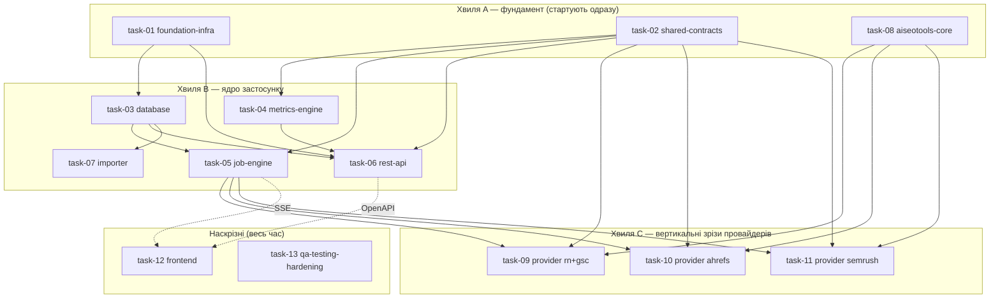

# Декомпозиція проєкту — робочі пакети для паралельних агентів

**Джерело істини:** [`../../../PLAN.md`](../../../PLAN.md) (master blueprint).
**Фронтенд-контракт:** [`../../../frontend/AGENTS.md`](../../../frontend/AGENTS.md) (обов'язковий для всієї роботи у `frontend/`).
**Процес роботи:** [`../../../CLAUDE.md`](../../../CLAUDE.md) (як брати таску, як закривати).

Архітектура з `PLAN.md` — це **модульний моноліт** (FastAPI API + один durable worker + SQLite WAL + vanilla-JS фронт), а не мережа окремих сервісів. Тому «мікросервіси» тут = **bounded modules / робочі пакети**: кожен має власні файли, чіткий вхідний/вихідний контракт і може розроблятися окремим агентом паралельно. Межі проведені по швах архітектури (`app/` дерево з §5.2) так, щоб два агенти не редагували один файл.

## Ключова ідея паралельності

Паралельність тримається на **контрактах, зафіксованих наперед** (`task-02`), а не на черговості. Кожен агент кодує проти оголошених типів/інтерфейсів і **не чекає** інших. Файли поділені так, що зони запису не перетинаються (див. «Owned paths» у кожному плані).

## Модель збору даних (матриця «клієнт × сервіс»)

Окремо від паралельності *розробки* є паралельність *збору* в рантаймі (PLAN §9.1/§9.2), яку реалізує `task-05`:

- 4 сервіси (Ahrefs, Semrush, GSC, Reporting Ninja), у кожному заведені наші клієнти;
- **між сервісами — паралельно** (одна доріжка на сервіс), **усередині сервісу — послідовно** (клієнт за клієнтом), бо один persistent browser-профіль/сесія + metered API на сервіс;
- клітинка `(client, provider)` — атомарна одиниця збору/прогресу/retry (`sync_job_providers`, task-03);
- **нуль падінь:** виняток у клітинці ізольований → `failed`, доріжка триває; новий клієнт без інтеграції → `not_configured` (не краш, не нуль); прогрес персистентний і переживає рестарт.

## Хвилі та залежності

- **Хвиля A** (`task-01`, `task-02`, `task-08`) стартує без залежностей — розблоковує всіх.
- **Хвиля B** стартує, щойно є `task-01` (скелет) і `task-02` (контракти); `task-03` потрібен лише скелет.
- **Хвиля C** (провайдери) стартує, коли є `task-02` (контракт adapter) і `task-08` (namespace у AISeoTools). Кожен провайдер — окремий агент.
- **Наскрізні** `task-12` (фронт) і `task-13` (QA/hardening) працюють паралельно з першого дня на фікстурах і синхронізуються по OpenAPI/SSE, коли ті готові.
- **Хвиля E (v2, таски 14–19)** — розширення після MVP (PLAN §21). Критичний шлях: **`task-16` (розмірні дані GSC) стартує першим**, бо без нього неможливі ні алерти (17), ні таби аналітики (18). Паралельно й без залежностей стартують `task-14` (періоди) і — у частині інлайн-дат — `task-19`. `task-18` замикає хвилю, бо споживає всі чотири бекенд-таски.

> Агент **не бере** таску, доки її `Depends on` не лежать у [`../done/`](../done/). Порядок у межах хвилі — довільний.

## Каталог тасок

| # | Файл | Пакет | Хвиля | Depends on | Головні owned paths |
|---|---|---|---|---|---|
| 01 | ✅ [task-01-foundation-infra.md](../done/task-01-foundation-infra.md) | Скелет, config, Docker/Compose, CI | A | — | `app/main.py`, `app/core/`, `pyproject.toml`, `Dockerfile`, `compose.yaml`, `app/api/health.py` |
| 02 | ✅ [task-02-shared-contracts.md](../done/task-02-shared-contracts.md) | Integration contract + schemas + DTO | A | — | `app/integrations/contract.py`, `app/integrations/registry.py`, `app/schemas/` |
| 03 | ✅ [task-03-database.md](../done/task-03-database.md) | ORM, міграції, репозиторії | B | 01 | `app/db/`, `migrations/`, `alembic.ini` |
| 04 | ✅ [task-04-metrics-engine.md](../done/task-04-metrics-engine.md) | Періоди, catalog, normalize, quality | B | 02 | `app/metrics/` |
| 05 | ✅ [task-05-job-engine.md](../done/task-05-job-engine.md) | Worker, черга, lease/recovery, events, SSE | B | 02, 03 | `app/jobs/`, fake adapter |
| 06 | ✅ [task-06-rest-api.md](../done/task-06-rest-api.md) | FastAPI роутери + OpenAPI | B | 01, 02, 03, 04 | `app/api/dashboard.py`, `app/api/clients.py`, `app/api/jobs.py` |
| 07 | ✅ [task-07-importer.md](../done/task-07-importer.md) | Імпорт історії з AISeoTools + CLI | B | 03, 04 | `app/importers/`, `app/cli.py` |
| 08 | ✅ [task-08-aiseotools-core.md](../done/task-08-aiseotools-core.md) | Additive namespace у AISeoTools (core) | A | — | `AISeoTools/seo_audit/dashboard/{events,models,config}.py` |
| 09 | ✅ [task-09-provider-reporting-ninja-gsc.md](../done/task-09-provider-reporting-ninja-gsc.md) | RN/GA4 + GSC вертикальний зріз | C | 02, 08, 05 | `AISeoTools/.../dashboard/{reporting_ninja,gsc}.py`, `app/integrations/{reporting_ninja,gsc}.py` |
| 10 | ✅ [task-10-provider-ahrefs.md](../done/task-10-provider-ahrefs.md) | Ahrefs Site Audit зріз | C | 02, 08, 05 | `AISeoTools/.../dashboard/ahrefs.py`, `app/integrations/ahrefs.py` |
| 11 | ✅ [task-11-provider-semrush.md](../done/task-11-provider-semrush.md) | Semrush зріз | C | 02, 08, 05 | `AISeoTools/.../dashboard/semrush.py`, `app/integrations/semrush.py` |
| 12 | ✅ [task-12-frontend.md](../done/task-12-frontend.md) | Vanilla-JS dashboard | D | 06 (OpenAPI), 05 (SSE) | `frontend/` (крім `AGENTS.md`) |
| 13 | ✅ [task-13-qa-testing-hardening.md](../done/task-13-qa-testing-hardening.md) | Тести, e2e, live smoke, hardening, деплой | D | усі | `tests/`, `scripts/backup*`, `docs/runbook.md` |

> Хвилі **E** (14–19) і **F** (20–22) мають власні таблиці нижче.

## Хвиля F — auth flow (сесії браузера)

Викликана реальним інцидентом: Semrush показувався як «немає даних», хоча насправді протухла browser-сесія. Послідовна: **20 → 21 → 22** (кожна споживає попередню). Разом вони закривають флоу «запуск збору → перевірка сесій → статус → «Увійти» → авто-продовження».

| # | Файл | Пакет | Depends on | Головні owned paths |
|---|---|---|---|---|
| 20 | ✅ [task-20-browser-session-bridge.md](../done/task-20-browser-session-bridge.md) | Міст до теплого Chrome, liveness, тригер логіну | — | `app/integrations/browser_session.py`, `compose.yaml`, AISeoTools `browser/warm.py` |
| 21 | ✅ [task-21-session-preflight-and-auth-pause.md](../done/task-21-session-preflight-and-auth-pause.md) | Preflight сесій, `auth_required`, пауза/резюм доріжки | 20 | `app/jobs/{lane,dispatcher,runner,recovery}.py`, `app/schemas/enums.py` |
| 22 | [task-22-sync-modal-auth-ux.md](task-22-sync-modal-auth-ux.md) | Попап: стадія сесій, статуси, кнопка «Увійти» | 20, 21 | `frontend/js/sync-modal.js`, `session-status.js` |
| 23 | ✅ [task-23-session-preflight-sse-events.md](../done/task-23-session-preflight-sse-events.md) | Події статусу клітинки в SSE (фікс зависання «Перевірки сесій») | 05, 20, 21, 22 | `app/jobs/{events,runner,lane,control}.py`, `frontend/js/sync-modal.js` |

> **task-21 закрита:** новий нетерміналний `CellStatus.awaiting_auth` (адитивно) — доріжка паузиться на ньому замість провалу, `check_session` (task-20) викликається один раз на провайдера (мемоізація в `lane.py`), profile-lock/lease звільняються самі собою (лише `status == running` тримає їх), таймаут паузи закриває весь `queued`-бэклог провайдера як `failed`/`auth_required`. `app/api/dashboard.py`/`app/api/providers.py` тепер читають стан з *останньої спроби*, а не лише зі snapshot-quality, і лишають останні успішні дані видимими поруч із бейджем. Торкнулась двох файлів поза owned paths (задокументовано, не мовчки): `app/db/repositories/cells.py` (два нових read-методи, той самий патерн, що й наявні «Added by task-05/06» секції) і `app/jobs/worker.py` (одна проводка `check_session=` у `Dispatcher(...)`, інакше фіча не активна в реальному воркері). `tests/unit/schemas/test_enums.py`'s вичерпний набір `CellStatus` доповнено — це очікуваний наслідок контрактної зміни. Job-level `JobStatus` не отримав «paused»-значення (task-05 зона не займали) — косметичний follow-up для task-22. Деталі — Completion report таски.

## Хвиля E — v2 (після MVP, PLAN §21)

Розширення поверх закритого MVP. Стартують, коли їхні `Depends on` лежать у [`../done/`](../done/).

| # | Файл | Пакет | Depends on | Головні owned paths |
|---|---|---|---|---|
| 14 | ✅ [task-14-period-engine-v2.md](../done/task-14-period-engine-v2.md) | Квартал/рік/кастом + агрегація збереженої історії | — (розширює 02/04) | `app/metrics/periods.py`, `app/metrics/aggregate.py`, `PeriodKind`, `CoverageDTO` |
| 15 | ✅ [task-15-health-score-and-sorting.md](../done/task-15-health-score-and-sorting.md) | Health % клієнта + сортування дашборду | 14 (для розширених періодів) | `app/metrics/health.py`, `app/api/dashboard.py` |
| 16 | ✅ [task-16-gsc-dimensional-data.md](../done/task-16-gsc-dimensional-data.md) | Розмірні дані GSC (сторінки/запити) | 14 | `gsc_dimension_metrics`, `DimensionRepository`, `app/api/analytics.py`, `collect_gsc_dimensions`/`collect_dimensions` |
| 17 | ✅ [task-17-alerts-engine.md](../done/task-17-alerts-engine.md) | Алерти: просідання та зростання | 16 | `app/metrics/alerts.py`, `app/api/alerts.py` |
| 18 | ✅ [task-18-client-analytics-page.md](../done/task-18-client-analytics-page.md) | Сторінка клієнта (§21.6) | 14, 16, 17 | `frontend/`, роутер сторінки клієнта |
| 19 | ✅ [task-19-dashboard-card-fixes.md](../done/task-19-dashboard-card-fixes.md) | Картка дашборду: health, sort-контрол | 15 | `frontend/` |
| 24 | ✅ [task-24-card-health-trend-blocks.md](../done/task-24-card-health-trend-blocks.md) | Тренд health на картці: стрілка WoW + денний спарклайн | 15, 19 | `client_health_daily`, `app/db/repositories/health.py`, `app/api/dashboard.py`, `frontend/js/client-card.js` |

> **task-14 закрита:** `PeriodKind` тепер `week | month | quarter | year | custom` (адитивно), з'явився `CoverageDTO` і `aggregate_metrics(...)`. Контрактні деталі — у Completion report таски.

> **task-15 закрита:** `ClientCardDTO` отримав `health` (`ClientHealthDTO`: `value | None`, `coverage_contributing`, `coverage_configured`); `GET /api/v1/dashboard` отримав `sort=` (default `quality`). `MetricSpec` отримав `health_weight: float = 1.0` (адитивно, task-04 зона, рівні ваги на старті). Контрактні деталі — у Completion report таски.

> **task-16 закрита:** нова таблиця `gsc_dimension_metrics` (immutable, top-N + залишок «інше», `quality`/`rank` на рядок; один `ProviderSnapshot` = один період), `DimensionRepository` (`bulk_insert`/`for_period`/`top_pages`/`top_queries`/`for_two_periods`/`purge_older_than`), `GET /api/v1/clients/{id}/analytics/{pages,queries}`. AISeoTools отримала `collect_gsc_dimensions()` (адитивно, `seo_audit/dashboard/gsc.py`); `GscAdapter.collect_dimensions()` — новий метод поза `ProviderAdapter`-протоколом, **ще не підключений** до `app/jobs`-конвеєра (task-05 зона) — task-17/18 читають уже збережені рядки через репозиторій, але живий collection-trigger лишається follow-up. Контрактні деталі — у Completion report таски.

> **task-17 закрита:** `app/metrics/alerts.py` — чиста `detect_alerts(pages_current, pages_previous, thresholds) -> AlertsResult(declining, rising, new, skipped_reason)`, decoupled від ORM через `DimensionRow` (як `StoredMetricValue` у task-14). `GET /api/v1/clients/{id}/alerts?period=…&dimension=page|query` (`app/api/alerts.py`) читає обидва боки через `DimensionRepository.for_two_periods`. Пороги — `Settings.alert_min_relative_change_pct/alert_min_base_impressions/alert_min_base_clicks/alert_top_n_per_group`. Живий збір розмірних даних досі не підключено до `app/jobs` (успадкований follow-up task-16) — ендпоінт чесно повертає `skipped_reason="missing_period_data"`, доки дані не з'являться. Контрактні деталі — у Completion report таски.
>
> **task-18 закрита:** сторінка клієнта на hash-маршруті `#/client/{id}` (`frontend/js/router.js` тепер єдина точка входу в `index.html`, динамічно вантажить `dashboard.js` або `client-page.js`); розширені періоди, таби «Сторінки»/«Запити» з current/previous/дельтою й `truncated`, блок алертів, графік Chart.js з accessible-резюме; увесь стан у URL. `app.metrics.aggregate`/`CoverageDTO` (успадкований TODO з task-14) **досі не підключені** до жодного ендпоінта — розширені періоди чесно показують точні дати й попереджають, що агрегація покриття не підключена, замість вигаданого відсотка; підключення вимагає нового ендпоінта в зоні task-06. `frontend/js/api.js` отримав 3 нові функції (`getClientAnalytics`/`getClientAlerts`/`getClientAnalyticsChart`), адитивно. Контрактні деталі — у Completion report таски.
>
> **task-13 закрита:** з'явився спільний harness (`tests/harness/**` + `tests/conftest.py`) — бери `temp_db`, `api_client`, `seed_client`, `fake_adapters`, `running_worker` замість власного склеювання БД/worker-а. Наскрізні набори: `tests/integration/**`, `tests/contract/**`, `tests/live/**` (останні пропускаються без `--live`). Стан MVP DoD — [`docs/dod-mvp.md`](../../../docs/dod-mvp.md).
>
> **task-19 закрита (done-with-followups):** інлайн-дати (range vs snapshot), health-чіп на картці, sort-контрол зі станом в URL, українська копія в межах owned paths. Торкнулась спільних read-only файлів адитивно (задокументовано, не мовчки): `formatters.js` (переклад лейблів + `en-US → uk-UA` для дат, новий експорт `formatDate()`), `api.js` (`getDashboard({sort})`), `store.js` (`sort` у стані/URL). `index.html` і `sync-modal.js` лишаються англійською — поза owned paths, follow-up. Деталі — Completion report таски.

> **task-23 закрита:** SSE-потік віддає лише рядки `job_events`, а фронт перечитує статуси клітинок тільки на подію — тож клітинка, що вирішилась на преflight (`awaiting_auth`/`not_configured`/`skipped`), не давала жодної події й модалка вічно висіла на «Перевіряємо…». З'явився `append_cell_status_event()` (пишеться в тій самій транзакції, що й зміна статусу) у всіх раніше «німих» переходах. Побічно полагоджено: скасування припаркованої доріжки, queued-cancel дефект task-13 (strict `xfail` знято), `aggregate_status` для повністю скасованого запуску. Деталі — Completion report таски.

> **task-24 закрита:** `ClientHealthDTO` отримав `value_previous`/`delta_pct`/`history` (адитивно) + вкладений `HealthPointDTO`; нова таблиця `client_health_daily` (upsert на `(client_id, day)`, **не** immutable) і `HealthHistoryRepository`. `_build_provider_summary` отримав опційний `as_of`, на якому тримається `yovth-report backfill-health-history`. Наявний спарклайн картки малював інший ряд (Ahrefs `health_score`) і був зламаний проти живого API через розбіжність ключа — замінений на композитний health без зайвого запиту на картку. Контрактні знімки перегенеровано. Деталі — Completion report таски.

## Хвиля G — Technical SEO Audit (machine-only)

Розширення після MVP: детермінований технічний аудит сайту клієнта на базі TechAudit-краулера AISeoTools, **без ШІ**. Категорії→знахідки на сторінці клієнта, повторний запуск, перепровірка окремої знахідки, експорт у XLSX (лише машинні [П]-дані). Зведений в **один** таск-док (рішення користувача); межі під-тасок проведені в «Owned paths» самого файлу.

| # | Файл | Пакет | Depends on | Головні owned paths |
|---|---|---|---|---|
| 25 | ✅ [task-25-technical-seo-audit.md](../done/task-25-technical-seo-audit.md) | Machine-only tech audit: AISeoTools `dashboard/tech_audit.py` + `Provider.tech_audit` + adapter/API + `audit-panel.js` + XLSX-export | — (адитивно розширює 02/03/04/05/06/12/18) | `seo_audit/dashboard/tech_audit.py`, `app/integrations/tech_audit.py`, `app/api/tech_audit.py`, `frontend/js/audit-panel.js` (+ адитивні дотики enums/api/models/migrations/client-page) |

> **Рішення (2026-07-23):** Фаза 1 — **без рендеру** (краул+детект на httpx, без Chromium); реюз `Provider`+`SyncJob`+`AnalyticsDatasetRow` (макс. реюз джоб-рушія/SSE/immutable snapshot). Рендер+CWV (`SLOW_PAGES`) — окрема майбутня task-29 (Chromium в образ). `Provider.tech_audit` **не** метрик-провайдер: гардиться поза дашбордом/health/каталогом і поза рутинним синком.

> **task-25 закрита:** нової таблиці під знахідки/recheck **не знадобилось** — категорії/знахідки/recheck їдуть у наявній `AnalyticsDatasetRow` під ключами `tech_categories`/`tech_findings`/`tech_recheck` (recheck append-only, читається як найсвіжіший рядок на `dimension_value` через новий `AnalyticsDatasetRepository.latest_rows_by_dimension`). Enum-міграції теж не знадобилось: `sa.Enum` тут без `create_constraint`, тож CHECK-констрейнтів на provider-колонках немає. Єдина міграція — `d47b9c1e5a02` (`sync_jobs.params_json`), бо адаптер за контрактом не має доступу до БД, а targeted-recheck потребує per-job параметрів (`CollectionContext.job_mode`/`job_params`, адитивно). З'явився **`METRIC_PROVIDERS`** — усі місця, що ітерували `tuple(Provider)` заради метрик (`api/jobs.py` розгортання `providers="all"`, `api/dashboard.py`, `api/providers.py`), переведені на нього; dispatcher свідомо лишився на повному enum, щоб піднімати доріжку `lane-tech_audit`. Деталі — Completion report таски.

## Хвиля H — Client Blogs (machine-only)

Розширення після MVP: детермінований інвентар блогу клієнта на базі blog-краулера AISeoTools (`discover_urls` + `blog_strategy`), **без ШІ**. Блок «Blogs» угорі сторінки клієнта (кількість + «Refresh data» + посилання), окрема сторінка зі списком постів (Title/Description/Word count/Link/Published date) і експорт у **CSV та XLSX**. Взірець наскрізь — **task-25** (той самий шаблон «machine-only провайдер поза рутинним синком»).

| # | Файл | Пакет | Depends on | Головні owned paths |
|---|---|---|---|---|
| 26 | ✅ [task-26-client-blogs.md](../done/task-26-client-blogs.md) | Machine-only blogs inventory: AISeoTools `dashboard/blogs.py` + `Provider.blogs` + adapter/API + `blogs-page.js` + CSV/XLSX-export | — (адитивно розширює 02/03/05/06/12/18/25) | `seo_audit/dashboard/blogs.py`, `app/integrations/blogs.py`, `app/api/blogs.py`, `frontend/js/blogs-page.js` (+ адитивні дотики enums/api/router/client-page) |

> **Рішення (2026-07-24):** реюз рушія task-25 — `Provider.blogs` **поза** `METRIC_PROVIDERS` і поза рутинним синком; пости в наявній `AnalyticsDatasetRow` (`blog_posts`/`blog_summary`), **без нових таблиць і без міграцій**. Краул стартує з `Client.domain` (автокласифікація блог-постів через `build_inventory`+`classify_role`, override `blog_url` опційний). Експорт **self-contained у застосунку** (`openpyxl` уже пряма залежність, task-07) — CSV+XLSX працюють навіть без AISeoTools.

> **task-26 закрита:** нової таблиці/міграції не знадобилось (як і в task-25) — пости й summary їдуть у наявній `AnalyticsDatasetRow` (`blog_posts`/`blog_summary`). `build_inventory()` в AISeoTools отримав 3 адитивні keyword-only параметри (`max_urls`/`on_page`/`should_stop`) для bound/progress/cooperative-cancel — точковий диф у чужому файлі, задокументований у Completion report. `runner.py`'s вузький `is_tech_audit` перейменовано на `is_self_configured` (охоплює і `tech_audit`, і `blogs`, той самий гейт-виняток). Виявлений і виправлений mobile-баг: `#blogs-page-root` (flex-column) давав горизонтальний page-scroll на 390px попри коректно клипований `.table-scroll` — точковий `overflow-x: hidden` фікс, першопричина відмінності від `#ahrefs-page-root` не з'ясована до кінця. Під час виконання виявлено паралельну незакомічену роботу іншої сесії (batch «Run audits», торкається `app/api/dashboard.py`/`app/api/tech_audit.py`/новий `app/db/repositories/tech_audits.py`) з окремим cache-buster — нормалізовано під єдиний `?v=`, чужі логічні зміни не займані. Деталі — Completion report таски.

## Хвиля I — Tools page + Image Alt Text

Нова верхньорівнева сторінка **Tools** (хаб інструментів: блоки + пошук) і перший інструмент — **Image Alt Text**: таблиця аудиту (CSV/XLSX) → детермінований пошуковий фрагмент для медіатеки WordPress → операторська таблиця з «відкрити/копіювати» → прогрес по кожній картинці в БД → перевірка «alt уже на сторінці?» **без кешу**.

| # | Файл | Пакет | Depends on | Головні owned paths |
|---|---|---|---|---|
| 27 | ✅ [task-27-tools-page-and-alt-text-tool.md](../done/task-27-tools-page-and-alt-text-tool.md) | Сторінка Tools + інструмент Image Alt Text (upload/parse → search key → copy-прогрес → no-cache verify → export) | — (адитивно розширює 02/03/06/12/18) | `app/tools/**`, `app/api/{tools,tools_alt_text}.py`, `app/db/repositories/alt_text.py`, `app/schemas/tools.py`, `frontend/js/{tools-page,alt-text-tool}.js`, `frontend/css/tools.css` (+ адитивні дотики `models.py`/`router.js`/`api.js`/`index.html` + одна міграція) |
| 39 | ✅ [task-39-alt-text-wp-media-id.md](../done/task-39-alt-text-wp-media-id.md) | Точний WordPress `attachment ID` для рядка звіту (REST `wp/v2/media` + матч uploads-шляху), окрема колонка Media ID і кнопка **Find** (copy alt + відкрити `upload.php?item=<ID>`), пакетний resolve по 50 | **27** ✅, **29** ✅ (`http_safety`) | `app/tools/alt_text/wp_rest.py` (новий), `app/api/tools_alt_text.py`, `app/db/repositories/alt_text.py`, `frontend/js/alt-text-tool.js`, `frontend/css/tools.css`, `migrations/versions/fbafa34716a9_alt_text_wp_media.py` (+ адитивні дотики `wp_media.py`/`models.py`/`schemas/tools.py`/`api.js`) |

> **Чому task-39:** `search_key` покриває ~80 % рядків; решта — `1.jpg`, `img_0421.jpg`, де пошук у медіатеці віддає
> сотні збігів. Знахідка з core: `WP_REST_Attachments_Controller::prepare_items_query()` вмикає
> `wp_allow_query_attachment_by_filename`, і `WP_Query` шукає по `_wp_attached_file` (`sq1.meta_value LIKE …`) —
> тобто пошук по **повному uploads-шляху** (`2024/03/1.jpg`), який у нас є з URL, дає точний ID навіть для `1.jpg`.
> Далі — `upload.php?item=<ID>&mode=grid`, що відкриває модалку «Attachment details» одразу.
>
> **task-39 закрита (2026-08-14):** реалізовано точно за планом. Живими табличними тестами до інтеграції знайдено й
> закрито власний дефект класифікації: слабкий («filename») тір матчингу спершу порівнював кандидатів лише по
> basename без огляду на директорію — для `1.jpg`-подібних назв це давало хибний `resolved` на першому-ліпшому
> файлі з тим самим коротким іменем в іншій директорії (та сама проблема, яку задача мала розв'язати). Виправлено:
> слабкий тір спрацьовує лише коли `media_details.file` взагалі відсутній у відповіді REST. Скріншот e2e-прогону
> також показав, що `Open in WP` з `button--primary` в кожному вирішеному рядку дає важку оранжеву смугу — замінено
> на `button--quiet` (frontend/AGENTS.md §2, «один контрольований сигнал»). Відомий, задокументований ліміт:
> `wp_root` для інсталяцій у підкаталозі (`site.com/blog/`) хибно спрощується до кореня домену (спільна причина зі
> старою WebP-Express-евристикою в `wp_media.py`, поза обсягом цієї задачі) — `TODO(task-40)`. 1287 unit/API/repo
> тестів зелені, e2e-скрипт `tools-alt-text.cjs` доповнено секцією на нову колонку. Деталі — Completion report таски.

> **task-27 закрита:** інструмент **не** провайдер і **не** job (парсинг — мілісекунди, перевірка — один HTTP-запит), тож `Provider` enum і `app/jobs/**` не чіпаються; на відміну від task-25/26, тут **потрібні 2 нові таблиці** (`alt_text_reports`/`alt_text_items`), бо дані мутабельні за задумом (статус прогресу, результат перевірки) і не мають провайдера/періоду — в immutable `AnalyticsDatasetRow` вони не вміщаються. **Без нових залежностей і без AISeoTools:** XLSX — наявний `openpyxl`, CSV — stdlib `csv`, перевірка — stdlib `urllib.request` + `html.parser` (`httpx`/`lxml`/`pandas` в образі лише транзитивні через optional-групу `local`, тому на них не спираємось). Legacy `.xls` — свідомо поза обсягом (`415` з дією замість тихої поломки; підтверджено користувачем — експорт іде з Google Sheets). CSP отримав `img-src 'self' data: https: http:` (зона task-01, адитивно): без цього прев'ю картинок клієнта блокувалися повністю; скрипти/стилі/fetch лишились під `'self'`. Живі прогони на реальному Ahrefs-експорті виявили ще три речі, які закриті тут же: об'єднані клітинки URL (939 із 997 рядків інакше йшли у `skipped`), кілька сторінок використання в одній клітинці (тепер список + перевірка обходить до 3 сторінок) і не-ASCII назва звіту, що валила експорт у 500. Деталі — Completion report таски.

## Хвиля J — Portfolio Trends (лінія = клієнт)

Нова верхньорівнева сторінка `#/trends`: один графік на весь портфель, де кожна **лінія — клієнт**, а точки — GSC
Clicks/Impressions і GA4 Sessions/Users по днях/тижнях/місяцях. Дані вже збираються (`gsc_daily`/`ga4_daily` в
`analytics_dataset_rows`) — нових провайдерів і змін в AISeoTools не потрібно, лише агрегація вже наявної денної історії +
разовий бекфіл через наявний `custom`-період.

| # | Файл | Пакет | Depends on | Головні owned paths |
|---|---|---|---|---|
| 28 | ✅ [task-28-portfolio-trends-page.md](../done/task-28-portfolio-trends-page.md) | Portfolio Trends: `app/metrics/portfolio.py` + `GET /analytics/portfolio-series` + `trends-page.js`/`trends-chart.js` + `backfill-daily-history` CLI | — (адитивно розширює 02/03/04/06/07/09/12) | `app/api/portfolio.py`, `app/metrics/portfolio.py`, `frontend/js/{trends-page,trends-chart}.js`, `frontend/css/trends.css` (+ адитивні дотики `schemas/api.py`/`db/repositories/analytics_datasets.py`/`cli.py`/`index.html`/`router.js`/`api.js`) |
| 44 | ✅ [task-44-trends-conversion-metrics.md](../done/task-44-trends-conversion-metrics.md) | Метрики конверсій у Trends: `Total` (уже зібраний — історія з 2024), `Organic`/`Direct` (новий датасет `ga4_daily_channels` на `firstUserDefaultChannelGroup` + backfill CLI), прапорець `additive` проти сумування неадитивних метрик, 4 фікси: нульова база в `Indexed`, `Δ` при нулі, `no_data` ≠ «not connected», група METRIC на 7 кнопок | **28** ✅, **09** ✅, **30** ✅ (узгоджено з **42**) | `app/metrics/portfolio.py`, `app/integrations/reporting_ninja.py`, `frontend/js/{trends-page,trends-chart}.js`, `frontend/css/trends.css` (+ адитивні дотики `schemas/api.py`/`cli.py`/`app/api/portfolio.py` — один рядок кожен) |

> **task-44 закрита (2026-08-17):** реалізовано за планом, з одним уточненням — `app/api/portfolio.py` **довелось** доторкнутись (один рядок `additive=spec.additive`), бо DTO конструюється по іменованих полях і той самий прецедент уже стався для `lag_days` у task-30; початкове формулювання «не змінюється взагалі» було неточним. Живий гейт §6 пройдено повністю: `backfill-ga4-channels --days 400` на реальному портфелі (12 клієнтів, 3940 нових рядків, ідемпотентний повторний прогін), крос-перевірка з клієнтським звітом дала рівно **654 / 391 / 1099** (EFFYS, липень 2026), а `ALPHA`/`GOREPORT`/`LAXTON` тепер показані в живому Trends як `NO DATA YET`, не `NOT CONNECTED`. Деталі — Completion report таски.

> **Рішення (2026-07-27):** реюз даних, які вже пишуть task-09 (GSC/GA4 daily) — жодної нової таблиці, жодної зміни в
> `/home/elon/dev/seo/AISeoTools`. `null` (клієнт без даних цього дня) ніколи не стає `0`; частковий бакет і
> "provisional"-хвіст (GSC/GA4 lag) позначаються окремо й не тягнуть дельту. Кольори — 8 категоріальних слотів,
> валідовані `dataviz`-скриптом під `#1e1e1e`; 9-й клієнт не отримує згенерований колір — режим `All clients`
> (small multiples) замість каші з ліній. Одна вісь Y (портфель порівнюється або в тих самих одиницях, або через
> режим `Indexed`, ніколи через другу шкалу).
>
> **task-28 закрита:** усі 4 ряди (`gsc_clicks`/`gsc_impressions`/`rn_sessions`/`rn_users`) працюють на живому
> `daily_series()` (новий метод `AnalyticsDatasetRepository`, той самий патерн «найсвіжіший рядок на `(client, day)`
> через усі знімки», що й `latest_rows_by_dimension`); `rn_sessions` **не** в `CATALOG` (жоден адаптер не пише таку
> `MetricValue` — додавання намалювало б порожній рядок на кожній картці), решта тягнуть
> `label`/`unit`/`better_direction` з `CATALOG`, щоб назва не розійшлася з карткою. CLI `backfill-daily-history`
> ставить джоб з `mode="force_refresh"` — без цього freshness-гейт (`app/jobs/runner.py`) мовчки пропускає клітинку
> з будь-яким недавнім snapshot незалежно від запитаного періоду. Живий браузерний smoke (playwright-core проти
> Playwright-кешованого Chromium) на 4 фікстурах спіймав 2 реальні баги до здачі: інлайновий `style=` у таблиці
> порушував CSP (`default-src 'self'`, немає `unsafe-inline`) — замінено на CSS-клас; спарклайн-канвас у
> small-multiples без `position: relative`/`width: 100%` змушував Chart.js падати на дефолтні 300px і ховати
> delta-чіп за межами картки — виправлено за взірцем наявного `.chart-wrap`. **Два свідомі відхилення від плану**
> (обсяг): §7-діалог бекфілу з UI не побудований (порожній стан друкує готову CLI-команду замість нового модального
> вікна — той самий прецедент, що й `backfill-health-history`/task-24, теж CLI-only); ручний чекбокс-пікер клієнтів
> (§6.2) замінений на детермінований авто-кап «топ-8 за сумою вікна» + режим `All clients` без ліміту. Контрактні
> зміни суто адитивні: новий ендпоінт + 6 DTO + `daily_series()` + одна CLI-підкоманда; OpenAPI-снапшот
> перегенеровано (+391 рядок, 0 видалень). 807 тестів (807 passed, 1 skipped), `ruff`/`mypy` чисті — усе в Docker.
> Деталі — Completion report таски.

## Хвиля K — Redirect Checker (другий інструмент у хабі Tools)

Другий блок на `#/tools`: оператор вставляє посилання (одне або список) і бачить **повний ланцюжок редіректів підряд,
хоп за хопом** — статус, `Location`, час, що змінилося на кроці (схема/хост/`www`/слеш/query), вердикт по ланцюжку й
прапорці-сигнали (зайвий хоп, тимчасовий редірект, петля, `https→http`, обрив у 404/5xx, canonical ≠ фінальний URL).
Реюз шаблону task-27: не провайдер і не job, нуль нових залежностей, без AISeoTools (Playwright-трейсер там —
лише референс, бо тягне Chromium за bind-mount-ом).

| # | Файл | Пакет | Depends on | Головні owned paths |
|---|---|---|---|---|
| 29 | ✅ [task-29-redirect-checker-tool.md](../done/task-29-redirect-checker-tool.md) | Redirect Checker: stdlib-трейсер хоп-за-хопом + `POST /tools/redirects/trace` + перевірки з історією в БД + `redirect-tool.js` + CSV/XLSX-експорт | **27** ✅ (адитивно розширює 03/12) | `app/tools/http_safety.py`, `app/tools/redirects/**`, `app/api/tools_redirects.py`, `app/db/repositories/redirects.py`, `frontend/js/redirect-tool.js` (+ адитивні дотики `api/tools.py`/`schemas/tools.py`/`models.py`/`tools-page.js`/`api.js`/`tools.css` + одна міграція) |

> **Рішення (2026-07-27):** редіректи трасуються **вручну** (opener без `HTTPRedirectHandler` + passthrough
> `HTTPErrorProcessor`), бо стандартний клієнт ховає проміжні хопи; метод — GET, не HEAD (частина серверів на HEAD
> відповідає інакше і трейс брехав би), тіло читається лише для фінального хопа. Список URL проганяється
> **frontend-driven** циклом по `POST /checks/{id}/targets/{tid}/run` (той самий патерн, що per-row «Verify alt»), а не
> durable-worker-ом — інакше довелося б лізти в закриту зону task-05 заради синхронного інструмента; прогрес живе в БД
> і переживає F5. Politeness-гард (1 запит на хост, 250 мс) — **на сервері**. SSRF-гард застосовується до **кожного**
> хопа, включно з `Location` і `meta refresh`; для цього спільний HTTP-safety шар витягується з
> `app/tools/alt_text/verify.py` у `app/tools/http_safety.py` (поведінка й публічні імена без змін).
> JS-редіректи й бот-блоки — окремі чесні стани (`possible_js_redirect`/`blocked`), Playwright-режим — follow-up.
>
> **task-29 закрита:** інструмент доданий у хаб **одним записом** у реєстрі `app/api/tools.py` + одним рядком у
> `TOOL_MODULES` — маршрут `#/tools/<tool>/<id>` і навігація з task-27 не змінювались, що й було критерієм «каталог,
> що росте». Дві нові таблиці `redirect_checks`/`redirect_check_targets` (міграція `a3f81c62d5b4`), хопи — у
> `chain_json` (ланцюжок завжди читається цілком). Спільний SSRF/UA/no-cache шар витягнутий у
> `app/tools/http_safety.py`; `alt_text/verify.py` реекспортує старі імена, тож усі тести task-27 зелені без правок.
> `claim_target` — атомарний UPDATE (подвійний клік → `409 target_running`), politeness-гард (1 запит/хост, 250 мс) —
> на сервері. Живі прогони на github.com/bit.ly/theyovth.com + SSRF-цілях підтвердили всі вердикти; авто-старт прогону
> при відкритті сторінки прибрано (F5 інакше обстрілював клієнтський сайт без кліку). 997 тестів зелені,
> `ruff`/`mypy` чисті. Деталі — Completion report таски.

## Хвиля L — свіжість даних і паралельний збір

Дві таски одного напряму: **дані мають доганяти «сьогодні» з UI**, і **збір усередині сервісу має йти в 3 доріжки
на одному логіні**. Порядок обов'язковий: 30 дає спільний власник модалки прогресу й «живий прогрес v2», на
якому 31 малює панель доріжок.

Діагноз, що породив хвилю (жива БД, 2026-07-31): останній батч 29.07 `succeeded`, але `gsc_daily`/`ga4_daily`
стоять на **26.07** — бо рутинний sync збирає `week`/`closed`, тобто останній **закритий** тиждень, і денні рядки
за поточний тиждень ніхто не просить. Долити «до вчора» може лише `period_kind=custom` + `force_refresh` — те, що
досі жило тільки в CLI `backfill-daily-history`.

| # | Файл | Пакет | Depends on | Головні owned paths |
|---|---|---|---|---|
| 30 | ✅ [task-30-live-data-refresh.md](../done/task-30-live-data-refresh.md) | «Refresh data» на `#/trends`: rolling-window джоба (`custom` + `force_refresh`), freshness-чип `data through … · N days behind`, спільний `job-progress.js`, живий прогрес v2 (коалесований refetch, no-flicker rerender, ETA) | — (адитивно розширює 03/05/06/09/12/28) | `frontend/js/job-progress.js` (новий), `frontend/js/{sync-modal,sse,trends-page,dashboard}.js`, `app/metrics/portfolio.py`, `app/api/portfolio.py` (+ адитивні поля `schemas/api.py`) |
| 31 | ✅ [task-31-parallel-collection-slots.md](../done/task-31-parallel-collection-slots.md) | Паралельний збір: профільний лок mutex → **семафор** (`capacity`), slot-пул, N потоків на провайдера, один auth-gate на провайдера, адитивний `slot=` в AISeoTools (3 вікна одного теплого Chrome на 1 профілі), панель «Browser lanes» | **30** | `app/jobs/**` (+ нові `auth_gate.py`/`slots.py`), `app/db/repositories/cells.py`, `app/core/config.py`, `app/integrations/{ahrefs,semrush}.py`, `AISeoTools: seo_audit/browser/{profile,session}.py` (+ адитивні `browser_slot`/`slot` через task-02, колонка `slot` через task-03) |
| 32 | ✅ [task-32-live-progress-telemetry.md](../done/task-32-live-progress-telemetry.md) | Живий прогрес: `PhaseTracker` (фазові ваги клітинки + вимірюваний `completed/total`), детальна телеметрія Ahrefs/Reporting Ninja/GSC, CSP-безпечні анімовані смуги, чесний індетермінантний стан, елапс на клітинці, ETA по lane-ах і по-провайдерній медіані, activity log зі SSE | **30**, **31** | `app/integrations/progress.py` (новий), `app/integrations/{ahrefs,reporting_ninja,gsc}.py`, `app/jobs/runner.py` (адитивні emit-и), `frontend/js/{sync-modal,formatters,sse,api}.js`, `frontend/css/app.css` |
| 33 | ✅ [task-33-integration-auto-connect.md](../done/task-33-integration-auto-connect.md) | Auto-connect: «Connect» шукає акаунт провайдера за доменом клієнта замість форми для ручного вписування ID — GSC за доменом, GA4 за назвою (аліас → домен-у-назві → схожість), автозапис лише при рішучому збігу чи явному відриві, звіт із preflight і перехід на «Collect data now» | — (адитивно розширює 02/06/07/12) | `app/integrations/discovery.py` (новий), `app/api/discovery.py` (новий), `app/integrations/aiseotools_sync.py`, `frontend/js/{dashboard,api}.js`, `frontend/index.html`, `frontend/css/app.css` (+ адитивні DTO в `schemas/api.py`) |
| 34 | ✅ [task-34-client-lifecycle-status.md](../done/task-34-client-lifecycle-status.md) | Статус клієнта `active`/`paused` (припинена оплата): колонка `status` + `status_changed_at`/`status_note`, `POST /clients/{id}/status`, `list_collectable()` замість `list_active()` в усіх «all»-розгортаннях (sync, аудити, CLI, portfolio), бейдж-кнопка на картці й на сторінці клієнта, приглушена картка внизу сітки, теги в sync-модалці | — (адитивно розширює 02/03/05/06/07/12/15/25/28) | `app/schemas/enums.py` (+`ClientStatus`), `app/db/models.py`, `migrations/versions/<rev>_client_status.py`, `app/db/repositories/clients.py`, `app/api/{clients,dashboard,jobs,tech_audit,portfolio}.py`, `app/cli.py`, `frontend/js/client-status.js` (новий) + `{client-card,dashboard,client-page,sync-modal,store,api}.js`, `frontend/index.html`, `frontend/css/{app,client-page}.css` |

> **Рішення (2026-07-31):** «оновлення даних» — це **не** новий ендпоінт: наявний `POST /sync-jobs` уже приймає
> `period_kind=custom` + `custom_start/custom_end` + `mode=force_refresh`, тож задача фронтова плюс чесний
> `data_through` в API трендів. Вікно за замовчуванням — **30 днів до вчора** (`today-1`, бо сьогоднішній день у
> джерелі ще пишеться); повторні перетинні вікна безпечні, бо `daily_series` бере найсвіжіший рядок на день.
> «Актуально» ≠ «сьогодні»: GSC фіналізує 3 дні, GA4 — 2, і UI має це показувати, а не приховувати.
>
> **task-30 закрита:** нових ендпоінтів не знадобилось — наявний `POST /sync-jobs` уже приймає `custom` +
> `force_refresh`; єдина серверна зміна — адитивне `PortfolioMetricDTO.lag_days`. `data_through` на бекенді **не**
> додавався: `last_day` уже означає «останній день із даними», решту свіжості рахує фронт. Діалог прогресу став
> спільним синглтоном (`frontend/js/job-progress.js`) — інакше `#/trends` не мав до нього доступу; cache-buster
> уніфіковано, бо два різні `?v=` дали б дві копії модуля модалки (два діалоги, два SSE на одну джобу). Живий
> прогін: 22 клітинки за ~3 хв, `gsc_daily` 26.07 → **29.07**, `ga4_daily` → **30.07**, чип «1 day behind» → «up to
> date». 1006 тестів зелені. Деталі — Completion report таски.
>
> **«3 паралельні браузери, 1 профіль» = 3 ВІКНА одного теплого хостового Chrome**, не 3 процеси: контейнер
> принципово attach-only (`_refuse_launch_when_attach_only`), профіль не змонтований, а три Chrome на одному
> `user-data-dir` неможливі через `SingletonLock`. Серіалізацію тримають **три** шари одночасно (БД-мутекс
> `acquire_profile_lock`, один lane-потік на провайдера, `busy_lock` keyed `{store}.{provider}` в AISeoTools) —
> знімати треба всі три. Завантаження експортів лишаються серіалізованими by design (`download_lock`, бо CDP
> `setDownloadBehavior` — browser-global), тож очікуваний виграш **2–2.5×**, а не 3×: живі числа — semrush 59 с
> середня / 581 с максимум, повний `force_refresh` портфеля 45 хв.
>
> **task-31 закрита:** механіка працює — 3 доріжки, 3 вікна одного профілю, різні CDP `targetId`, нуль перехресних
> ефектів. Виміряно на живому стеку: ті самі 22 клітинки GSC+RN — **180 с → 60 с (×3)**. Але для Ahrefs третя доріжка
> **коштує даних**: усі три детальні експорти впали в таймаут (`partial`), тоді як на двох доріжках обидві клітинки
> `complete` без попереджень — причина структурна (bulk-експорт іде через store-wide `download_lock`). Тому дефолти
> **виміряні, а не на смак**: `ahrefs=2`, `semrush=2`, `gsc`/`reporting_ninja`=3, `tech_audit`/`blogs`=1. Ще один живий
> ефект: три однакові SPA-навігації, стартовані в ту саму мілісекунду, дали 2 з 3 `Page.goto` таймаутів → з'явився
> `lane_start_stagger_seconds=8`. Semrush-якість (`truncated`) збігається з однодоріжковим прогоном 23.07 — це не
> регресія паралельності. 1031 тест зелений. Деталі — Completion report таски.

## Хвиля M — Site Monitor (спостережуваність сайтів клієнтів)

Безперервний нагляд за сайтами: **щогодини** легка перевірка (robots.txt, sitemap, ключові сторінки, DNS),
**що 3 години** — повна (усі URL із sitemap). Кожна версія robots.txt, sitemap, сторінки й DNS-запису
зберігається з часом збору; кожна зміна стає записом зі ступенем серйозності, де `noindex` і втрата
верифікації Google Search Console — максимальний рівень. Порядок обов'язковий: **35 → 36** (UI споживає API двигуна).

| # | Файл | Пакет | Depends on | Головні owned paths |
|---|---|---|---|---|
| 35 | ✅ [task-35-site-monitor-engine.md](../done/task-35-site-monitor-engine.md) | Двигун монітора: fetch/parse/diff/severity, «стан + ланцюг незмінних версій», content-addressed сховище документів, планувальник у worker-процесі, REST API, CLI | **34** | `app/monitor/**`, `app/db/repositories/monitor.py`, `app/api/monitor.py`, `app/schemas/monitor.py`, `migrations/versions/<rev>_site_monitor.py` (+ адитивні дотики `db/models.py`/`core/config.py`/`jobs/worker.py`/`cli.py`) |
| 36 | ✅ [task-36-site-monitor-ui.md](../done/task-36-site-monitor-ui.md) | UI монітора: сторінка `#/monitor`, розділ `#/client/{id}/monitor`, переглядач версій і дифів, червоний бейдж на картці | **35** | `frontend/js/{monitor-page,monitor-client,monitor-diff}.js`, `frontend/css/monitor.css` (+ адитивні дотики `router.js`/`api.js`/`index.html`/`client-page.js`/`client-card.js`/`dashboard.js`/`tools.css`, `app/api/monitor.py`/`app/db/repositories/monitor.py`) |
| 37 | ✅ [task-37-site-monitor-fixes.md](../done/task-37-site-monitor-fixes.md) | Фікси після живої перевірки: 422 на `/monitor/pages` (контракт `sort`), прогрес прогону (зведення ховає `running`), `[object Object]` у помилках, лічильники змін на прогін, повноширинний блок DNS, пагінація стрічки + **живий прохід у e2e** | **35**, **36** | `app/api/monitor.py`, `app/db/repositories/monitor.py`, `app/monitor/runner.py`, `migrations/versions/<rev>_monitor_run_totals.py`, `frontend/js/monitor-client.js`, `frontend/css/monitor.css`, `tests/e2e/frontend/monitor-smoke.cjs` |
| 38 | ✅ [task-38-site-monitor-ux-round2.md](../done/task-38-site-monitor-ux-round2.md) | Вічний скелетон «Check history» (спільний ключ запиту на 4 різні наміри), перевірка окремої сторінки з рядка таблиці, дизайн-раунд 2 (canonical `self`, чіпи статусу, англійська дата, скелетони за формою контенту) | **35**, **36**, **37** | `frontend/js/{api,monitor-client}.js`, `frontend/css/monitor.css`, `app/api/monitor.py`, `app/monitor/runner.py`, `tests/e2e/frontend/monitor-smoke.cjs` |
| 41 | ✅ [task-41-site-monitor-alert-quality.md](../done/task-41-site-monitor-alert-quality.md) | Живий дефект hearwellservices.com: `sitemap_lost` (critical) на разовому фетч-збої замість підтвердженого 404 → новий `sitemap_unavailable` (warning, self-heal); `MonitorSettings.canonical_www` (операторський прапорець www/non-www); `MonitorChange.related_id` нарешті заповнюється — кнопка **View diff** у стрічці змін на `content_changed`/`title_changed`/... | **35**, **36**, **37**, **38** | `app/monitor/{diff,runner,severity}.py`, `app/db/models.py`, `app/db/repositories/monitor.py`, `app/schemas/monitor.py`, `app/api/monitor.py`, `frontend/js/{monitor-client,formatters,api}.js`, `frontend/css/{monitor,client-page}.css`, `migrations/versions/5c3b4a7bda87_monitor_settings_canonical_www.py` |

> **Знайдено живою перевіркою 2026-08-12:** секція «Check history» зависає в скелетоні **назавжди**, бо
> `listMonitorRuns` віддає всім чотирьом викликам один ключ `monitor-runs-${clientId}`, а `request()` трактує ключ
> як «скасуй попередній» — відновлення поллінгу вбиває запит історії, гілка `isAbortError → return` виходить не
> знявши `aria-busy`. Той самий корінь ламає і відновлення поллінгу після F5 (два виклики `Promise.all` вбивають
> один одного). Це **третій** випадок класу «ключ запиту виведений з ресурсу, а не з наміру» — деталі й системний
> фікс у task-38.

> **Знайдено живою перевіркою 2026-08-11 (після здачі task-36):** блок Pages падав з 422 **у кожного клієнта з
> першого відкриття** (фронт шле `sort=-last_checked_at`, API приймає лише беспрефіксні значення, а репозиторій і
> зовсім завжди сортує `desc`), а прогрес прогону не з'являвся ніколи, бо зведення віддає лише **завершені**
> прогони — поллер бачив попередній `succeeded` і глушив себе за 2 секунди. Причина, чому це пройшло приймання
> зеленим: `monitor-smoke.cjs` ганяє **тільки фікстури**, де мережевого запиту немає взагалі, тож розбіжність
> контракту фронт↔API там фізично не проявляється. Деталі й порядок робіт — task-37.

> **Рішення (2026-08-11), підкріплені живим виміром по 14 клієнтах із бази:**
>
> - Монітор — **не** провайдер і **не** `SyncJob`. ~450 прогонів/добу поховали б `sync_jobs` (703 рядки за всю
>   історію) і `job_events`, на який дивиться SSE модалки прогресу; до того ж у монітора немає ні періоду, ні
>   метрик, ні browser-профілю. Тому власний легкий рушій `app/monitor/**` у тому ж worker-процесі, з формою
>   доріжок PLAN §9.1 (між клієнтами паралельно, всередині клієнта послідовно й чемно). `app/jobs/**` не чіпаємо.
> - **Триярусний відбиток** замість «хеш сторінки»: `signals` (вирішує алерти) / `text` (контент) / `raw` (доказ).
>   Вимір: сирий хеш стабільний на 5 із 6 сайтів, а `goreport.com` міняє Cloudflare-нонс `__CF$cv$params` щозапиту —
>   наївне хешування кричало б «змінилось» щогодини.
> - **robots.txt парситься по групах user-agent**, не дифиться текстом: у `exxxoticaexpo.com` `Disallow: /` стоїть
>   для `meta-externalagent`, тоді як `*` відкритий — текстовий діф дав би хибну критику вже сьогодні.
> - **«Стан + версія на зміну»** замість рядка на кожен URL на кожен прогін: 2 850 URL × 8 повних прогонів = 22 800
>   рядків/добу, з яких 99 % — «те саме». Усі версії зберігаються повністю, але обсяг росте зі швидкістю **змін**.
> - **Нуль нових залежностей** (`dnspython` в образі немає, `httpx`/`lxml` є лише транзитивно через optional-групу
>   `local` і відсутні на CI): stdlib + DNS через **DoH** до `dns.google` і `cloudflare-dns.com` — два незалежні
>   резолвери показують те, що бачить світ.
> - Вимірювані рамки: sitemap-и 16…608 URL (≈2 850 разом), медіана сторінки 442 KB / 0,51 с → повний прогін
>   ≈10–12 хв при 4 клієнтах паралельно, ≈1,2 GB трафіку на прогін. Ціна видима в лічильниках кожного прогону.
> - Канали доставки сповіщень (Telegram/email/webhook) — свідомо **поза** хвилею (рішення користувача): v1 — UI.
>   Паузовані клієнти (task-34) з розкладу випадають, але мають тумблер «monitor anyway».
>
> **Уточнення користувача (2026-08-11), уже вшиті в план:** перевіряються **всі** URL із sitemap (продуктової межі
> немає — лише аварійний клапан і кільцевий обхід, щоб хвіст списку не лишався непереверненим); **повний код
> сторінок зберігається** — baseline ≈250 MB gzip, далі новий блоб лише на реальну зміну, безстроково; URL, що зник
> із sitemap, лишається під наглядом **30 днів**; **URL у sitemap зі статусом ≠ 200 — окремий алерт** із трьома
> типами (`3xx`/`4xx`/`5xx`), зведенням `critical` на пороговій частці й живим лічильником `sitemap_health`, видимим
> уже з першого прогону.
>
> **Знахідка, що виправдовує хвилю:** розвідка 2026-08-11 знайшла `<meta name='robots' content='noindex, follow'>`
> на головній **`laxton.se`** — рівно той інцидент, який сьогодні ніхто не бачить. Він же — наскрізний
> приймальний тест обох тасок.

## Хвиля N — Reports (генерація клієнтських звітів)

Сторінка **Report** з історією прогонів і генерацією звітів за довільними наборами періодів: місячний
(6 стандартних періодів), річний (порівняння років), кастомний (до 24 місяців) і порівнятор (той самий
місяць у до 4 різних років). Два незалежні шляхи до **однакової** таблиці: **API** (Reporting Ninja REST,
~2 с на колонку) і **PDF** (реальні файли з кабінету через headless-браузер у контейнері, ~40–70 с на колонку)
з авто-логіном, ретраями, кешем закритих періодів і крос-перевіркою. Порядок обов'язковий: **42 → 43**.

| # | Файл | Пакет | Depends on | Головні owned paths |
|---|---|---|---|---|
| 42 | ✅ [task-42-reports-engine.md](../done/task-42-reports-engine.md) | Двигун звітів: 4 набори періодів, API-джерело з **виправленою атрибуцією**, headless-PDF-експортер з авто-логіном і класифікацією збоїв, парсер PDF, XLSX, крос-перевірка PDF↔API, планувальник у worker-процесі, REST + SSE | **34**, **06** | `app/reports/**`, `app/api/reports.py`, `app/schemas/reports.py`, `app/db/repositories/reports.py`, `migrations/versions/83dac485b9c1_reports_engine_task_42.py` (+ адитивні дотики `db/models.py`/`core/config.py`/`jobs/worker.py`/`cli.py`/`Dockerfile`) |
| 43 | ✅ [task-43-reports-ui.md](../done/task-43-reports-ui.md) | UI звітів: сторінка `#/reports`, майстер запуску (тип → параметри → шлях) з чесною оцінкою часу, живий прогрес по колонках + живі логи (SSE), таблиця з походженням клітинок, інлайн-перегляд PDF і завантаження XLSX | **42** | `frontend/js/{reports-page,reports-wizard,reports-run}.js`, `frontend/css/reports.css`, `tests/e2e/frontend/reports.cjs` (+ адитивні дотики `index.html`/`router.js`/`api.js`/`formatters.js`, точковий адитив `app/api/reports.py`/`app/schemas/reports.py`) |
| 45 | ✅ [task-45-reports-round2.md](../done/task-45-reports-round2.md) | Reports раунд 2 після живої перевірки: прогрес стає **даними** (`report_runs.periods_json` замість реконструкції стану з тексту логів — на API-шляху періоду взагалі не бачили `Running`), бейджі діапазонів дат на колонках періодів, **XLSX для API-прогонів** (`build_xlsx` викликався лише в `_run_pdf` → «No files were saved»), друга таблиця **Historical Data** (місяць · Clicks · Impressions · CTR · Organic Conversions) в UI та XLSX, заборона прив'язати клієнтові **чужий** звіт кабінету, і `None ≠ 0` для GSC-періодів без даних | **42** ✅, **43** ✅ | `app/reports/{runner,api_source,history,xlsx,table}.py`, `app/api/reports.py`, `app/schemas/reports.py`, `migrations/versions/<rev>_report_run_periods.py`, `frontend/js/{reports-run,reports-wizard}.js`, `frontend/css/reports.css` (+ адитивні дотики `db/models.py`/`core/config.py`) |
| 47 | ✅ [task-47-reports-batch-client-pdf.md](../done/task-47-reports-batch-client-pdf.md) | **Масовий місячний звіт**: батч на весь портфель (`report_batches` + `report_runs.batch_id`, тротлінг під ліміт RN 300/хв, матриця прогресу клієнт × період, картка батчу + картка клієнта), **клієнтський документ** (KPI-тайли з дельтами, 4 SVG-графіки динаміки, YOY-блок) і **клієнтський PDF** — один рендерер на екран і на файл (`/runs/{id}/document` → `page.pdf()`), ZIP на батч | **42** ✅, **43** ✅, **45** ✅ | `app/reports/{document,svg_charts,client_pdf,batch}.py`, `app/api/reports.py`, `app/schemas/reports.py`, `migrations/versions/<rev>_report_batches.py`, `frontend/css/report-doc.css`, `frontend/js/reports-batch.js`, доведення **фільтра історії** (стиль контролів до рівня застосунку, пошук по клієнту, завжди видимий `Clear filters`, `Scope` одиночні/батчі) (+ адитивні дотики `reports-{wizard,page,run}.js`/`reports.css`/`db/models.py`/`core/config.py`) |
| 48 | ✅ [task-48-data-accuracy.md](../done/task-48-data-accuracy.md) | **Точність даних PDF↔API**: розслідування завершене — API правильний (44/48 збігів у EFFYS), а прогін-«катастрофа» був порівнянням двох різних клієнтів (SWM прив'язаний до `EFFYS-Internal report`). Закриваємо причини: пошуковий дискаверинг замість зчиту першого екрана таблиці кабінету, аудит і санація прив'язок (SWM-прив'язку знято наживо), вердикт `no_data` замість фальшивих mismatch/match на порожніх періодах, повторюваний `accuracy`-звіт. **done-with-followups:** жива перевірка нового дискаверингу проти кабінету не відбулась — `app.reportingninja.com` був недоступний увесь час виконання | **42** ✅, **43** ✅, **45** ✅ | `app/reports/{ninja_browser,pdf_parse,verify}.py`, `app/api/reports.py`, `app/schemas/reports.py`, `app/cli.py`, `frontend/js/reports-run.js`, `frontend/css/reports.css` |

> **Розслідування 2026-08-18 (жива база + Reporting Ninja API) — читати перед будь-якою роботою над точністю:**
>
> - **API-шлях правильний.** Три повні PDF-прогони EFFYS дали **44 збіги з 48**, причому точні (`6251/6251`, `654/654`,
>   `2528/2528`). Виправлення полів із task-42 працює.
> - **🔴 Прогін, який виглядав як «44 values differ», порівнював двох різних клієнтів.** `SWM.ninja_report_name =
>   "EFFYS-Internal report"`. Живий контрольний запит: API-колонка = **8 з 8** справжніх чисел SWM (1 027 / 372 / 634 /
>   321 / 111 / 204 / 291 / 33 840), PDF-колонка = числа EFFYS. Крос-перевірка не знайшла помилку в даних — вона зловила
>   **хибну прив'язку**. Аудит портфеля: 3 збережені прив'язки, 1 хибна, 11 клієнтів без прив'язки.
> - **Єдина справжня розбіжність EFFYS — семантична:** 4 клітинки `Users`/`Total Conversions` за YOY-періоди, де
>   `pdf=0`, `api=None`. Один і той самий PDF кодує «немає даних» **двома способами**: у «Overall performance» друкує `0`,
>   а в таблиці каналів просто не має рядків (звідти коректний `None`).
> - **Дзеркальний випадок:** `Clicks`/`Impressions` за `Month YOY` були `0` з обох боків → фальшивий `match` на
>   неіснуючому числі. API-бік task-45 уже полагодила (`date`-розмірність), тож **наступний PDF-прогін покаже 8 mismatch
>   замість 4** — гучніше саме тому, що даних стало точніше. Це і закриває task-48.
> - **Механізм хибної прив'язки:** `list_report_names` читає віртуалізовану Vaadin-таблицю **один раз, без скролу й
>   пошуку** → живий зчит дав 32 назви з обривом на `GRP-…`, тобто клієнти після літери G (`HWELL`…`SWM`) у кандидати не
>   потрапляють; а майстер **пре-чекає першого кандидата**. При цьому завантаження працює для будь-якого звіту, бо
>   `_open_report` шукає назву **через пошук** — механізм завантаження вміє те, чого не вміє дискаверинг.
> - **Guard із task-45 має дві дірки:** не лікує вже збережені прив'язки і бере `known_names` із того ж усіченого
>   списку, тож для клієнта після G відхилить **правильну** назву як `report_name_unknown`, а чужу пропустить.
> - **3 з 9 PDF-прогонів упали з інфраструктурних причин, які вже усунено** (ефемерний Chromium у `/tmp`, відсутній
>   `pdftotext`) — сліди задокументовані, переслідувати їх не треба.

> **Нумерація:** `46` зарезервовано під follow-up'и task-44 (`TODO(task-46)`: таб Channels на `firstUserDefaultChannelGroup`
> + бакетний збір `Users` замість сумування денних уніків) — план ще не написаний, номер не перевикористовувати.

> **Розвідка 2026-08-18, живі виміри в контейнері `api` (на чому стоїть task-47):**
>
> - **PDF генерується запеченим Chromium за 0,8 с** і виходить **векторним**: `pdfimages -list` не показує жодного растру,
>   крім самого бренд-фону `ribbon.webp`; `pdffonts` — усі три фірмові шрифти `embedded+subset` (бо woff2 лежать локально);
>   `pdftotext` витягує текст. 117 KB на повну сторінку. Ніяких нових залежностей: ні wkhtmltopdf, ні LaTeX.
> - **🔴 CSP вирішує архітектуру шаблону.** Перший прототип з інлайновим `<style>` і Chart.js у інлайновому `<script>`
>   дав **порожній canvas** і **serif замість фірмових шрифтів** — `default-src 'self'` без `unsafe-inline`. Це третій
>   випадок цього класу в проєкті (після інлайн `style=` у task-28 і `.style.top/left` у task-43). Тому шаблон = зовнішній
>   `report-doc.css` + **inline SVG** графіки, і на це є тест-регресія.
> - **Одна сторінка — вимірюванням, не вгадуванням:** висота `.report-doc__page` читається з DOM і передається в
>   `page.pdf(height=…)` → `Pages: 1`. Це рівно той формат, який агенція вже віддає клієнтам («9.8 × 18.11»).
> - **Нових даних не треба:** 16 тайлів беруться з колонок `monthly`-звіту (This/Last Month, This/Last Quarter + YOY і
>   відсоткові зміни), 4 графіки — з таблиці **Historical Data** (task-45). Один прогін на клієнта дає весь документ.
> - **Ліміт провайдера близько:** батч на 14 клієнтів = **280** запитів проти стелі RN **300/хв** → обов'язковий
>   токен-бакет (`reports_api_max_rpm=240`). Час: API ≈60 с при 3 клієнтах паралельно; `Ninja PDFs` ≈70 хв (браузер
>   серіалізований by design); клієнтські PDF — 11 с на весь портфель.
> - **Колізія назв:** `source=pdf` (вихідні PDF кабінету як доказ) ≠ клієнтський PDF-делівербл. Enum не міняємо,
>   копірайт розводимо: `API` / `Ninja PDFs` для джерела, `Client PDF` для делівербла, новий тип файлу `client_pdf`.

> **Розвідка 2026-08-17, живі виміри з контейнера `api` (усе, на чому стоїть план):**
>
> - **Браузер у Docker — так.** `chromium.launch(headless=True)` у наявному образі працює, авто-логін у Reporting Ninja
>   з `REPORTING_NINJA_EMAIL`/`PASSWORD` проходить, повний цикл «відкрити звіт → Edit template → GA4/GSC popup → PDF»
>   дав валідний **846 KB** PDF, парсер витяг **8/8 метрик**. CDP-міст до хостового Chrome (task-20) звітам **не потрібен**.
> - **🔴 API може збігатися з PDF до останньої цифри.** На EFFYS/липень 2026 нинішній API-шлях AISeoTools розходиться з
>   PDF на organic/direct до **15 %** — але причина не «свіжість API», а вибір полів: `sessionMedium` замість
>   `firstUserDefaultChannelGroup` і тотали як сума по рядках розмірності. З виправленими полями — **8/8 збіг** за
>   **1,9 с** замість 67 с. Тому PDF-шлях перевизначається як **доказ** (файли, які бачить клієнт) + крос-перевірка,
>   а не як «правильніші числа».
> - **Ціна PDF-шляху виміряна:** 41–67 с на колонку (open 5–8 с, дати 24 с, reopen 5 с, завантаження 7–30 с) → місячний
>   звіт 4–7 хв, максимальний кастом на 24 місяці — **17–28 хв**. Звідси кеш закритих періодів (PDF минулого місяця
>   не змінюється ніколи) і скасування як умови придатності режиму, а не як прикраси.
> - **Образу бракує двох речей:** `pdftotext` (немає взагалі) і **вбудованого** Chromium — нинішній лежить у
>   `/tmp/.cache/ms-playwright` (бо `HOME=/tmp`) і зникне при першому `--force-recreate`. Нових Python-залежностей
>   не треба: `playwright` і `openpyxl 3.1.5` в образі вже є.
> - **Назви звітів у кабінеті не вгадуються:** `Client.name` тут уже короткий код (`EFFYS`, `SAPHNY`, `3XE`), і живий
>   список кабінету містить рівно `EFFYS-Internal report`. Назва зберігається в `ClientIntegration.config_json` через
>   дискаверинг, а не здогад — PDF-прогон без неї дає `422` за мілісекунди замість 4 хвилин браузера в нікуди.
> - **GSC є в 11 із 14 клієнтів** (немає в `ALPHA`, `GOREPORT`, `LAXTON`) → `Clicks`/`Impressions` там `None`, **не `0`**.

> **task-42 закрита (2026-08-17):** обидва шляхи перевірені **живо** проти реального кабінету
> Reporting Ninja. API-шлях EFFYS: 6/6 колонок за ~15 с, 8/8 метрик побайтово збіглись із §1.3.
> PDF-шлях EFFYS: 6 реальних PDF, XLSX з усіма 4 аркушами, крос-перевірка обчислена коректно
> (2 старі колонки дають очікуваний `mismatch` — рахунок до налаштування акаунта, `None` проти `0`,
> не дефект). Скасування (15 с), recovery після рестарту worker і повторний запуск = кеш (0
> завантажень) — усі підтверджені живо. П'ять живих дефектів знайдено й виправлено під час гейту
> (SSE-адаптер без `.percent`, відсутній `filename=` на `FileResponse` → `Content-Disposition`
> ніколи не ставився, `_ensure_session` не чекала рендеру SPA → читала неавторизовану сесію як
> залогінену, відсутня подія `reused cached PDF`, і сам блокер §1.5 — `Dockerfile` не мав
> `poppler-utils`/бекованого Chromium, перевірено повним `build && up --force-recreate`). Одна
> знахідка не в моєму обсязі: `LAXTON` **не має жодного PDF-звіту в кабінеті** (16 унікальних
> звітів на 8 клієнтів; LAXTON серед них немає) — PDF-шлях для нього структурно недоступний, доки
> хтось не побудує звіт у Reporting Ninja; API-шлях працює штатно. `report_name_missing` для нього
> повертається за мілісекунди, як і задумано. Контрактні зміни суто адитивні. Деталі — Completion
> report таски.

> **task-43 закрита (2026-08-17):** `#/reports` (історія + фільтри), 3-крокий майстер (усі 4 типи,
> точний превʼю періодів — порт `periods.py` на JS, бо dry-run ендпоінта нема), деталь прогону
> (живий SSE-лог + прогрес по колонках, похідний із самого потоку подій — `ReportRunDTO` не має
> по-періодного стану), фінальна таблиця з крос-перевіркою, файлами й походженням клітинки (inline
> рядок, не floating-попап). Живий гейт на реальному API-стеку зелений (усі стани + один справжній
> прогон). Два живі дефекти впіймано й виправлено під час гейту: (1) CSP блокує будь-який
> `el.style.top/left`/`style=""` — floating-попап походження переписано на inline `<tr>` без жодного
> позиціювання; (2) `GET /runs/{id}/files` 404-в на реальному стеку — контейнер `api` не мав
> `--reload`, і мій новий роут не підхопився без рестарту (`docker compose restart api worker`
> виправило; підказка на майбутнє тим, хто тестує live проти вже піднятого стека). Контрактні зміни
> — суто адитивні, обидві поза `app/api/reports.py`/`app/schemas/reports.py` (task-42, закрита) з
> явним обґрунтуванням у Completion report: `GET /runs/{id}/files` (списку файлів не було жодного
> REST-виходу) і поле `params` на `ReportRunDTO` (без нього Retry не міг відтворити параметри
> нічого, крім `monthly`).

> **task-45 закрита (2026-08-17):** прогрес звіту став **даними** — нова колонка
> `report_runs.periods_json` (одна міграція `a1c58d7e26b4`) заповнюється **вже при постановці в
> чергу**, тож список періодів із реальними датами повний із першої секунди, а `derivePeriodRows()`
> (парсинг тексту логів) видалено цілком. Головна знахідка гейту підтверджена живо: GSC без
> розмірності віддає **рядок нулів** для періоду, де даних немає, тому запити перейшли на
> розмірність `date` — 0 рядків → `None`. На реальному 3XE `Month YOY`/`Quarterly YOY` тепер `—`, а
> не `0`. `build_xlsx` переїхав у спільний хвіст `run()`, тож API-прогін теж дає книгу (живо:
> EFFYS, 3 аркуші). Нова `Historical Data` (12 повних місяців, CTR — формула, `Conversions` =
> Organic через `firstUserDefaultChannelGroup`, **не** `sessionMedium`, як у порті AISeoTools)
> збіглася з основною таблицею до одиниці: липень 2026 = 2 528 / 31 564 / 8,01 % / 654. Прив'язку
> чужого звіту кабінету закрито з трьох боків: `matches`/`others` у відповіді, чекбокс підтвердження
> в майстрі, серверна валідація `PUT` (живо: `422 report_name_mismatch` і `422
> report_name_unknown` проти реального кабінету з 32 звітів). Контрактні зміни — адитивні, крім
> `NinjaReportNameDTO.candidates` → `matches`/`others` (розділення й було суттю фіксу); деталі —
> Completion report таски.

> **task-47 закрита (2026-08-18):** батч = батьківський рядок `report_batches` + N звичайних
> `report_runs` — жодного нового двигуна, увесь наявний функціонал прогону (періоди, події, XLSX,
> скасування, recovery) працює без зміни. Окремий пул конкурентності `reports_batch_client_workers`
> для батчевого API-шляху не змагається з одиночними прогонами. Клієнтський документ і PDF — **один
> рендерер**: `GET /runs/{id}/document` і на iframe-прев'ю, і на вхід `page.pdf()`. Живо знайдено й
> виправлено три дефекти, не видимі з коду: (1) DOM-виміряна висота сторінки систематично не
> збігалась із висотою друк-конвеєра Chromium — `client_pdf.py` тепер сам перевіряє результат через
> `pdfinfo` і донарощує висоту, поки сторінка не стане одна; (2) iframe-прев'ю малював порожній
> прямокутник — `/document` не знімав блоковий `X-Frame-Options: DENY` (той самий клас багу, що й
> §1.2 дослідження таски, третій випадок у проєкті); (3) дельта-тайл із відсутнім значенням показував
> зайву іконку поряд із «—». Живий гейт §7 на реальному портфелі **не пройдено** (немає доступу до
> облікових даних Reporting Ninja в середовищі виконання) — статус `done-with-followups`, деталі й
> рекомендація оператору — у Completion report.

## Мапа володіння файлами (write-зони)

Кожен шлях має **рівно одного** власника. Якщо таска має торкнутись чужого шляху — це зміна контракту: узгодь через `task-02` (див. правила у `CLAUDE.md`).

| Шлях | Власник |
|---|---|
| `app/main.py`, `app/core/**`, `app/api/health.py` | task-01 |
| `pyproject.toml`, `poetry.lock`, `Dockerfile`, `compose.yaml`, `docker/**`, `.env.example`, `README.md`, CI | task-01 |
| `app/integrations/contract.py`, `app/integrations/registry.py`, `app/schemas/**` | task-02 |
| `app/db/**`, `migrations/**`, `alembic.ini` | task-03 |
| `app/metrics/**` | task-04 (крім `periods.py`/`aggregate.py` — task-14, хвиля E) |
| `app/jobs/**` | task-05 |
| `app/api/dashboard.py`, `app/api/clients.py`, `app/api/jobs.py` | task-06 |
| `app/importers/**`, `app/cli.py` | task-07 |
| `AISeoTools/seo_audit/dashboard/{__init__,events,models,config}.py` + additive kwargs у наявних функціях | task-08 |
| `AISeoTools/seo_audit/dashboard/{reporting_ninja,gsc}.py`, `app/integrations/{reporting_ninja,gsc}.py` | task-09 |
| `AISeoTools/seo_audit/dashboard/ahrefs.py`, `app/integrations/ahrefs.py` | task-10 |
| `AISeoTools/seo_audit/dashboard/semrush.py`, `app/integrations/semrush.py` | task-11 |
| `frontend/**` (окрім `frontend/AGENTS.md`, який read-only контракт) | task-12 |
| `tests/**`, `scripts/backup*`, `scripts/restore*`, `docs/**` | task-13 |
| `app/metrics/periods.py`, `app/metrics/aggregate.py`, `app/schemas/enums.py` | task-14 |
| `app/metrics/health.py`, `app/api/dashboard.py`, `app/schemas/api.py` | task-15 |
| `app/db/repositories/dimensions.py`, `app/api/analytics.py`, `app/integrations/gsc.py` (додатки), нові розмірні таблиці + міграція | task-16 |
| `app/metrics/alerts.py`, `app/api/alerts.py` | task-17 |
| `frontend/js/{client-page,router,analytics-tabs,alerts-block,charts}.js`, `frontend/css/client-page.css` | task-18 |
| `frontend/js/{client-card,dashboard,detail-drawer}.js`, `frontend/css/app.css` | task-19 |
| `app/reports/**`, `app/api/reports.py`, `app/schemas/reports.py`, `app/db/repositories/reports.py` + власна міграція | task-42 |
| `frontend/js/{reports-page,reports-wizard,reports-run}.js`, `frontend/css/reports.css` | task-43 |
| `app/reports/history.py`, `migrations/versions/a1c58d7e26b4_report_run_periods.py` | task-45 (round-2 доробка зони task-42/43: `app/reports/**`, `app/api/reports.py`, `app/schemas/reports.py`, `app/db/repositories/reports.py`, `frontend/js/reports-{run,wizard}.js`) |

> **Успадковані зони (v2).** Таски 14–19 доповнюють файли завершених тасок (`app/schemas/`, `app/db/models.py`, `migrations/`, `app/integrations/gsc.py`, `frontend/`). Кожна відповідає **лише за свої додатки** й не змінює наявну поведінку. Спільні фронт-модулі (`formatters.js`, `api.js`, `tokens.css`, `index.html`) — read-only для 18 і 19: правки узгоджуються, не робляться мовчки.

> **Юніт-тести свого модуля пише сам власник модуля** у `tests/unit/<module>/`. `task-13` володіє **спільним harness**, фікстурами, integration/e2e-наборами, що перетинають модулі, CI-гейтами та ops-hardening.

## Спільні контракти (read-only для всіх, крім task-02)

Повні визначення — у [task-02-shared-contracts.md](../done/task-02-shared-contracts.md). Стисло:

- `ProviderAdapter` Protocol: `preflight()`, `collect(context, emit, is_cancel_requested)`.
- `CollectionContext`, `CollectionResult`, `PreflightResult`, `ProgressEvent`.
- `Provider` enum: `ahrefs | semrush | gsc | reporting_ninja`.
- `MetricSpec` (тип запису каталогу метрик; сам каталог наповнює `task-04`).
- API DTO (Dashboard/Client/Job) — форма відповідей REST.

## Зв'язок із етапами PLAN.md

| Етап (PLAN §16) | Таски |
|---|---|
| Етап 0 — контракти й fixtures | 02, 08, 13 (фікстури) |
| Етап 1 — skeleton | 01, 12 (shell) |
| Етап 2 — БД, clients, import | 03, 06, 07 |
| Етап 3 — job engine, live progress | 05, 12 (sync modal) |
| Етап 4 — RN/GA4 + GSC зріз | 09 |
| Етап 5 — Ahrefs | 10 |
| Етап 6 — Semrush | 11 |
| Етап 7 — UX polish + hardening | 12, 13 |
| Етап 8 — автоматизація після MVP | поза MVP (нові таски пізніше) |
