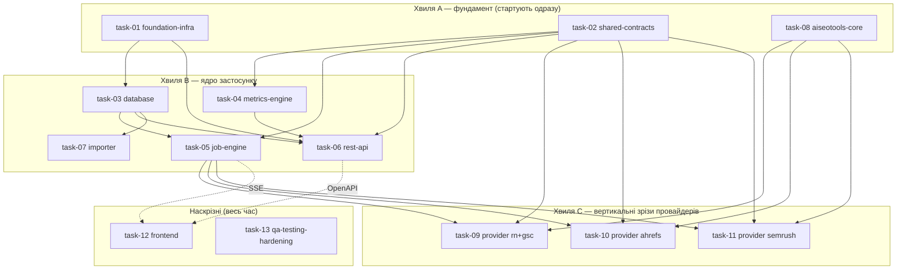

# Декомпозиція проєкту — робочі пакети для паралельних агентів

**Джерело істини:** [`../../../PLAN.md`](../../../PLAN.md) (master blueprint).
**Фронтенд-контракт:** [`../../../frontend/AGENTS.md`](../../../frontend/AGENTS.md) (обов'язковий для всієї роботи у `frontend/`).
**Процес роботи:** [`../../../CLAUDE.md`](../../../CLAUDE.md) (як брати таску, як закривати).

Архітектура з `PLAN.md` — це **модульний моноліт** (FastAPI API + один durable worker + SQLite WAL + vanilla-JS фронт), а не мережа окремих сервісів. Тому «мікросервіси» тут = **bounded modules / робочі пакети**: кожен має власні файли, чіткий вхідний/вихідний контракт і може розроблятися окремим агентом паралельно. Межі проведені по швах архітектури (`app/` дерево з §5.2) так, щоб два агенти не редагували один файл.

## Ключова ідея паралельності

Паралельність тримається на **контрактах, зафіксованих наперед** (`task-02`), а не на черговості. Кожен агент кодує проти оголошених типів/інтерфейсів і **не чекає** інших. Файли поділені так, що зони запису не перетинаються (див. «Owned paths» у кожному плані).

## Хвилі та залежності

- **Хвиля A** (`task-01`, `task-02`, `task-08`) стартує без залежностей — розблоковує всіх.
- **Хвиля B** стартує, щойно є `task-01` (скелет) і `task-02` (контракти); `task-03` потрібен лише скелет.
- **Хвиля C** (провайдери) стартує, коли є `task-02` (контракт adapter) і `task-08` (namespace у AISeoTools). Кожен провайдер — окремий агент.
- **Наскрізні** `task-12` (фронт) і `task-13` (QA/hardening) працюють паралельно з першого дня на фікстурах і синхронізуються по OpenAPI/SSE, коли ті готові.

> Агент **не бере** таску, доки її `Depends on` не лежать у [`../done/`](../done/). Порядок у межах хвилі — довільний.

## Каталог тасок

| # | Файл | Пакет | Хвиля | Depends on | Головні owned paths |
|---|---|---|---|---|---|
| 01 | [task-01-foundation-infra.md](task-01-foundation-infra.md) | Скелет, config, Docker/Compose, CI | A | — | `app/main.py`, `app/core/`, `pyproject.toml`, `Dockerfile`, `compose.yaml`, `app/api/health.py` |
| 02 | [task-02-shared-contracts.md](task-02-shared-contracts.md) | Integration contract + schemas + DTO | A | — | `app/integrations/contract.py`, `app/integrations/registry.py`, `app/schemas/` |
| 03 | [task-03-database.md](task-03-database.md) | ORM, міграції, репозиторії | B | 01 | `app/db/`, `migrations/`, `alembic.ini` |
| 04 | [task-04-metrics-engine.md](task-04-metrics-engine.md) | Періоди, catalog, normalize, quality | B | 02 | `app/metrics/` |
| 05 | [task-05-job-engine.md](task-05-job-engine.md) | Worker, черга, lease/recovery, events, SSE | B | 02, 03 | `app/jobs/`, fake adapter |
| 06 | [task-06-rest-api.md](task-06-rest-api.md) | FastAPI роутери + OpenAPI | B | 01, 02, 03, 04 | `app/api/dashboard.py`, `app/api/clients.py`, `app/api/jobs.py` |
| 07 | [task-07-importer.md](task-07-importer.md) | Імпорт історії з AISeoTools + CLI | B | 03, 04 | `app/importers/`, `app/cli.py` |
| 08 | [task-08-aiseotools-core.md](task-08-aiseotools-core.md) | Additive namespace у AISeoTools (core) | A | — | `AISeoTools/seo_audit/dashboard/{events,models,config}.py` |
| 09 | [task-09-provider-reporting-ninja-gsc.md](task-09-provider-reporting-ninja-gsc.md) | RN/GA4 + GSC вертикальний зріз | C | 02, 08, 05 | `AISeoTools/.../dashboard/{reporting_ninja,gsc}.py`, `app/integrations/{reporting_ninja,gsc}.py` |
| 10 | [task-10-provider-ahrefs.md](task-10-provider-ahrefs.md) | Ahrefs Site Audit зріз | C | 02, 08, 05 | `AISeoTools/.../dashboard/ahrefs.py`, `app/integrations/ahrefs.py` |
| 11 | [task-11-provider-semrush.md](task-11-provider-semrush.md) | Semrush зріз | C | 02, 08, 05 | `AISeoTools/.../dashboard/semrush.py`, `app/integrations/semrush.py` |
| 12 | [task-12-frontend.md](task-12-frontend.md) | Vanilla-JS dashboard | D | 06 (OpenAPI), 05 (SSE) | `frontend/` (крім `AGENTS.md`) |
| 13 | [task-13-qa-testing-hardening.md](task-13-qa-testing-hardening.md) | Тести, e2e, live smoke, hardening, деплой | D | усі | `tests/`, `scripts/backup*`, `docs/runbook.md` |

## Мапа володіння файлами (write-зони)

Кожен шлях має **рівно одного** власника. Якщо таска має торкнутись чужого шляху — це зміна контракту: узгодь через `task-02` (див. правила у `CLAUDE.md`).

| Шлях | Власник |
|---|---|
| `app/main.py`, `app/core/**`, `app/api/health.py` | task-01 |
| `pyproject.toml`, `poetry.lock`, `Dockerfile`, `compose.yaml`, `docker/**`, `.env.example`, `README.md`, CI | task-01 |
| `app/integrations/contract.py`, `app/integrations/registry.py`, `app/schemas/**` | task-02 |
| `app/db/**`, `migrations/**`, `alembic.ini` | task-03 |
| `app/metrics/**` | task-04 |
| `app/jobs/**` | task-05 |
| `app/api/dashboard.py`, `app/api/clients.py`, `app/api/jobs.py` | task-06 |
| `app/importers/**`, `app/cli.py` | task-07 |
| `AISeoTools/seo_audit/dashboard/{__init__,events,models,config}.py` + additive kwargs у наявних функціях | task-08 |
| `AISeoTools/seo_audit/dashboard/{reporting_ninja,gsc}.py`, `app/integrations/{reporting_ninja,gsc}.py` | task-09 |
| `AISeoTools/seo_audit/dashboard/ahrefs.py`, `app/integrations/ahrefs.py` | task-10 |
| `AISeoTools/seo_audit/dashboard/semrush.py`, `app/integrations/semrush.py` | task-11 |
| `frontend/**` (окрім `frontend/AGENTS.md`, який read-only контракт) | task-12 |
| `tests/**`, `scripts/backup*`, `scripts/restore*`, `docs/**` | task-13 |

> **Юніт-тести свого модуля пише сам власник модуля** у `tests/unit/<module>/`. `task-13` володіє **спільним harness**, фікстурами, integration/e2e-наборами, що перетинають модулі, CI-гейтами та ops-hardening.

## Спільні контракти (read-only для всіх, крім task-02)

Повні визначення — у [task-02-shared-contracts.md](task-02-shared-contracts.md). Стисло:

- `ProviderAdapter` Protocol: `preflight()`, `collect(context, emit, is_cancel_requested)`.
- `CollectionContext`, `CollectionResult`, `PreflightResult`, `ProgressEvent`.
- `Provider` enum: `ahrefs | semrush | gsc | reporting_ninja`.
- `MetricSpec` (тип запису каталогу метрик; сам каталог наповнює `task-04`).
- API DTO (Dashboard/Client/Job) — форма відповідей REST.

## Зв'язок із етапами PLAN.md

| Етап (PLAN §16) | Таски |
|---|---|
| Етап 0 — контракти й fixtures | 02, 08, 13 (фікстури) |
| Етап 1 — skeleton | 01, 12 (shell) |
| Етап 2 — БД, clients, import | 03, 06, 07 |
| Етап 3 — job engine, live progress | 05, 12 (sync modal) |
| Етап 4 — RN/GA4 + GSC зріз | 09 |
| Етап 5 — Ahrefs | 10 |
| Етап 6 — Semrush | 11 |
| Етап 7 — UX polish + hardening | 12, 13 |
| Етап 8 — автоматизація після MVP | поза MVP (нові таски пізніше) |
