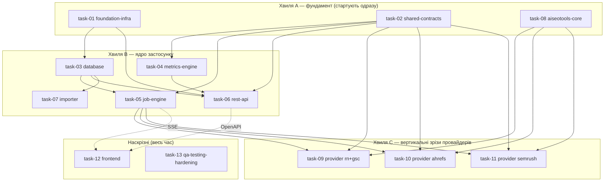

# Декомпозиція проєкту — робочі пакети для паралельних агентів

**Джерело істини:** [`../../../PLAN.md`](../../../PLAN.md) (master blueprint).
**Фронтенд-контракт:** [`../../../frontend/AGENTS.md`](../../../frontend/AGENTS.md) (обов'язковий для всієї роботи у `frontend/`).
**Процес роботи:** [`../../../CLAUDE.md`](../../../CLAUDE.md) (як брати таску, як закривати).

Архітектура з `PLAN.md` — це **модульний моноліт** (FastAPI API + один durable worker + SQLite WAL + vanilla-JS фронт), а не мережа окремих сервісів. Тому «мікросервіси» тут = **bounded modules / робочі пакети**: кожен має власні файли, чіткий вхідний/вихідний контракт і може розроблятися окремим агентом паралельно. Межі проведені по швах архітектури (`app/` дерево з §5.2) так, щоб два агенти не редагували один файл.

## Ключова ідея паралельності

Паралельність тримається на **контрактах, зафіксованих наперед** (`task-02`), а не на черговості. Кожен агент кодує проти оголошених типів/інтерфейсів і **не чекає** інших. Файли поділені так, що зони запису не перетинаються (див. «Owned paths» у кожному плані).

## Модель збору даних (матриця «клієнт × сервіс»)

Окремо від паралельності *розробки* є паралельність *збору* в рантаймі (PLAN §9.1/§9.2), яку реалізує `task-05`:

- 4 сервіси (Ahrefs, Semrush, GSC, Reporting Ninja), у кожному заведені наші клієнти;
- **між сервісами — паралельно** (одна доріжка на сервіс), **усередині сервісу — послідовно** (клієнт за клієнтом), бо один persistent browser-профіль/сесія + metered API на сервіс;
- клітинка `(client, provider)` — атомарна одиниця збору/прогресу/retry (`sync_job_providers`, task-03);
- **нуль падінь:** виняток у клітинці ізольований → `failed`, доріжка триває; новий клієнт без інтеграції → `not_configured` (не краш, не нуль); прогрес персистентний і переживає рестарт.

## Хвилі та залежності

- **Хвиля A** (`task-01`, `task-02`, `task-08`) стартує без залежностей — розблоковує всіх.
- **Хвиля B** стартує, щойно є `task-01` (скелет) і `task-02` (контракти); `task-03` потрібен лише скелет.
- **Хвиля C** (провайдери) стартує, коли є `task-02` (контракт adapter) і `task-08` (namespace у AISeoTools). Кожен провайдер — окремий агент.
- **Наскрізні** `task-12` (фронт) і `task-13` (QA/hardening) працюють паралельно з першого дня на фікстурах і синхронізуються по OpenAPI/SSE, коли ті готові.
- **Хвиля E (v2, таски 14–19)** — розширення після MVP (PLAN §21). Критичний шлях: **`task-16` (розмірні дані GSC) стартує першим**, бо без нього неможливі ні алерти (17), ні таби аналітики (18). Паралельно й без залежностей стартують `task-14` (періоди) і — у частині інлайн-дат — `task-19`. `task-18` замикає хвилю, бо споживає всі чотири бекенд-таски.

> Агент **не бере** таску, доки її `Depends on` не лежать у [`../done/`](../done/). Порядок у межах хвилі — довільний.

## Каталог тасок

| # | Файл | Пакет | Хвиля | Depends on | Головні owned paths |
|---|---|---|---|---|---|
| 01 | ✅ [task-01-foundation-infra.md](../done/task-01-foundation-infra.md) | Скелет, config, Docker/Compose, CI | A | — | `app/main.py`, `app/core/`, `pyproject.toml`, `Dockerfile`, `compose.yaml`, `app/api/health.py` |
| 02 | ✅ [task-02-shared-contracts.md](../done/task-02-shared-contracts.md) | Integration contract + schemas + DTO | A | — | `app/integrations/contract.py`, `app/integrations/registry.py`, `app/schemas/` |
| 03 | ✅ [task-03-database.md](../done/task-03-database.md) | ORM, міграції, репозиторії | B | 01 | `app/db/`, `migrations/`, `alembic.ini` |
| 04 | ✅ [task-04-metrics-engine.md](../done/task-04-metrics-engine.md) | Періоди, catalog, normalize, quality | B | 02 | `app/metrics/` |
| 05 | ✅ [task-05-job-engine.md](../done/task-05-job-engine.md) | Worker, черга, lease/recovery, events, SSE | B | 02, 03 | `app/jobs/`, fake adapter |
| 06 | ✅ [task-06-rest-api.md](../done/task-06-rest-api.md) | FastAPI роутери + OpenAPI | B | 01, 02, 03, 04 | `app/api/dashboard.py`, `app/api/clients.py`, `app/api/jobs.py` |
| 07 | ✅ [task-07-importer.md](../done/task-07-importer.md) | Імпорт історії з AISeoTools + CLI | B | 03, 04 | `app/importers/`, `app/cli.py` |
| 08 | ✅ [task-08-aiseotools-core.md](../done/task-08-aiseotools-core.md) | Additive namespace у AISeoTools (core) | A | — | `AISeoTools/seo_audit/dashboard/{events,models,config}.py` |
| 09 | ✅ [task-09-provider-reporting-ninja-gsc.md](../done/task-09-provider-reporting-ninja-gsc.md) | RN/GA4 + GSC вертикальний зріз | C | 02, 08, 05 | `AISeoTools/.../dashboard/{reporting_ninja,gsc}.py`, `app/integrations/{reporting_ninja,gsc}.py` |
| 10 | ✅ [task-10-provider-ahrefs.md](../done/task-10-provider-ahrefs.md) | Ahrefs Site Audit зріз | C | 02, 08, 05 | `AISeoTools/.../dashboard/ahrefs.py`, `app/integrations/ahrefs.py` |
| 11 | ✅ [task-11-provider-semrush.md](../done/task-11-provider-semrush.md) | Semrush зріз | C | 02, 08, 05 | `AISeoTools/.../dashboard/semrush.py`, `app/integrations/semrush.py` |
| 12 | ✅ [task-12-frontend.md](../done/task-12-frontend.md) | Vanilla-JS dashboard | D | 06 (OpenAPI), 05 (SSE) | `frontend/` (крім `AGENTS.md`) |
| 13 | ✅ [task-13-qa-testing-hardening.md](../done/task-13-qa-testing-hardening.md) | Тести, e2e, live smoke, hardening, деплой | D | усі | `tests/`, `scripts/backup*`, `docs/runbook.md` |
| 14 | [task-14-period-engine-v2.md](task-14-period-engine-v2.md) | Квартал/рік/кастом + агрегація історії | E | — | `app/metrics/periods.py`, `app/metrics/aggregate.py`, `app/schemas/enums.py` |
| 15 | [task-15-health-score-and-sorting.md](task-15-health-score-and-sorting.md) | Health % клієнта + сортування за якістю | E | 14 | `app/metrics/health.py`, `app/api/dashboard.py`, `app/schemas/api.py` |
| 16 | [task-16-gsc-dimensional-data.md](task-16-gsc-dimensional-data.md) | Розмірні дані GSC (сторінки/запити) | E | — | `app/db/repositories/dimensions.py`, `app/api/analytics.py`, нова міграція |
| 17 | [task-17-alerts-engine.md](task-17-alerts-engine.md) | Алерти: просідання / зростання сторінок | E | 16, 14 | `app/metrics/alerts.py`, `app/api/alerts.py` |
| 18 | [task-18-client-analytics-page.md](task-18-client-analytics-page.md) | Сторінка клієнта: таби, періоди, графіки | E | 14, 15, 16, 17 | `frontend/js/client-page.js`, `router.js`, `analytics-tabs.js`, `charts.js` |
| 19 | [task-19-dashboard-card-fixes.md](task-19-dashboard-card-fixes.md) | Картка: інлайн-дати, health %, сорт, укр. копія | E | 15 | `frontend/js/client-card.js`, `dashboard.js` |

## Хвиля E — v2 (після MVP, PLAN §21)

Розширення поверх закритого MVP. Стартують, коли їхні `Depends on` лежать у [`../done/`](../done/).

| # | Файл | Пакет | Depends on | Головні owned paths |
|---|---|---|---|---|
| 14 | ✅ [task-14-period-engine-v2.md](../done/task-14-period-engine-v2.md) | Квартал/рік/кастом + агрегація збереженої історії | — (розширює 02/04) | `app/metrics/periods.py`, `app/metrics/aggregate.py`, `PeriodKind`, `CoverageDTO` |
| 15 | [task-15-health-score-and-sorting.md](task-15-health-score-and-sorting.md) | Health % клієнта + сортування дашборду | 14 (для розширених періодів) | `app/metrics/health.py`, `app/api/dashboard.py` |
| 16 | [task-16-gsc-dimensional-data.md](task-16-gsc-dimensional-data.md) | Розмірні дані GSC (сторінки/запити) | 14 | розмірні таблиці + збір |
| 17 | [task-17-alerts-engine.md](task-17-alerts-engine.md) | Алерти: просідання та зростання | 16 | `app/metrics/alerts.py` |
| 18 | [task-18-client-analytics-page.md](task-18-client-analytics-page.md) | Сторінка клієнта (§21.6) | 14, 16, 17 | `frontend/`, роутер сторінки клієнта |
| 19 | [task-19-dashboard-card-fixes.md](task-19-dashboard-card-fixes.md) | Картка дашборду: health, sort-контрол | 15 | `frontend/` |

> **task-14 закрита:** `PeriodKind` тепер `week | month | quarter | year | custom` (адитивно), з'явився `CoverageDTO` і `aggregate_metrics(...)`. Контрактні деталі — у Completion report таски.

> **task-13 закрита:** з'явився спільний harness (`tests/harness/**` + `tests/conftest.py`) — бери `temp_db`, `api_client`, `seed_client`, `fake_adapters`, `running_worker` замість власного склеювання БД/worker-а. Наскрізні набори: `tests/integration/**`, `tests/contract/**`, `tests/live/**` (останні пропускаються без `--live`). Стан MVP DoD — [`docs/dod-mvp.md`](../../../docs/dod-mvp.md).

## Мапа володіння файлами (write-зони)

Кожен шлях має **рівно одного** власника. Якщо таска має торкнутись чужого шляху — це зміна контракту: узгодь через `task-02` (див. правила у `CLAUDE.md`).

| Шлях | Власник |
|---|---|
| `app/main.py`, `app/core/**`, `app/api/health.py` | task-01 |
| `pyproject.toml`, `poetry.lock`, `Dockerfile`, `compose.yaml`, `docker/**`, `.env.example`, `README.md`, CI | task-01 |
| `app/integrations/contract.py`, `app/integrations/registry.py`, `app/schemas/**` | task-02 |
| `app/db/**`, `migrations/**`, `alembic.ini` | task-03 |
| `app/metrics/**` | task-04 (крім `periods.py`/`aggregate.py` — task-14, хвиля E) |
| `app/jobs/**` | task-05 |
| `app/api/dashboard.py`, `app/api/clients.py`, `app/api/jobs.py` | task-06 |
| `app/importers/**`, `app/cli.py` | task-07 |
| `AISeoTools/seo_audit/dashboard/{__init__,events,models,config}.py` + additive kwargs у наявних функціях | task-08 |
| `AISeoTools/seo_audit/dashboard/{reporting_ninja,gsc}.py`, `app/integrations/{reporting_ninja,gsc}.py` | task-09 |
| `AISeoTools/seo_audit/dashboard/ahrefs.py`, `app/integrations/ahrefs.py` | task-10 |
| `AISeoTools/seo_audit/dashboard/semrush.py`, `app/integrations/semrush.py` | task-11 |
| `frontend/**` (окрім `frontend/AGENTS.md`, який read-only контракт) | task-12 |
| `tests/**`, `scripts/backup*`, `scripts/restore*`, `docs/**` | task-13 |
| `app/metrics/periods.py`, `app/metrics/aggregate.py`, `app/schemas/enums.py` | task-14 |
| `app/metrics/health.py`, `app/api/dashboard.py`, `app/schemas/api.py` | task-15 |
| `app/db/repositories/dimensions.py`, `app/api/analytics.py`, `app/integrations/gsc.py` (додатки), нові розмірні таблиці + міграція | task-16 |
| `app/metrics/alerts.py`, `app/api/alerts.py` | task-17 |
| `frontend/js/{client-page,router,analytics-tabs,alerts-block,charts}.js`, `frontend/css/client-page.css` | task-18 |
| `frontend/js/{client-card,dashboard,detail-drawer}.js`, `frontend/css/app.css` | task-19 |

> **Успадковані зони (v2).** Таски 14–19 доповнюють файли завершених тасок (`app/schemas/`, `app/db/models.py`, `migrations/`, `app/integrations/gsc.py`, `frontend/`). Кожна відповідає **лише за свої додатки** й не змінює наявну поведінку. Спільні фронт-модулі (`formatters.js`, `api.js`, `tokens.css`, `index.html`) — read-only для 18 і 19: правки узгоджуються, не робляться мовчки.

> **Юніт-тести свого модуля пише сам власник модуля** у `tests/unit/<module>/`. `task-13` володіє **спільним harness**, фікстурами, integration/e2e-наборами, що перетинають модулі, CI-гейтами та ops-hardening.

## Спільні контракти (read-only для всіх, крім task-02)

Повні визначення — у [task-02-shared-contracts.md](../done/task-02-shared-contracts.md). Стисло:

- `ProviderAdapter` Protocol: `preflight()`, `collect(context, emit, is_cancel_requested)`.
- `CollectionContext`, `CollectionResult`, `PreflightResult`, `ProgressEvent`.
- `Provider` enum: `ahrefs | semrush | gsc | reporting_ninja`.
- `MetricSpec` (тип запису каталогу метрик; сам каталог наповнює `task-04`).
- API DTO (Dashboard/Client/Job) — форма відповідей REST.

## Зв'язок із етапами PLAN.md

| Етап (PLAN §16) | Таски |
|---|---|
| Етап 0 — контракти й fixtures | 02, 08, 13 (фікстури) |
| Етап 1 — skeleton | 01, 12 (shell) |
| Етап 2 — БД, clients, import | 03, 06, 07 |
| Етап 3 — job engine, live progress | 05, 12 (sync modal) |
| Етап 4 — RN/GA4 + GSC зріз | 09 |
| Етап 5 — Ahrefs | 10 |
| Етап 6 — Semrush | 11 |
| Етап 7 — UX polish + hardening | 12, 13 |
| Етап 8 — автоматизація після MVP | поза MVP (нові таски пізніше) |
